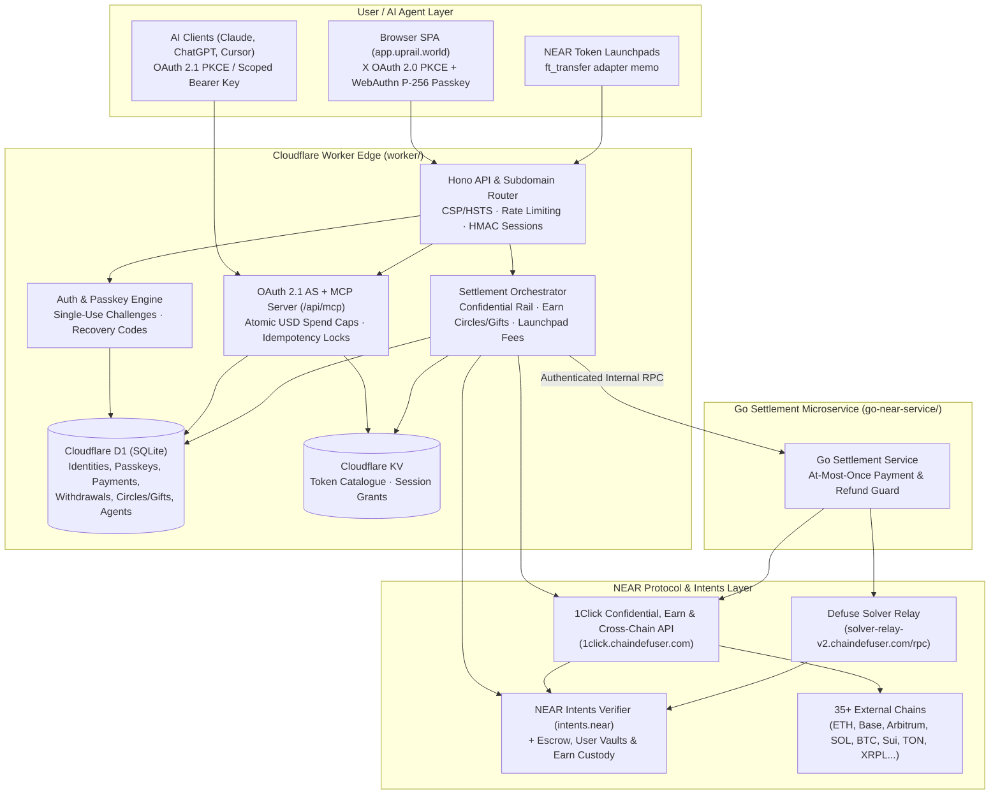

# UPRAIL (v1.1)

**Your X handle is now your private money hub.**  
UPRAIL is a complete **social money ecosystem built around NEAR Intents** (`intents.near` + Confidential Intents): earn together in yield-bearing **Circles**, gift timelocked Earn vaults, pay anyone privately by `@handle`, accept no-login **Buy Me a Coffee** tips across 35+ chains, and route `$` directly to `near.com` or AI agents without a wallet acts for you — all without a seed phrase or gas.

- **Version:** v1.1.0
- **Hackathon Tracks:** Privacy & Private AI (`privacy`) · Social Money (`social`) · Unstoppable DeFi (`defi`) · Agent Economy (`agents`) · Autonomous Business (`business`) · Real-World Money (`realworld`) · Open Innovation (`open`)
- **Mainnet Traction (Real People, Real Money):** **80 and counting** real users · **141** payment & withdrawal txs (**95** settled on-chain · **8** active escrow) · **$158.55 USDC** settled (**$156.83** payments & withdrawals + **$1.72** Buy Me a Coffee; **$186.51+ USDC** initiated) on NEAR Mainnet
- **Live Application:** [https://app.uprail.world](https://app.uprail.world) *(Judge Invite Code: `INTENT` — controlled onboarding while testing and talking directly with early users)*
- **Marketing & Interactive Preview:** [https://uprail.world](https://uprail.world)
- **Developer Documentation:** [https://docs.uprail.world](https://docs.uprail.world)
- **Remote MCP Server:** `https://api.uprail.world/api/mcp`
- **OpenAPI 3.1.0 Spec (AI Agents):** [https://api.uprail.world/api/agent/openapi.json](https://api.uprail.world/api/agent/openapi.json)
- **X (Twitter):** [@uprailworld](https://x.com/uprailworld)

---

## 📑 Index

- **[Live Mainnet Traction](#live-mainnet-traction-real-people-real-money)** — Live NEAR Mainnet user, transaction, and USDC volume metrics
- **[Judging in 60 Seconds](#-judging-in-60-seconds-do-x--see-y)** — `make check-mainnet`, 174 automated tests, curl checks, and `Do X → See Y`
- **[Judging Map (Track-by-Track)](#-judging-map-track-by-track-verification)** — Every hackathon track mapped to verified source files and tests
- **[Why UPRAIL](#why-uprail-a-social-ecosystem-around-near-intents)** — Social money thesis built around NEAR Intents and `@handle` identity
- **[How It Works (Technical)](#how-it-works-technical)** — Vaults, Circles ("like a DAO, with friends"), Passkeys, Confidential Intents, `near.com`, and MCP
- **[Key NEAR Primitives Used](#key-near-primitives-used)** — `intents.near`, 1Click, Defuse Solver Relay, `escrow.uprail.near`, and NEAR RPC
- **[Quick Demo (For Human & AI Judges)](#quick-demo-for-human--ai-judges)** — Step-by-step walkthroughs starting with Circles & Timelocked Gifts
- **[Architecture](#architecture)** — System diagram across SPA, Cloudflare Worker/D1/KV, Go service, and NEAR Intents
- **[Project Structure](#project-structure)** — Repository layout (`frontend/`, `worker/`, `go-near-service/`)
- **[Tech Stack & Security Model](#tech-stack)** — Frameworks, defense-in-depth security, production status, and env config
- **[Links](#links)** — Live app, docs, OpenAPI, MCP server, and X (`@uprailworld`)

---

## Live Mainnet Traction (Real People, Real Money)

UPRAIL is not a testnet prototype — it is live in production on **NEAR Mainnet** with real users onboarding via X + WebAuthn passkeys and moving real money across social handles, AI agents, and external wallets:

| Metric | Live Mainnet Count / Volume | Breakdown & Details |
| :--- | :--- | :--- |
| **Users (`x_identities`)** | **80 X Identities (and counting)** | Authenticated real X (Twitter) accounts onboarded via OAuth 2.0 PKCE, each mapped to a deterministic `u_<hex>.escrow.uprail.near` sub-account |
| **Payment & Withdrawal Txs** | **141 Total** (**95** settled · **8** in escrow) | **82** `@handle` payments (**59** claimed, **8** escrowed, **14** cancelled, **1** refunded) + **59** cross-chain & `near.com` withdrawals (**36** completed, **23** failed) |
| **Settled USDC Volume** | **$158.55 USDC Settled** | **$84.51 USDC** in **49** claimed `@handle` payments + **$72.31 USDC** in **29** completed withdrawals (**$156.83 USDC**; **$186.51+ USDC** initiated) + **$1.72 USDC** Buy Me a Coffee settlement *(excl. NEAR & launchpad token txs)* |
| **Social & Agent Surfaces** | **13** requests · **8** agent keys · **3** Circles | **13** social requests (**1** completed, **4** pending, **6** declined, **2** expired) · **8** MCP AI agent keys · **8** coffee checkouts (**1** settled, **7** expired) · **3** active Circles |

---

## ⚡ Judging in 60 Seconds (Do X → See Y)

Judges and automated evaluators (Claude Code, Codex) can verify the live project, on-chain contracts, every core feature, and the full test suite in seconds:

### 1. One-Command Live Mainnet & Feature Verification (11 Checks)
Verify the live gas sponsor (`escrow.uprail.near`), user sub-accounts, `intents.near` key registration, cross-chain token registry, AI agent OpenAPI/MCP discovery, launchpad routing, Circles & Earn Vault Gifting, and fail-closed security:
```bash
make check-mainnet
# Or directly: python3 scripts/verify-mainnet.py
```
**Expected Output (11/11 checks passing):**
```text
=================================================================
⚡ UPRAIL: Live Mainnet & Full-Feature Verification (11 Checks)
=================================================================

[1/11] NEAR Mainnet Sponsor (escrow.uprail.near)... ✔ OK! Block #224158284 (0.3546 NEAR)
[2/11] User Sub-Account (u_fc982587d85af44f.escrow.uprail.near)... ✔ OK! Key ed25519:FBgiyiswzZ...
[3/11] NEAR Intents Key Registration (intents.near)... ✔ OK! has_public_key == true
[4/11] Production Worker Health (api.uprail.world/health)... ✔ OK! uprail-worker v1.0.0
[5/11] Public Identity Resolver (@uprailworld)... ✔ OK! -> u_fc982587d85af44f.escrow.uprail.near
[6/11] Cross-Chain Tokens & Live Price Oracle... ✔ OK! 494 Intents tokens · NEAR=$3.55
[7/11] AI Agent OpenAPI 3.1.0 Spec (/api/agent/openapi.json)... ✔ OK! 9 agent paths
[8/11] OAuth 2.1 & MCP Discovery (RFC 8414 / RFC 9728)... ✔ OK! MCP=https://api.uprail.world/api/mcp
[9/11] Launchpad Creator-Fee Routing (/api/launchpads/config)... ✔ OK! Kinds: token_config, factory, jh_v2_dev
[10/11] Fail-Closed Anti-BAC Guard (/api/payments)... ✔ OK! Unauthenticated access blocked (HTTP 401)
[11/11] Circles & Earn Vault Gifting (/api/circles/vaults)... ✔ OK! 6 Earn vaults (TLO, gtUSDCp, kV-gtSOLb, stNEAR, cNEAR, wstETH) · Auth 401 guarded
=================================================================
🎉 ALL ON-CHAIN SPONSOR, MAINNET & FEATURE CHECKS PASSED!
```

### 2. Run Full Automated Test Suite (174 Tests, 0 Failures)
Run the complete unit, Miniflare integration, confidential rail, stabilization, coffee, Circles & Earn Vault Gifting, launchpad, and security test harness *(requires Node 22+; `make test` automatically switches via `nvm` when present)*:
```bash
make test
# Or (on Node 22+): cd worker && npm test
```
**Expected Output:**
```text
ℹ tests 120 + 54 = 174
ℹ suites 26 + 13 = 39
ℹ pass 174
ℹ fail 0
```

### 3. Quick Zero-Install Curl Checks (All Public Surfaces)
Inspect every live public endpoint directly from your terminal:
```bash
# 1. Live Worker health & version
curl -sS https://api.uprail.world/health | jq .

# 2. Resolve an X @handle to its deterministic on-chain NEAR vault
curl -sS "https://api.uprail.world/api/resolve?handle=uprailworld" | jq .

# 3. Inspect live cross-chain Intents tokens (35+ chains) & live USD oracle pricing
curl -sS https://api.uprail.world/api/onchain/tokens | jq '{count: (.tokens | length)}'
curl -sS "https://api.uprail.world/api/onchain/price?asset=wrap.near" | jq .

# 4. Verify OAuth 2.1 RFC 8414 Server & RFC 9728 MCP Protected Resource metadata
curl -sS https://app.uprail.world/.well-known/oauth-authorization-server | jq .
curl -sS https://api.uprail.world/.well-known/oauth-protected-resource/api/mcp | jq .

# 5. Inspect OpenAPI 3.1.0 Agent Payment specification (9 agent endpoints)
curl -sS https://api.uprail.world/api/agent/openapi.json | jq '{openapi, paths: (.paths | keys)}'

# 6. Inspect self-serve Launchpad Creator-Fee Routing proof config
curl -sS https://api.uprail.world/api/launchpads/config | jq '{network, escrowAccount, verificationKinds}'

# 7. Inspect Public Payment Link / Buy Me a Coffee routes & live creator JSON (@xy63ry0rx)
curl -sS https://api.uprail.world/api/coffee/options | jq '.tokens | map({symbol, chains: (.chains | length)})'
curl -sS "https://uprail.world/xy63ry0rx?format=json" | jq .

# 8. Inspect Circles & Timelocked Earn Vault Gifting catalog (6 curated 1Click Earn vaults) & fail-closed guards
curl -sS https://api.uprail.world/api/circles/vaults | jq '.vaults | map({symbol, estimatedApyPct, minDepositUsd, priceUsd})'
curl -sS https://api.uprail.world/api/gifts/vaults | jq '.vaults | length'
```

### 4. All-Feature Quick Verification (`Do X → See Y`)

| Feature | Do This (Action) | See This (Verified Result) |
| :--- | :--- | :--- |
| **1. Circles (Like a DAO, With Friends) & Timelocked Earn Vault Gifting** | Click **Circles** above **Stabilize** (`/app/circles`) to pool percentage-sized member goals, have every member sign with Passkey before custody activates, or send a 1-to-1 timelocked Earn Vault gift (`uprail.world/gift/:id`) | Routes into 6 curated 1Click Earn vaults (`TLO`, `gtUSDCp`, `kV-gtSOLb`, `stNEAR`, `cNEAR`, `wstETH`), compounds yield in per-item `intents.near` custody accounts, enforces unanimous Passkey dissolve or creator settle (99%/1%), renders `/og/gift/:id.png` SEO cards, and enforces anti-IDOR gates |
| **2. Private `@handle` Send & Unlinked Claim** | Send USDC/NEAR on `/app/send` to any `@handle` (registered or new) + confirm with Passkey | Instant confidential settlement or shareable `/claim/<id>` link with edge OG card; claimed via X + Passkey |
| **3. Public Payment Link (`uprail.world/<handle>`)** | Toggle ON via dashboard coin-pouch icon; visit `uprail.world/xy63ry0rx` without logging in | Pick `USDC`/`USDT`/`NEAR`/`SOL`/`ETH`/`BTC`, exact token amount (`amountToken`) & chain → one-time `FLEX_INPUT` `CONFIDENTIAL_INTENTS` address + 99% net payout settled directly in stables (`USDC`/`USDT`) |
| **4. 1-Tap `near.com` Internal Withdrawal** | Dashboard → **Withdraw** (`near.com`) → bind `nearcom:0x...` address with Passkey → withdraw | 0% bridge fee internal settlement straight into `near.com` balance (`nearcomWithdraw.ts`) |
| **5. 35+ Chain "Send to Wallet"** | Send/Withdraw to any external EVM, Solana, Bitcoin, TON, Tron, Sui, XRP, or NEAR address | 1Click cross-chain swap & delivery across 35+ networks (`oneclickWithdraw.ts`) |
| **6. Stabilize (Crypto → USDC/USDT)** | Click **Stabilize** on Dashboard or any held token ≥ 0.05 NEAR / $1 | Gas-sponsored 1Click Confidential or Rhea Finance swap into USDC/USDT (1% fee) |
| **7. Social Invoicing & "People You Pay"** | Create request on `/app/request`; share `/request/:id`; pin/nickname frequent contacts | Recipient views/pays/declines `/request/:id` in 1 tap; persistent contact memory with anti-spam blocks |
| **8. AI Agent Rail (OAuth 2.1 + 13-Tool MCP)** | Connect `https://api.uprail.world/api/mcp` in Claude/ChatGPT/Cursor & approve caps with Passkey | Agent calls 13 MCP tools (`pay_handle`, `request_payment`, etc.) bounded by atomic per-tx/daily USD caps |
| **9. Launchpad Creator-Fee Routing** | Register token via `POST /api/launchpads/register` or send `Fees to @handle via UPRAIL` | Escrow verifies on-chain receipts/memos via NEAR RPC and credits the creator's vault automatically |
| **10. Hardware Passkeys & Recovery Codes** | Register WebAuthn P-256 passkey on onboarding; view/rotate encrypted recovery codes | Every fund-moving endpoint rejects unverified sessions; lost passkeys rotate safely via HMAC recovery codes |
| **11. 100% Sponsored Gas & Key Export** | Onboard a fresh X account with invite code `INTENT` & 0 NEAR; run `Export Private Key` with Passkey | `escrow.uprail.near` sponsors account creation, `intents.near` key reg & NEP-145 storage; full self-custody export |

---

## 🗺️ Judging Map (Track-by-Track Verification)

Where each hackathon track criterion is implemented and tested in the codebase:

| Track | Focus & Hints | UPRAIL Implementation | Verified Source Code & Tests |
| :--- | :--- | :--- | :--- |
| **`social`**<br/>(Social Money) | Social identity value transfer, shared budgets, collective rewards (for walletless users without DAO UIs) | Maps any `@handle` to deterministic NEAR vaults (`u_<hex>.escrow.uprail.near`); **Circles** multi-member percentage-sized Earn pools (`/app/circles`) with per-item implicit `intents.near` custody & unanimous WebAuthn passkey dissolve; **1-to-1 Timelocked Earn Vault Gifting** (`uprail.world/gift/:id`); public **Buy Me a Coffee** links (`uprail.world/<handle>`); `/request/:id` invoicing | • [`worker/src/services/circles.ts`](worker/src/services/circles.ts)<br/>• [`worker/src/services/gifts.ts`](worker/src/services/gifts.ts)<br/>• [`worker/src/routes/coffee.ts`](worker/src/routes/coffee.ts)<br/>• [`worker/src/routes/requests.ts`](worker/src/routes/requests.ts)<br/>• [`worker/test/circles-and-gifts.test.ts`](worker/test/circles-and-gifts.test.ts) |
| **`privacy`**<br/>(Privacy & Private AI) | Private finance, breaking on-chain transaction graphs | NEAR Confidential Intents (`intents.near` + 1Click `CONFIDENTIAL_INTENTS`) with fail-closed anti-downgrade validation; unlinked pooled escrow claims break sender-recipient linkability; D1 leg-identifier scrubbing (`scrubSettledPaymentLinks`) & anti-IDOR gates *(financial privacy layer; does not run TEE AI inference)* | • [`worker/src/services/confidentialRail.ts`](worker/src/services/confidentialRail.ts)<br/>• [`worker/test/confidential-rail.test.ts`](worker/test/confidential-rail.test.ts)<br/>• [`worker/src/services/refunds.ts`](worker/src/services/refunds.ts) |
| **`defi`**<br/>(Unstoppable DeFi) | Multi-chain settlement & vaults via NEAR Intents | Cross-chain ingress & egress across 35+ chains via 1Click & `intents.near`; **6 live 1Click Earn Vaults** (`TLO`, `gtUSDCp`, `kV-gtSOLb`, `stNEAR`, `cNEAR`, `wstETH`); 0% bridge-fee `near.com` internal withdrawals (`nearcom:0x...`); **Stabilize** swaps (1Click + Rhea DEX); Launchpad fee routing | • [`worker/src/services/earnVaults.ts`](worker/src/services/earnVaults.ts)<br/>• [`worker/src/services/oneclickWithdraw.ts`](worker/src/services/oneclickWithdraw.ts)<br/>• [`worker/src/services/stabilize.ts`](worker/src/services/stabilize.ts)<br/>• [`worker/src/services/nearcomWithdraw.ts`](worker/src/services/nearcomWithdraw.ts)<br/>• [`worker/test/stabilize.test.ts`](worker/test/stabilize.test.ts) |
| **`agents`** / **`business`**<br/>(Agent Economy & Autonomous Business) | Policy-bounded agent commerce, treasury/invoicing without raw keys | Production OAuth 2.1 AS + 13-tool Streamable HTTP MCP Server (`api.uprail.world/api/mcp`) + OpenAPI 3.1.0 with atomic per-tx/daily USD spend caps, idempotency locks, live oracle pricing, and mobile/desktop `/approve` WebAuthn escalation | • [`worker/src/routes/mcp.ts`](worker/src/routes/mcp.ts)<br/>• [`worker/src/routes/agent.ts`](worker/src/routes/agent.ts)<br/>• [`worker/src/routes/approval.ts`](worker/src/routes/approval.ts)<br/>• [`worker/test/miniflare.test.mjs`](worker/test/miniflare.test.mjs) |
| **`realworld`**<br/>(Real-World Money) | Stablecoins, invoicing, remittances, meta-tx for real users | Zero seed phrases, zero payer login, and 100% sponsored gas (`escrow.uprail.near`); Touch ID / Face ID WebAuthn P-256 passkeys + HMAC recovery codes; `uprail.world/<handle>` USDC/USDT checkouts & live mainnet volume (**$158.55 USDC** settled across payments, withdrawals & coffee) | • [`frontend/src/views/CirclesView.tsx`](frontend/src/views/CirclesView.tsx)<br/>• [`frontend/src/views/PublicGiftView.tsx`](frontend/src/views/PublicGiftView.tsx)<br/>• [`frontend/src/views/PublicCoffeeView.tsx`](frontend/src/views/PublicCoffeeView.tsx)<br/>• [`worker/test/recovery-codes.test.ts`](worker/test/recovery-codes.test.ts) |
| **`open`**<br/>(Open Innovation) | Chain abstraction + composable identity/intelligence rails | Unifies public social handles (`@handle`), confidential `intents.near` settlement, universal `near.com` ingress, Earn vault social pools/gifts, and autonomous MCP commerce under one passkey-secured identity layer | • [`scripts/verify-mainnet.py`](scripts/verify-mainnet.py)<br/>• [`worker/src/index.ts`](worker/src/index.ts) |

---

## Why UPRAIL: A Social Ecosystem Around NEAR Intents

> *"Public blockchains leak your wealth and rekt. NEAR Intents made confidential transfers possible. UPRAIL streams that private value to X handles."*

Instead of building a single-purpose bridge or spend-cap script, UPRAIL wraps **NEAR Intents**, **Confidential Intents**, and **1Click Earn Vaults** around social identity so crypto behaves like everyday internet money — private, gasless, and social by default:

1. **Social Transfers, Invoicing & Public Pay Links (No Wallet Required):** Public explorers expose every financial relationship, and asking someone for a chain-specific address breaks peer payments. UPRAIL maps any `@handle` to a deterministic NEAR vault (`u_<hex>.escrow.uprail.near`) with 100% sponsored gas, `CONFIDENTIAL_INTENTS` routing, pooled escrow for unregistered recipients, *People You Pay* contact memory, `/request/:id` invoicing, and public `uprail.world/<handle>` pages.
2. **Social Earning & Timelocked Gifting (`Circles` + `Gifts`):** Real social money isn't just 1-to-1 transfers — people save together and gift across milestones. **Circles** let groups pool into 6 curated 1Click Earn vaults with percentage splits and unanimous WebAuthn passkey dissolve, while **Timelocked Gifts** (`uprail.world/gift/:id`) compound yield until an unlock timestamp behind anti-IDOR and biometric claim gates.
3. **Universal Ingress for `near.com` & 35+ Chains:** `near.com` and 1Click deposit addresses rotate per live user session, so peers, clients, or agents can't fund you asynchronously. UPRAIL turns `@handle` and `uprail.world/<handle>` into permanent cross-chain ingress across 35+ chains, paired with **Stabilize** swaps into USDC/USDT and a **0%-bridge-fee `near.com` internal withdrawal rail (`nearcom:0x...`)**.
4. **Autonomous Agents & Creator Fee Routing (Post-Frontend Era):** Software is shifting from web dashboards to AI assistants, and launchpads shouldn't force creators to expose static wallets. UPRAIL embeds an **OAuth 2.1 + 13-tool MCP server** (`api.uprail.world/api/mcp`) with atomic biometric spend caps and `/approve` escalation, alongside on-chain receipt verification for launchpad creator fees (`Fees to @handle via UPRAIL`).

---

## How It Works (Technical)

### 1. Deterministic Per-User NEAR Vaults & 100% Gas-Sponsored Execution
Every X account is mapped to a dedicated NEAR sub-account (`u_<hex>.escrow.uprail.near`) without requiring a browser wallet extension or any native gas balance:

1. **100% Sponsored Gas (Zero Gas Required from Users):**
   - **Sub-Account Creation & Storage:** `escrow.uprail.near` sponsors onchain sub-account creation (`CreateAccount` + `AddKey`) and funds the `0.01 NEAR` storage/execution reserve automatically.
   - **NEAR Intents Key Registration (`5 TGas`):** Every user vault's Ed25519 public key is registered on `intents.near::add_public_key` (`5 TGas`), with [`ensureRegistrationGas`](worker/src/services/nearRpc.ts) automatically topping up any gas shortfall from `escrow.uprail.near`.
   - **Token Storage Sponsorship (NEP-145):** `escrow.uprail.near` sponsors `storage_deposit` on NEP-141 token contracts for `intents.near`, user vaults, and destination wallets before transfers or withdrawals execute.
   - **Gasless Intent Relaying & FT Top-Ups:** Signed NEP-413 intents are relayed and gas-sponsored by `escrow.uprail.near` (`execute_intents`), and direct NEP-141 transfers from user sub-accounts automatically receive sponsored gas reserves beforehand.
2. **Self-Custody Key Export:**
   - With a fresh WebAuthn passkey assertion, any user can export their raw Ed25519 private key and sub-account ID at any time, maintaining complete non-custodial ownership and portability.

### 2. 1Click Earn Circles ("Like a DAO, But With Friends") & Timelocked Vault Gifting
Instead of deploying a DAO contract, managing a multisig, or asking friends for wallet addresses and gas, **Circles** let any group pool money and earn yield together using only X `@handle`s and hardware Passkeys (`Touch ID` / `Face ID`):

1. **Propose & Unanimous Member Sign-Off (`PENDING_SIGNATURES` → `ACTIVE`):**
   - The creator picks one of **6 curated 1Click Earn vaults** (`TLO` Ethereum USDC, `gtUSDCp` Base USDC, `kV-gtSOLb` Solana SOL, `stNEAR` NEAR, `cNEAR` NEAR, `wstETH` Ethereum), sets a USD goal, a payout `@handle`, and exact member percentage splits summing to `10,000` bps (`100.00%`).
   - Invited members review the Circle terms and sign with their WebAuthn Passkey. **Only after every member has signed** does UPRAIL derive the Circle's dedicated 64-hex implicit `intents.near` custody account (`deriveEarnCustodyKey` via `HMAC-SHA256`) and activate the pool (`ACTIVE`) — nobody can deposit funds until the whole group agrees.
2. **Continuous Yield-Bearing Contributions (`ACTIVE` → `GOAL_MET`):**
   - Members can fund their share in one or multiple installments from any Intents balance; `1Click` swaps into the Circle's Earn vault shares inside its isolated per-circle custody account so funds **compound yield automatically** while the group fills the goal (`GOAL_MET` once all member targets are met).
3. **Payout Settlement (`SETTLED`):**
   - The creator settles the Circle with a Passkey challenge (`ACTIVE` / `GOAL_MET` → `SETTLING` → `SETTLED`), sending **99%** of the accumulated vault shares directly to the designated payout `@handle`'s `intents.near` account and **1%** to `escrow.uprail.near`.
4. **Unanimous Passkey Dissolve (`DISSOLVED`):**
   - If the group changes its mind before settlement, **every contributor with shares must approve dissolution with their hardware Passkey**. Once unanimous, the Circle atomically transitions (`DISSOLVING` → `DISSOLVED`) and refunds each contributor pro-rata back to their `intents.near` vault (if zero contributions have been made yet, the creator can cancel immediately).
5. **Timelocked Vault Gifting (`uprail.world/gift/:id`):**
   - Sends compounding 1-to-1 Earn vault positions to any `@handle` with server-enforced `timelock_until`, optional private amount masking (`show_amount = 0`), anti-IDOR visibility gates, atomic `LOCKED -> CLAIMING` transitions (`gifts.ts`), and custom `/og/gift/:id.png` social cards.

### 3. Dual-Factor Identity: X OAuth 2.0 PKCE + WebAuthn P-256 Passkeys
- **X OAuth 2.0:** Uses S256 PKCE challenges to verify ownership of the X handle and issues an authenticated session.
- **Per-Transaction WebAuthn Gate:** Restricts authorization to hardware P-256 / ES256 passkeys with resident keys. Every fund-moving or security-sensitive action requires a fresh biometric challenge and verifies signature counters to prevent replays.
- **Encrypted Recovery Codes:** First-time passkey registration issues one-time recovery codes protected with authenticated encryption and domain-separated hashing, enabling users to safely rotate passkeys if a device is lost.

### 4. Three-Rail Intent Execution & Confidential Settlement
When a sender initiates a transfer, the system generates a cryptographically signed quote binding recipient, asset, amount, and expiry, then settles across three rails:

1. **NEAR Confidential Intents Rail:**
   - Authenticates intent sessions and requests confidential execution with anti-downgrade validation.
   - Signs NEP-413 intent payloads and submits them to `intents.near` via the confidential execution layer.
2. **Public NEAR Intents Rail:**
   - Pre-registers NEP-145 token storage, deposits assets into `intents.near`, and broadcasts NEP-413 transfer intents via gas-sponsored relayer or the Defuse Solver Relay.
3. **Native NEP-141 Fallback Rail:**
   - For launchpad or custom NEP-141 tokens not yet listed on `intents.near`, handles direct sponsored transfers.

### 5. Escrowed Social Claims, Atomic Locks & Refunds
- **Direct vs. Escrowed Routing:** Registered handles settle directly into their NEAR Intents vault. Unregistered handles receive funds into a 30-day pooled escrow.
- **Handle Binding on Registration:** When a new user connects their X identity and registers a passkey, all pending escrowed transfers matching their handle are permanently bound to their verified identity, preventing handle rename attacks.
- **Atomic Claim Reservation:** Claims execute using atomic conditional state updates to guarantee at-most-once payouts and eliminate race conditions.
- **At-Most-Once Refunds:** Senders can cancel unclaimed transfers, and expired escrowed funds (>30 days) automatically refund the full gross amount to the original sender.

### 6. Universal Ingress to near.com & Internal Withdrawal Rail
- **Universal Ingress for near.com (Solving the Rotating Address Barrier):** On `near.com` (and Defuse / 1Click), cross-chain deposit addresses are ephemeral, session-bound, and rotating. Only the authenticated owner at their terminal can generate a quote to fund their account. UPRAIL solves this by giving every user a persistent public identity (`@handle`) mapped to a NEAR Intents vault: anyone in the world can deposit from 35+ chains directly to `@handle` without requiring a live session quote from the recipient.
- **Passkey-Gated `near.com` Internal Withdrawal Rail:** Once funds settle into the user's UPRAIL vault, users can withdraw directly into their personal `near.com` wallet in one tap:
  - **Zero Bridge Fees & 1:1 Routing:** Bypasses external chain bridges and routing fees by transferring internally inside the Confidential Intents layer (`submitPrivateTransfer`) to the recipient's NEP-518 internal address (`nearcom:0x...`).
  - **Two-Step Passkey Security:**
    1. **Address Setup & Verification:** Users paste their internal address from `near.com` (Account Menu → *My address* → copy internal address like `nearcom:0xb137a2f1054b5de422a8df801613d6722701163c`). The address is validated, stripped of the URI scheme, and cryptographically bound to the user's identity via a WebAuthn passkey challenge.
    2. **Withdrawal Execution:** Selecting an Intents-supported asset and amount opens a detailed confirmation modal. The user signs with their hardware passkey (`Touch ID` / `Face ID`), the worker reserves the withdrawal in D1, shields any plain balance shortfall via `ensureConfidentialFunds`, and submits the private transfer to `intents.near` with instant settlement.
  - **Edit Protection:** Updating or replacing the saved `near.com` withdrawal destination is strictly gated by a fresh passkey challenge to protect against unauthorized modification.
- **Cross-Chain Withdrawals ("Send to Wallet"):** In addition to internal `near.com` routing, users can withdraw any asset from their vault to an external address across **35+ blockchains** (NEAR, Ethereum, Base, Arbitrum, Optimism, Polygon, BNB Chain, Avalanche, Solana, Bitcoin, Sui, Aptos, TON, Tron, XRP Ledger, Stellar, Dogecoin, Litecoin, Zcash, Starknet, Hyperliquid, Monad, Berachain, etc.) with chain-specific address validation and atomic state reservation.

### 7. AI Agent Payment Rail & OAuth 2.1 Remote MCP Server (The Post-Frontend Thesis)

> **The Post-Frontend Thesis:** In the coming era, users will rarely interact with traditional web frontends. The future of software is conversational and autonomous — where AI agents negotiate, orchestrate workflows, tip creators, purchase compute, split bounties, and settle transactions on our behalf. But an agent that cannot move value is just an observer, while giving an LLM unconstrained access to a raw crypto wallet is a fatal security flaw. From day one, UPRAIL was built with this post-frontend reality in mind: we integrated the agentic value railway directly into the protocol's foundation, letting autonomous models transact with cryptographic safety, biometric spend limits, and zero seed phrases.

UPRAIL includes a full **OAuth 2.1 Authorization Server** and **Streamable HTTP MCP Server** (`2025-06-18`) at `https://api.uprail.world/api/mcp`:
- **The Railway for Autonomous Agents:** Rather than forcing humans to sit at terminals and click through transaction forms, users connect Claude, ChatGPT, Grok, Meta Muse, or Cursor directly to UPRAIL via open standards (OAuth 2.1 PKCE + Model Context Protocol).
- **Zero Raw Key Exposure:** Agents never touch or store private keys. Instead, they receive revocable, policy-bounded OAuth bearer grants authorized by the user's hardware passkey (Touch ID / Face ID / WebAuthn).
- **Biometric Policy Boundaries & Spend Caps:** Users define strict, immutable guardrails during connection: a maximum USD limit per individual payment and an aggregate daily USD spend cap. Every tool call pre-checks and reserves quota atomically against live oracle pricing.
- **13 MCP Tools for Autonomous Commerce:**
  1. `pay_handle`: Send crypto confidentially to any X handle (single or batch) with automated claim links and prefilled X post intent URLs.
  2. `check_approval`: Query the resolution status of batch or policy-overflow authorization tickets.
  3. `withdraw_to_wallet`: Withdraw funds to any external address across 35+ blockchains or internally to near.com.
  4. `receive_payment`: Inspect deposit addresses, pending incoming transfers, or shareable payment links.
  5. `get_balance`: Check public, confidential, and total balances across all supported assets.
  6. `list_payments`: Audit recent sent and received payments with full transaction telemetry.
  7. `resolve_handle`: Resolve whether an X identity has an active UPRAIL vault or routes through escrow.
  8. `list_contacts`: Retrieve the user's saved and frequent transfer recipients with recency and preferred assets.
  9. `save_contact`: Save, update, or pin trusted contacts in the user's persistent address book.
  10. `request_payment`: Create a social payment request asking an X handle for funds, generating shareable claim URLs and prefilled X posts.
  11. `list_requests`: Query inbound and outbound payment requests by direction and settlement status.
  12. `accept_request`: Pay an incoming payment request autonomously on behalf of the owner, bounded by spend caps.
  13. `decline_request`: Decline an incoming payment request with an optional reason.
- **Human-in-the-Loop Instant Passkey Escalation (`/approve`):** When an agent needs to execute an anomalous high-value batch transfer or exceed its daily limit, it yields an authorization ticket link (`/approve?id=...`). The user reviews the breakdown on their device, confirms with Face ID or fingerprint via WebAuthn, and the agent's intent executes atomically on NEAR.
- **Fail-Closed Spend Policy & Anti-Replay:** Live oracle token pricing, atomic database reservations before signing intents, and idempotency locks prevent retried prompts from causing double-spends or prompt-injection drains.

### 8. Launchpad Creator-Fee Routing
Launchpads and DEX pools (Nearly, JustHoot v2, and Intear Launchpad on `launch.intear.near` / `dex.intear.near`) keep their own fee receiver. When a payout should reach an X handle, their adapter or keeper sends the transfer to escrow with the target handle memo (`Fees to @handle via UPRAIL`), and UPRAIL automatically verifies the onchain receipt and credits the creator's vault.

### 9. Social Invoicing, Contact Memory & Anti-Spam Request Rails
Peer-to-peer finance is fundamentally relational and two-sided. UPRAIL introduces zero-friction social payment memory:
- **"People you pay" (Contact Engine):** A user-governed registry mapping contacts to X identities, tracking custom nicknames, preferred transfer assets and amounts, and pin priorities, automatically merged with transfer ledger history.
- **Social Requests Lifecycle & Anti-Harassment:** Payment requests follow a strict state machine (`PENDING` → `COMPLETED` / `DECLINED` / `CANCELLED` / `EXPIRED`). Requests include rate-limiting (max 10 requests/hour/user) and request-blocking primitives to prevent spam, while allowing unregistered recipients to inspect invoices without signing up upfront.
- **Full Autonomous Agent Parity:** AI agents can audit, generate, accept, and decline payment requests within their owner's biometric spend guardrails.

---

## Key NEAR Primitives Used

| NEAR Primitive | Contract / Endpoint | How UPRAIL Uses It | Primary Code Path |
| :--- | :--- | :--- | :--- |
| **NEAR Intents (NEP-413)** | `intents.near` | Off-chain Ed25519 signed `nep413` payloads (`transfer`, `ft_withdraw`, `swap_transfer`) with versioned salt and deadline nonces. | [`nearRpc.ts`](worker/src/services/nearRpc.ts), [`intentsNonce.ts`](worker/src/services/intentsNonce.ts) |
| **Confidential Intents & 1Click** | `https://1click.chaindefuser.com` | Confidential balances, NEP-413 session authentication, confidential quotes, intent generation, and 1Click Earn vaults. | [`confidentialRail.ts`](worker/src/services/confidentialRail.ts), [`earnVaults.ts`](worker/src/services/earnVaults.ts) |
| **Defuse Solver Relay** | `https://solver-relay-v2.chaindefuser.com/rpc` | JSON-RPC 2.0 `publish_intent` relay for signed NEP-413 escrow settlements and refunds. | [`relay.go`](go-near-service/internal/intents/relay.go), [`nearRpc.ts`](worker/src/services/nearRpc.ts) |
| **Deterministic Sub-Accounts & Implicit Custody** | `u_<hex>.escrow.uprail.near` & `intents.near` | Per-user sub-accounts registered on `intents.near::add_public_key`, plus deterministic 64-hex implicit custody accounts per Circle and Gift. | [`nearRpc.ts`](worker/src/services/nearRpc.ts), [`earnVaults.ts`](worker/src/services/earnVaults.ts) |
| **Gasless Relayer & Storage Sponsor** | `escrow.uprail.near` | Sponsors NEP-145 `storage_deposit` and relays `intents.near::execute_intents` so end users never hold NEAR for gas. | [`nearRpc.ts`](worker/src/services/nearRpc.ts) |
| **Onchain Receipt Verification** | NEAR JSON-RPC | Verifies onchain receipt logs to credit creator fees directly to X identities. | [`nearRpc.ts`](worker/src/services/nearRpc.ts), [`launchpadFees.ts`](worker/src/services/launchpadFees.ts) |

---

## Quick Demo (For Human & AI Judges)

### Flow 1: Circles ("Like a DAO, With Friends") & Timelocked Earn Vault Gifting
1. **Create a Circle Pool & Collect Unanimous Member Signatures:** On `/app/circles` (click **Circles** above **Stabilize** on the dashboard), pick one of 6 live Earn vaults (`TLO`, `gtUSDCp`, `kV-gtSOLb`, `stNEAR`, `cNEAR`, `wstETH`), set a USD goal and payout `@handle`, assign member handles with percentage splits summing to `100%`, and sign with your Passkey.
   - **Expected result:** The Circle starts in `PENDING_SIGNATURES`. Once **every invited member** signs with their hardware Passkey, UPRAIL derives the Circle's dedicated `intents.near` custody account and flips the Circle to `ACTIVE`.
2. **Contribute, Earn Yield & Settle (or Unanimously Dissolve):** Signed members contribute in one or multiple installments; contributions swap into compounding Earn vault shares until the creator settles (`99%` to payout `@handle`, `1%` fee to `escrow.uprail.near`) or every contributor approves dissolution via Passkey for pro-rata refunds.
3. **Send a Timelocked Earn Gift:** Open **Send Gift** on `/app/circles`, enter any recipient `@handle`, pick an occasion preset & unlock timestamp, optionally hide exact USD principal, and fund from any Intents asset with your Passkey.
   - **Expected result:** UPRAIL swaps into the chosen Earn vault, renders a shareable `uprail.world/gift/<id>` page with `/og/gift/<id>.png` preview card, and blocks claims until `Date.now() >= timelock_until` and recipient X + Passkey verification.

### Flow 2: Send & Claim Privately by `@handle`
1. **Sign In, Enter Invite Code `INTENT` & Provision Vault:** Go to [https://app.uprail.world](https://app.uprail.world), sign in with X, enter invite code **`INTENT`** *(gated during active testing so onboarding stays controlled and the team can talk directly with early users)*, and register a device Passkey (Touch ID / Face ID).
   - **Expected result:** UPRAIL deterministically provisions your vault, registers its key on `intents.near`, and displays your recovery codes.
2. **Deposit or Check Balance:** Open **Receive** (`/app/receive`) to copy your `@handle` payment link or generate a cross-chain deposit address (e.g., USDC from Base, Arbitrum, Solana, or NEAR).
3. **Send to Any `@handle`:** Open **Send** (`/app/send`), enter any X handle (even one that has never used UPRAIL), choose an asset and amount, and confirm with your Passkey.
   - **Expected result:** A signed quote is generated, your passkey authorizes the intent, and UPRAIL returns a shareable claim link (`https://app.uprail.world/claim/<paymentId>`) with a dynamically rendered OpenGraph preview card.
4. **Claim with X + Passkey:** Open the claim link as the recipient `@handle`, sign in with X, and confirm with your Passkey (or click **Send to Wallet** on `/app/claim` to withdraw directly to an external wallet across 35+ chains).
   - **Expected result:** The payment is atomically claimed and settled into the recipient's vault (or bridged cross-chain via 1Click).

### Flow 3: 1-Tap Internal Withdrawal to near.com (0% Bridge Fee)
1. **Open Withdraw:** On the Dashboard ([https://app.uprail.world/app](https://app.uprail.world/app)), click the **Withdraw** button (`near.com`).
2. **First-Time Setup (Passkey Gated):**
   - In `near.com`, tap your account menu → click **My address** → copy your internal address (e.g. `nearcom:0xb137a2f1054b5de422a8df801613d6722701163c`).
   - Paste it into the setup modal and click **Save & Verify with Passkey** (Touch ID / Face ID).
   - UPRAIL validates the NEP-518 account, strips the scheme, and binds it securely to your verified identity in D1.
3. **Withdraw Assets:**
   - Tap any Intents asset (USDC, NEAR, USDT, ETH, BTC, SOL) and enter or select the amount (`25%`, `50%`, `75%`, `MAX`).
   - Click **Review Withdrawal** to verify the confirmation modal breakdown (`Fee: 0.00 Sponsored`, `Route: Confidential Intents → near.com Internal`).
   - Confirm with your Passkey: the transfer settles directly into your `near.com` internal balance with zero bridge fees.
   - You can edit your saved destination at any time by clicking **Edit** (also passkey-gated).

### Flow 4: Connect an AI Agent (Claude, ChatGPT, Cursor) via OAuth 2.1 + MCP
1. Go to [https://app.uprail.world/app/agents](https://app.uprail.world/app/agents) and copy the MCP server URL `https://api.uprail.world/api/mcp`.
2. Add it as a remote connector in Claude, ChatGPT, or Cursor—this launches UPRAIL's **OAuth 2.1 PKCE + Passkey** consent screen where you set per-transaction and daily USD spend caps.
3. Once connected, manage or revoke active agent session cards directly on `/app/agents`. Your agent gets access to all **13 MCP tools** (`pay_handle`, `check_approval`, `withdraw_to_wallet`, `receive_payment`, `get_balance`, `list_payments`, `resolve_handle`, `list_contacts`, `save_contact`, `request_payment`, `list_requests`, `accept_request`, `decline_request`) bounded by your passkey-approved caps.

### Flow 5: Public Payment Link (`uprail.world/<handle>` — Live Example: `@xy63ry0rx`)
1. **Enable Your Payment Link (Passkey-Gated):** On your dashboard ([https://app.uprail.world/app](https://app.uprail.world/app)), click the coin-pouch button under **Stabilize** and flip the toggle (verified by Face ID / Touch ID). Your link `https://uprail.world/<handle>` goes live immediately with a `PAY ME HERE` OpenGraph preview card showing your X profile picture.
2. **Get Paid Without Payer Sign-Up (Human Flow):** Visit the live public page [https://uprail.world/xy63ry0rx](https://uprail.world/xy63ry0rx) without logging in, choose `USDC` / `USDT` / `NEAR` / `SOL` / `ETH` / `BTC`, enter an exact token amount (`amountToken`), pick an origin chain, and send to a one-time `FLEX_INPUT` confidential deposit address + QR code. Regardless of the token sent, `checkAndSettleCoffeeDonation` settles 99% net **directly in stables (`USDC`/`USDT`)** privately via `payEscrowPrivate` and displays a minimal receipt.
3. **Get Paid by Any Visiting AI Agent:**
   ```bash
   # Discover supported routes & machine-readable instructions on live creator @xy63ry0rx
   curl -s "https://uprail.world/xy63ry0rx?format=json" | jq .

   # Create a one-time confidential FLEX_INPUT deposit quote directly
   curl -s -X POST https://uprail.world/xy63ry0rx \
     -H "Content-Type: application/json" \
     -d '{"amountToken":"1","originSymbol":"NEAR","originChain":"near"}' | jq .
   ```

---

## Architecture



---

## Project Structure

```text
/
├── frontend/                              # Next.js 16 + React 19 + Tailwind CSS (static export served by Worker)
│   ├── src/app/                           # App Router pages: /, /tip, /gift, /app/send, /app/claim, /app/receive, /app/circles, /app/agents, /docs/*
│   ├── src/components/                    # AppShell, CapabilitiesCarousel, PasskeyModal, CoffeeModal, StabilizeModal, DomainGate
│   ├── src/views/                         # LandingPage, AppHome, CirclesView, PublicGiftView, PublicCoffeeView, SendPage, ClaimPage, ReceivePage, AgentsPage
│   ├── src/hooks/                         # useXAuth, usePasskey, usePayments, useOnchainData
│   └── src/lib/                           # Typed API client (api.ts), client router, status formatters
│
├── worker/                                # Cloudflare Worker (Hono v4 + D1 SQLite + KV + Cron Triggers)
│   ├── wrangler.jsonc                     # Routes, D1/KV bindings, cron schedule ("0 * * * *"), public vars
│   ├── src/index.ts                       # Entry point, security headers, subdomain routing, OG bot handler, cron sweeps
│   ├── src/db/                            # Canonical D1 schema.sql + sequential SQL migrations
│   ├── src/middleware/                    # HMAC sessions, WebAuthn passkeyAuth, agentAuth, rateLimit, securityHeaders
│   ├── src/oauth/                         # OAuth 2.1 Authorization Server (PKCE, DCR, /authorize UI) & Resource Server
│   ├── src/routes/                        # auth, payments, claim, coffee, circles, gifts, onchain, agent, mcp, fees, launchpads, invites, og
│   ├── src/services/                      # nearRpc, confidentialRail, coffee, circles, gifts, earnVaults, stabilize, oneclickClient,
│   │                                      # oneclickAuth, oneclickWithdraw, intentsNonce, launchpadFees, launchpadIntegrations, refunds
│   └── test/                              # 18 automated test files (174 tests across 39 suites: Miniflare integration + unit tests)
│
├── go-near-service/                       # Go 1.25 Settlement Microservice
│   ├── cmd/server/main.go                 # Chi HTTP server, graceful shutdown, route wiring
│   └── internal/                          # middleware, escrow signer, solver relay RPC client, oneclick
└── README.md
```

---

## Tech Stack

- **Frontend:** Next.js 16.4 (Static Export), React 19.3, TypeScript 5, Tailwind CSS 3.4, `@simplewebauthn/browser`
- **Edge Backend:** Cloudflare Workers, Hono v4, Cloudflare D1 (SQLite), Cloudflare KV, `@simplewebauthn/server`, `@noble/curves`, `workers-og`
- **Settlement Microservice:** Go 1.25 (`chi/v5`), Ed25519 NEP-413 signer, JSON-RPC 2.0 Solver Relay client
- **Authentication & Agent Auth:** X OAuth 2.0 (PKCE `S256`), WebAuthn Passkeys (`ES256` / P-256), OAuth 2.1 Authorization Server, Streamable HTTP MCP (`2025-06-18`)
- **Blockchain & Confidentiality:** NEAR Protocol (`intents.near`), NEAR Confidential Intents & 1Click API (`1click.chaindefuser.com`), Defuse Solver Relay (`solver-relay-v2.chaindefuser.com`)

---

## Security Model & Defense-in-Depth

- **Fail-Closed Secret Validation:** All critical services fail closed immediately if cryptographic secrets or configurations are absent, preventing insecure fallbacks.
- **Hardware Passkey Assertion Per Transaction:** Every fund-moving action requires a fresh biometric WebAuthn P-256 assertion bound to a single-use challenge.
- **Anti-Downgrade Confidentiality Guard:** The client cryptographically verifies that the privacy level returned matches the requested confidential tier before any intent is signed.
- **Atomic Database Reservations:** Claims, refunds, withdrawals, and AI agent spend reservations execute atomically to eliminate race conditions and double-spends.
- **Strict Subdomain Isolation & Security Headers:** Enforces strict origin separation, CSP, HSTS, frame denial, and CORS policies across web app and API boundaries.

---

## Current Status & Known Limitations

### Current Status
- **Live in Production:** Running at [https://app.uprail.world](https://app.uprail.world), [https://api.uprail.world](https://api.uprail.world), [https://docs.uprail.world](https://docs.uprail.world), and [https://uprail.world](https://uprail.world).
- **Mainnet Onchain Activity (Real People, Real Money):** **80 and counting** authenticated X users across **141** payment & withdrawal records (**95** settled on-chain: **59** `@handle` claims + **36** withdrawals; **8** active in escrow), settling **$158.55 USDC** (**$84.51** `@handle` claims + **$72.31** withdrawals + **$1.72** Buy Me a Coffee; **$186.51+ USDC** initiated) alongside NEAR & launchpad token transfers, **13** payment requests, **8** MCP AI agent keys, and **3** active Circles.

### Known Limitations (Tracked)
1. **Fail-Closed Confidential Policy:** Prioritizes privacy over convenience. If confidential execution is unavailable or reports a privacy downgrade, transactions fail closed rather than falling back to a public broadcast.
2. **Self-Custodial Export:** Users can export their keys at any time for direct onchain control via standard NEAR CLI or wallets.
3. **Static Export CSP:** Web application is distributed as a high-performance static export at the edge, utilizing scoped Content-Security-Policy directives for client scripts.
4. **Client State Caching:** Transient balance and activity snapshots are cached locally in browser storage for instant UI responsiveness and cleared on sign-out.

---

## Configuration Reference

Local configuration templates are available in `worker/.dev.vars.example` and `go-near-service/.env.example`. Production configurations are managed via Cloudflare Wrangler and container environment variables.

| Variable | Component | Purpose |
| :--- | :--- | :--- |
| `SESSION_SECRET` | Worker | Session encryption and state verification |
| `X_CLIENT_SECRET` | Worker | X OAuth 2.0 authentication |
| `RECOVERY_PEPPER` | Worker | Passkey recovery code protection |
| `INTERNAL_SERVICE_KEY` | Worker & Go | Internal service-to-service authentication |
| `SETTLEMENT_SERVICE_URL` | Worker | Base URL of the settlement microservice |
| `ESCROW_PRIVATE_KEY` | Worker & Go | Relayer and escrow onchain execution key |
| `NEAR_RPC_URL` | Worker | NEAR JSON-RPC provider endpoint |
| `ONE_CLICK_API_KEY` | Worker & Go | 1Click cross-chain routing API key |
| `CONFIDENTIAL_RAIL_ENABLED` | Worker | Feature flag for confidential execution path |
| `CREATOR_FEES_ENABLED` | Worker | Feature flag for launchpad creator fee processing |

---

## Links

- **Live Web App:** [https://app.uprail.world](https://app.uprail.world) *(Judge Invite Code: `INTENT` — controlled onboarding during active testing & user feedback)*
- **Marketing & Interactive Demo:** [https://uprail.world](https://uprail.world)
- **Developer Docs:** [https://docs.uprail.world](https://docs.uprail.world) ([AI Agents](https://docs.uprail.world/agents) · [MCP Server](https://docs.uprail.world/mcp) · [Creator Fees](https://docs.uprail.world/fees) · [Buy Me a Coffee](https://docs.uprail.world/coffee))
- **Remote MCP Endpoint:** `https://api.uprail.world/api/mcp`
- **Agent OpenAPI 3.1.0 Spec:** [https://api.uprail.world/api/agent/openapi.json](https://api.uprail.world/api/agent/openapi.json)
- **X (Twitter):** [@uprailworld](https://x.com/uprailworld)

---

## Hackathon Disclosure (Multi-Project Rule Q-015)

In accordance with NEAR HACKATHON rule **Q-015**, the author is also submitting a separate, independent hackathon project: **[fe2vi.space](https://fe2vi.space)** (a distinct product with its own repository and submission; maximum 2 projects per participant).

---

## License

Released under the [MIT License](./LICENSE).

