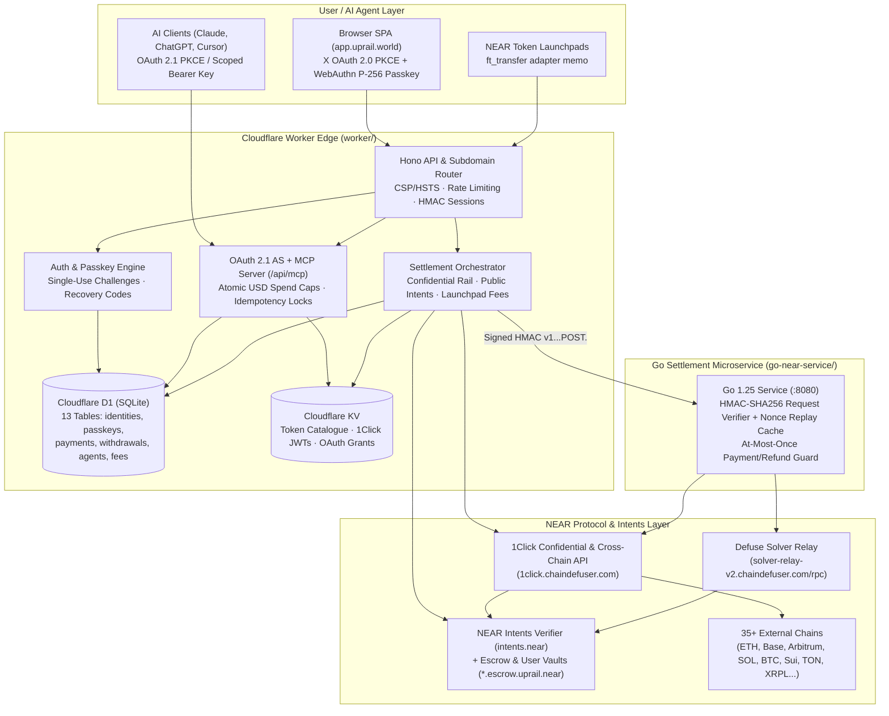

# UPRAIL

**Private value transfers to any X (Twitter) handle, AI agent payment rails, and creator-fee routing built on NEAR Intents + confidential execution.**

- **Hackathon Tracks:** Privacy & Private AI · Social Money · Unstoppable DeFi
- **Live Application:** [https://app.uprail.world](https://app.uprail.world)
- **Marketing & Interactive Preview:** [https://uprail.world](https://uprail.world)
- **Developer Documentation:** [https://docs.uprail.world](https://docs.uprail.world)
- **Remote MCP Server:** `https://api.uprail.world/api/mcp`
- **OpenAPI 3.1.0 Spec (AI Agents):** [https://api.uprail.world/api/agent/openapi.json](https://api.uprail.world/api/agent/openapi.json)

---

## Problem

1. **Public blockchains expose every financial relationship.** Standard transfers leak the sender address, recipient address, token, and exact amount on public explorers, turning a single peer transfer or creator payout into permanent wallet-graph surveillance.
2. **Sending crypto requires the recipient to already have a wallet.** Senders must ask for a chain-specific address (`0x...`, `.near`, Solana base58) and worry about bridging and gas before a transfer can happen.
3. **AI agents and token launchpads lack safe, identity-native payment primitives.** Giving an AI assistant raw private keys risks catastrophic balance drain, while token launchpads require creators to hardcode public wallets upfront instead of routing fees directly to an X identity.

---

## Solution

UPRAIL maps any X handle (`@handle`) to a deterministic, passkey-gated NEAR vault and routes transfers through **NEAR Intents** and **NEAR Confidential Intents** (`intents.near` + 1Click confidential execution):

- **Send to any `@handle` without a recipient wallet:** Senders pay `@handle` in `USDC`, `USDT`, `NEAR`, `ETH`, `SOL`, `BTC`, or NEP-141 tokens. Registered recipients receive funds directly into their confidential/intents vault; unregistered handles receive funds into a 30-day pooled escrow (`escrow.uprail.near`) and claim whenever they sign in.
- **Passkey + X OAuth 2.0 claim (zero seed phrases):** Recipients sign in with X OAuth 2.0 PKCE and confirm with a hardware WebAuthn P-256 passkey (Touch ID / Face ID / YubiKey). UPRAIL sponsors 100% of NEAR account creation, storage deposits, and execution gas.
- **Confidential execution & unlinked escrow claims:** When routed through NEAR Confidential Intents, balances and swap legs settle inside the confidential layer. Escrowed claims settle from `escrow.uprail.near`'s confidential balance to the recipient's vault, breaking onchain linkability between sender and recipient.
- **Cross-chain "Send to Wallet" across 35+ blockchains:** Users can withdraw their balance to any external wallet on NEAR, Ethereum, Base, Arbitrum, Solana, Bitcoin, Sui, Aptos, TON, Tron, XRP Ledger, Starknet, and 25+ other chains via 1Click.
- **Policy-bounded AI Agent Payments (OAuth 2.1 + MCP):** Users connect Claude, ChatGPT, Grok, or Cursor via OAuth 2.1 + PKCE or scoped Bearer keys with Passkey-approved per-transaction and daily USD spend caps enforced atomically in D1.
- **Launchpad Creator-Fee Routing:** Nearly, JustHoot, and any other launchpad keep their own fee receiver. When a payout should reach an X handle, their adapter sends `ft_transfer` to `escrow.uprail.near` with memo `Fees to @handle via UPRAIL`, then submits the transaction hash to `POST /api/fees/adapter`.

---

## How It Works (Technical)

### 1. Deterministic Per-User NEAR Vaults & Zero-Gas Provisioning
Every X account (`x_id`) is mapped to a dedicated NEAR sub-account under `escrow.uprail.near` without requiring a browser wallet extension (`worker/src/services/nearRpc.ts`):

1. **Key Derivation (`deriveUserNearKeypair`):**
   - Root secret: `ESCROW_PRIVATE_KEY` (Ed25519 master key).
   - Per-user Ed25519 seed:
     $$\text{seed} = \text{HMAC-SHA256}(\text{key} = \text{ESCROW\_PRIVATE\_KEY},\; \text{msg} = \text{"near\_vault\_key:"} \parallel \text{x\_id})$$
   - Deterministic sub-account ID:
     $$\text{accountId} = \text{"u\_"} \parallel \text{hex}(\text{SHA-256}(\text{pubKey}))[0..16] \parallel \text{".escrow.uprail.near"}$$
2. **Atomic Onchain Provisioning (`createOnchainSubAccount` & `ensureKeyOnIntents`):**
   - `escrow.uprail.near` signs and broadcasts a single Borsh transaction containing three actions on `u_<16hex>.escrow.uprail.near`: `CreateAccount`, `Transfer(0.05 NEAR)` for account storage, and `AddKey(userPubKey, FullAccess)`.
   - The user sub-account then signs a `FunctionCall` to `intents.near::add_public_key({ public_key: "ed25519:..." })` (40 TGas, 1 yoctoNEAR, gas-sponsored by `escrow.uprail.near`) so the user's derived key can sign NEP-413 intents directly.
3. **Self-Custody Key Export (`POST /auth/export-key`):**
   - After a fresh WebAuthn passkey assertion, any user can export their raw `ed25519:<base58>` private key and `u_<16hex>.escrow.uprail.near` account ID (`Cache-Control: no-store`).

### 2. Dual-Factor Identity: X OAuth 2.0 PKCE + WebAuthn P-256 Passkeys
- **X OAuth 2.0 (`worker/src/routes/auth.ts`):** Uses `S256` PKCE challenges stored in D1 (`auth_challenges`, zero KV writes) to verify ownership of `(x_id, x_handle)` and issues an `HttpOnly; Secure; SameSite=Lax` HMAC-SHA256 session cookie (`uprail_session`).
- **Per-Transaction WebAuthn Gate (`worker/src/middleware/passkeyAuth.ts`):** Uses `@simplewebauthn/server` restricted to **P-256 / ES256 (`alg: -7`)** with `residentKey: 'required'` and RP ID `uprail.world`. Every fund-moving or security-sensitive action (`/api/send`, `/api/claim/execute`, `/api/claim/withdraw`, `/api/agent/keys`, `/authorize/approve`, `/auth/export-key`) consumes a single-use 5-minute challenge from `/api/auth-challenge` and verifies the hardware signature counter (`passkeys.counter`).
- **Crockford-Base32 Recovery Codes (`worker/src/services/recoveryCodes.ts`):** First-time passkey registration mints 10 one-time 16-character recovery codes ($\approx 80$ bits of entropy each). Codes are verified against domain-separated `HMAC-SHA256(RECOVERY_PEPPER, "recovery_code:v2:<xId>:<code>")` hashes and stored as `AES-GCM` ciphertexts (`additionalData: "recovery_code:<xId>"`) so users can rotate a lost passkey after X re-authentication.

### 3. Three-Rail Intent Execution & Confidential Settlement
When a sender initiates a transfer (`POST /api/quote` $\rightarrow$ `POST /api/send`), the Worker issues an HMAC-signed quote token (`quoteSignature`) binding `(recipientHandle, asset, amount, depositAddress, expiry)` and deducts a **5% protocol fee** (`FEE_PERCENT = 0.05`) using exact integer base-unit math (`95%` net to recipient, `5%` to `FEE_ACCOUNT_ID = escrow.uprail.near`). Settlement executes across three rails:

1. **NEAR Confidential Intents Rail (`worker/src/services/confidentialRail.ts`, `worker/src/services/oneclickClient.ts`, `go-near-service/`):**
   - **1Click User-Session Auth (`oneclickAuth.ts`):** Signs an empty NEP-413 intent (`intents: []`) with a 32-byte versioned salt/deadline nonce (`intents.near::current_salt` via `intentsNonce.ts`) and exchanges it at `POST /v0/auth/authenticate` for a JWT User-Session token.
   - **Confidential Quoting & Anti-Downgrade Guard:** Calls `POST /v0/quote` with `confidentiality: 'basic' | 'advanced'`, `depositType: 'CONFIDENTIAL_INTENTS'` (or `'INTENTS'` when shielding from a public Intents balance via `submitPrivateSendFromPublic`), and `recipientType: 'CONFIDENTIAL_INTENTS'`. If 1Click returns a lower confidentiality level than requested, the client aborts with `ONE_CLICK_PRIVACY_DOWNGRADE` before signing.
   - **Intent Generation & Signing:** Calls `POST /v0/generate-intent` (verifying `payload.recipient` is `intents.near`), signs the NEP-413 message with the user's derived Ed25519 key (or `escrow.uprail.near` for claim payouts), and submits via `POST /v0/submit-intent`.
2. **Public NEAR Intents Rail (`intents.near`, `worker/src/services/nearRpc.ts`):**
   - Verifies NEP-145 storage for `intents.near` on the token contract (`registerTokenStorageForIntents` — *"register-then-transfer"*), wraps/deposits plain NEP-141 or native NEAR (`wrap.near`) into `intents.near`, signs a NEP-413 `transfer` intent, and relays `intents.near::execute_intents` via `escrow.uprail.near` (zero user gas) or publishes `publish_intent` to the Defuse Solver Relay (`https://solver-relay-v2.chaindefuser.com/rpc`).
3. **Native NEP-141 Fallback Rail:**
   - For launchpad or custom NEP-141 tokens not indexed on `intents.near`, `escrow.uprail.near` sponsors NEP-145 `storage_deposit` for the recipient/escrow and executes direct NEP-141 `ft_transfer` transactions.

### 4. Escrowed Social Claims, Atomic Locks & Refunds
- **Direct vs. Escrowed Routing:** If `@handle` has already registered a passkey, `POST /api/send` settles directly into the recipient's vault (`status = CLAIMED`). If `@handle` has not onboarded yet, funds settle into `escrow.uprail.near` (`status = ESCROWED`, 30-day window).
- **Handle-Bind on Registration (`POST /api/claim/register`):** When `@handle` signs in with X and registers a passkey, all `ESCROWED` rows matching `LOWER(recipient_handle)` are permanently bound to `recipient_x_id` so subsequent X handle renames cannot hijack pending funds.
- **Atomic Claim Reservation (`POST /api/claim/execute`):**
  ```sql
  UPDATE payments
     SET status = 'CLAIMED', recipient_x_id = ?, updated_at = ?
   WHERE id = ? AND status = 'ESCROWED'
     AND (recipient_x_id = ? OR (recipient_x_id IS NULL AND LOWER(recipient_handle) = LOWER(?)))
  ```
  Only the request that wins `meta.changes === 1` triggers the payout from `escrow.uprail.near` (`submitEscrowPrivateTransfer` on the Confidential Rail or `executeTransferFromEscrowIntent` on `intents.near`).
- **At-Most-Once Refunds (`worker/src/services/refunds.ts`):** Senders can cancel unclaimed escrowed sends (`POST /api/payments/:id/cancel`), and an hourly cron (`0 * * * *`) auto-refunds expired escrowed payments (>30 days) by returning the **full gross amount (`amount + fee`)** to the sender. Ambiguous RPC timeouts transition the row to `REFUND_REVIEW` so cron sweeps can never double-refund from pooled escrow.

### 5. Cross-Chain Withdrawals ("Send to Wallet") via 1Click
`POST /api/claim/withdraw` (`worker/src/services/oneclickWithdraw.ts`) lets users withdraw any asset to an external address across **35+ blockchains** (NEAR, Ethereum, Base, Arbitrum, Optimism, Polygon, BNB Chain, Avalanche, Solana, Bitcoin, Sui, Aptos, TON, Tron, XRP Ledger, Stellar, Dogecoin, Litecoin, Zcash, Starknet, Hyperliquid, Monad, Berachain, etc.):
- Validates chain-specific destination addresses (`0x` EVM/Sui/Aptos, Solana base58, Bitcoin `bc1`/legacy, TON `EQ`/`UQ`, Tron `T...`, XRPL `r...`/`X...`, NEAR named/implicit).
- Reserves the withdrawal atomically in D1 (`withdrawals` table) before quoting `EXACT_INPUT` with `recipientType: 'DESTINATION_CHAIN'` on 1Click, signing the `swap_transfer` NEP-413 intent, and generating a shareable receipt (`/receipt/<withdrawalId>`).

### 6. AI Agent Payment Rail & OAuth 2.1 Remote MCP Server
UPRAIL includes a full **OAuth 2.1 Authorization Server** (`worker/src/oauth/`) and **Streamable HTTP MCP Server** (`worker/src/routes/mcp.ts`, protocol `2025-06-18`) at `https://api.uprail.world/api/mcp`:
- **OAuth 2.1 + Passkey Consent (`/authorize`):** Supports RFC 8414 & RFC 9728 discovery, Dynamic Client Registration (`POST /oauth/register`), and PKCE `S256`. On the consent screen, the user authenticates with X + WebAuthn Passkey and sets mandatory **per-payment USD** (`per_tx_limit`, default `$10`) and **daily USD** (`daily_limit`, default `$50`) spend limits.
- **6 MCP Tools:** `pay_handle` (restricted to `@handle` recipients; blocks raw wallet addresses), `withdraw_to_wallet` (requires explicit amount; blocks `"all"`), `receive_payment`, `get_balance`, `list_payments`, and `resolve_handle`.
- **Fail-Closed Spend Policy (`worker/src/services/agentPolicy.ts`):** Prices tokens in USD via the live 1Click `/v0/tokens` oracle (rejecting unpriced assets with `unpriced_asset`), reserves daily spend atomically in D1 `agent_spend` before signing, and enforces `Idempotency-Key` locks (`agent_requests`) so retried LLM tool calls cannot double-pay.

### 7. Launchpad Creator-Fee Routing
Launchpads keep their own fee receiver (`fee_to`, `dev_id`). When a payout should reach an X handle, they implement the adapter in [`adapters/launchpad`](adapters/launchpad) (`worker/src/routes/fees.ts`, `worker/src/services/launchpadFees.ts`):
- Call `ft_transfer` with exactly 1 yoctoNEAR attached. Never `ft_transfer_call`. `escrow.uprail.near` is a plain account.
- `receiver_id` is `escrow.uprail.near`. The memo is exactly `Fees to @handle via UPRAIL`.
- NEAR fees are sent as wNEAR (`wrap.near`), because a native transfer has no memo.
- After the transaction is final, `POST /api/fees/adapter` with `{ "txHash" }`.

UPRAIL reads the handle from that on-chain memo, deducts the 5% protocol fee, and credits the rest to the handle: directly over the confidential rail when the handle is registered, otherwise into non-expiring escrow until they sign in. If the asset cannot be quoted privately, the fee stays in escrow rather than falling back to a public payout. A launchpad's own role memo is ignored. The API caller cannot choose the handle.

---

## Key NEAR Primitives Used

| NEAR Primitive | Contract / Endpoint | How UPRAIL Uses It | Primary Code Path |
| :--- | :--- | :--- | :--- |
| **NEAR Intents (NEP-413)** | `intents.near` | Off-chain Ed25519 signed `nep413` payloads (`transfer`, `ft_withdraw`, `swap_transfer`) with 32-byte versioned salt + nanosecond deadline nonces (`intents.near::current_salt`). | [`nearRpc.ts`](worker/src/services/nearRpc.ts), [`intentsNonce.ts`](worker/src/services/intentsNonce.ts) |
| **Confidential Intents & 1Click** | `https://1click.chaindefuser.com` | Confidential balances (`/v0/account/balances`), NEP-413 JWT session auth (`/v0/auth/authenticate`), confidential quotes (`/v0/quote`), intent generation (`/v0/generate-intent`), and submission (`/v0/submit-intent`). | [`confidentialRail.ts`](worker/src/services/confidentialRail.ts), [`oneclickClient.ts`](worker/src/services/oneclickClient.ts) |
| **Defuse Solver Relay** | `https://solver-relay-v2.chaindefuser.com/rpc` | JSON-RPC 2.0 `publish_intent` relay for signed NEP-413 escrow settlements and refunds. | [`relay.go`](go-near-service/internal/intents/relay.go), [`nearRpc.ts`](worker/src/services/nearRpc.ts) |
| **Deterministic Sub-Accounts** | `u_<16hex>.escrow.uprail.near` | Per-user NEAR accounts created via atomic `CreateAccount + Transfer + AddKey` Borsh transactions and registered on `intents.near::add_public_key`. | [`nearRpc.ts`](worker/src/services/nearRpc.ts), [`service.go`](go-near-service/internal/account/service.go) |
| **Gasless Relayer & Storage Sponsor** | `escrow.uprail.near` | Sponsors NEP-145 `storage_deposit` (`register-then-transfer`) and relays `intents.near::execute_intents` so end users never hold NEAR for gas. | [`nearRpc.ts`](worker/src/services/nearRpc.ts) |
| **Onchain Access-Key & Receipt Verification** | NEAR JSON-RPC (`fastnear`, `lava`, `1rpc`) | Reads an adapter `ft_transfer` memo and NEP-141 receipt logs (`EXPERIMENTAL_tx_status` / `tx`) to credit an X handle. | [`nearRpc.ts`](worker/src/services/nearRpc.ts), [`launchpadFees.ts`](worker/src/services/launchpadFees.ts) |

---

## Quick Demo (For Human & AI Judges)

### Option A – Live Product (Recommended: "Do X → See Y")

#### Flow 1: Send & Claim Privately by `@handle`
1. **Sign In & Provision Vault:** Go to [https://app.uprail.world](https://app.uprail.world), sign in with X, and register a device Passkey (Touch ID / Face ID).
   - **Expected result:** UPRAIL deterministically derives your `u_<16hex>.escrow.uprail.near` vault, creates the sub-account on NEAR mainnet, registers its Ed25519 key on `intents.near`, and displays your 10 one-time recovery codes.
2. **Deposit or Check Balance:** Open **Receive** (`/app/receive`) to copy your `@handle` payment link or generate a 1Click confidential cross-chain deposit address (e.g., USDC from Base, Arbitrum, Solana, or NEAR).
3. **Send to Any `@handle`:** Open **Send** (`/app/send`), enter any X handle (even one that has never used UPRAIL), choose an asset and amount, and confirm with your Passkey.
   - **Expected result:** A signed quote is generated (`95%` net to recipient, `5%` protocol fee), your passkey authorizes the intent, and UPRAIL returns a shareable claim link (`https://app.uprail.world/claim/<paymentId>`) with a dynamically rendered OpenGraph card (`/og/claim/<paymentId>.png`).
4. **Claim with X + Passkey:** Open the claim link as the recipient `@handle`, sign in with X, and confirm with your Passkey (or click **Send to Wallet** on `/app/claim` to withdraw directly to an external wallet across 35+ chains).
   - **Expected result:** The payment row is atomically reserved in D1 and settled from `escrow.uprail.near` into the recipient's vault (or bridged cross-chain via 1Click).

#### Flow 2: Verify Live API, OAuth 2.1 & MCP Endpoints via `curl`
Judges and automated agents can inspect the live production endpoints directly:

```bash
# 1. Check Worker + Go Settlement Service health
curl -s https://api.uprail.world/health | jq .
# Expected: {"status":"ok","worker":true,"nearContainer":{"service":"uprail-near-go","status":"ok"},...}

# 2. Resolve whether an X @handle has an active UPRAIL vault or routes via escrow
curl -s "https://api.uprail.world/api/resolve?handle=uprailworld" | jq .
# Expected: {"handle":"uprailworld","registered":true|false,"routing":"direct"|"escrow",...}

# 3. Inspect OAuth 2.1 Authorization Server & Protected Resource MCP metadata (RFC 8414 / RFC 9728)
curl -s https://app.uprail.world/.well-known/oauth-authorization-server | jq .
curl -s https://api.uprail.world/.well-known/oauth-protected-resource/api/mcp | jq .

# 4. Inspect the OpenAPI 3.1.0 specification for AI Chat Payment actions
curl -s https://api.uprail.world/api/agent/openapi.json | jq '{openapi, info, paths: (.paths | keys)}'

# 5. Launchpad X payouts are credited by POST /api/fees/adapter after
#    ft_transfer to escrow.uprail.near with memo "Fees to @handle via UPRAIL".
#    See adapters/launchpad and https://docs.uprail.world/fees
```

#### Flow 3: Connect an AI Agent (Claude, ChatGPT, Cursor) via MCP
1. Go to [https://app.uprail.world/app/agents](https://app.uprail.world/app/agents) and either:
   - Add `https://api.uprail.world/api/mcp` as a remote MCP server in Claude / ChatGPT / Cursor (triggers the OAuth 2.1 + Passkey consent screen where you set per-tx and daily USD caps), **or**
   - Click **New Key**, approve with your Passkey, and copy the `up_agent_...` Bearer token.
2. Call the MCP server over Streamable HTTP:
   ```bash
   curl -s -X POST https://api.uprail.world/api/mcp \
     -H "Authorization: Bearer up_agent_YOUR_KEY" \
     -H "Content-Type: application/json" \
     -d '{"jsonrpc":"2.0","id":1,"method":"tools/list"}' | jq .
   ```
   - **Expected result:** Returns all 6 MCP tools (`pay_handle`, `withdraw_to_wallet`, `receive_payment`, `get_balance`, `list_payments`, `resolve_handle`) scoped to your key's USD spend caps.

---

### Option B – Local Setup & Automated Test Suite

Node.js `>=22.23.4` (`.nvmrc` specifies `24.22.1`) and Go `>=1.25` are required.

```bash
# 1. Clone the repository
git clone <REPO_URL> uprail
cd uprail

# 2. Run the Cloudflare Worker + Miniflare integration & unit test suites (14 test files)
cd worker
npm install
npm run typecheck
npm test

# 3. Build & typecheck the Next.js 16 static frontend
cd ../frontend
npm install
npm run typecheck
npm run build        # Emits static export to frontend/out and syncs to frontend/dist

# 4. Build, vet, and test the Go NEAR settlement microservice
cd ../go-near-service
go build ./...
go vet ./...
go test -v ./...
```

**Expected result when running `npm test` in `worker/`:**
- Bundles the Worker (`dist/worker.js`) and service modules via `esbuild`.
- Runs **14 automated test suites** (Miniflare v4 end-to-end integration + unit tests):
  - `test/miniflare.test.mjs`: Applies all 11 D1 SQL migrations and verifies quote HMAC signing, 5% fee split, anti-IDOR access controls, Passkey cross-account mismatch guards, MCP `tools/list` & `pay_handle` USD policy enforcement, `Idempotency-Key` replay blocking, full OAuth 2.1 PKCE + DCR + `/authorize` + `/oauth/token` flow, and dynamic PNG OpenGraph card rendering.
  - `test/confidential-rail.test.ts` & `test/oneclick-client.test.ts`: Verifies Confidential Intents balance formatting, `ONE_CLICK_PRIVACY_DOWNGRADE` fail-closed rejection, dual-header (`X-API-Key` + `Bearer <userSession>`) auth, and cron status reconciliation.
  - `test/intents-nonce.test.ts`: Verifies the 32-byte versioned NEP-413 nonce layout (`magic[4] || version[1] || salt[4] || deadline_ns_le[8] || random[15]`).
  - `test/oneclick-withdraw.test.mjs`: Verifies 35+ chain withdrawal discovery, wBTC-to-BTC asset mapping, and XRPL/EVM/Solana/BTC address validation.
  - `test/launchpad-fees.test.mjs` & `test/launchpad-integrations.test.mjs`: Verifies the adapter memo, inner `ft_transfer` and wNEAR log parsing, 5% integer fee math, the `$1` dust guard, and NEP-141 `EVENT_JSON` receipt log parsing.

#### Running Local Dev Servers

```bash
# Terminal 1: Go settlement service (:8080)
cd go-near-service
cp .env.example .env          # Set INTERNAL_SERVICE_KEY, ESCROW_PRIVATE_KEY, NEAR_PARTNER_API_KEY
go run ./cmd/server

# Terminal 2: Cloudflare Worker (:8787)
cd worker
cp .dev.vars.example .dev.vars # Set matching INTERNAL_SERVICE_KEY, SESSION_SECRET, ESCROW_PRIVATE_KEY, etc.
npm run dev

# Terminal 3: Next.js Frontend (:3000, proxies /api and /auth to :8787)
cd frontend
npm run dev
```

---

## Architecture



### Worker ↔ Go Internal Authentication
All internal settlement calls from the Cloudflare Worker to `go-near-service` (`worker/src/utils/internalAuth.ts` $\rightarrow$ `go-near-service/internal/middleware/auth.go`) are authenticated with a replay-protected HMAC scheme:
- **Signature payload:** `HMAC-SHA256(INTERNAL_SERVICE_KEY, "v1.<timestamp>.<nonce>.POST.<path>.<sha256(body)>")`
- **Replay & skew enforcement:** Rejects requests outside a $\pm 5\text{ minute}$ clock window, tracks single-use `X-Internal-Nonce` values in a 10-minute TTL cache, enforces constant-time comparison, and fails closed (`503`) if `INTERNAL_SERVICE_KEY` is missing.

---

## Key Features

- **Wallet-less Social Transfers:** Send crypto to any `@handle` on X. Unregistered recipients claim via X login + device passkey within 30 days, or funds auto-refund to the sender.
- **Confidential Intents Execution:** Integrates 1Click `/v0/auth/authenticate`, `/v0/quote`, `/v0/generate-intent`, and `/v0/submit-intent` with `CONFIDENTIAL_INTENTS` recipient/deposit types and fail-closed downgrade protection.
- **Hardware Passkey Biometrics + Recovery:** WebAuthn P-256 (`ES256`) per-transaction assertions on every fund-moving endpoint, backed by 10 one-time Crockford-Base32 recovery codes (`HMAC-SHA256` + `AES-GCM`) and full self-custody `ed25519` private key export.
- **Zero-Gas User Experience:** `escrow.uprail.near` sponsors sub-account creation (`u_<16hex>.escrow.uprail.near`), NEP-145 token storage registration, and `intents.near::execute_intents` gas.
- **Cross-Chain Withdrawals (35+ Chains):** Withdraw from UPRAIL directly to external wallets on NEAR, Ethereum, Base, Arbitrum, Optimism, Polygon, Solana, Bitcoin, Sui, Aptos, TON, Tron, XRP Ledger, Starknet, and more.
- **AI Chat Payments (OAuth 2.1 + Remote MCP):** Streamable HTTP MCP server (`/api/mcp`) and OpenAPI 3.1.0 spec (`/api/agent/openapi.json`) with Passkey-approved per-tx and daily USD caps, live oracle valuation, and idempotency keys.
- **Launchpad Creator-Fee Routing:** Payout adapter (`POST /api/fees/adapter`). The launchpad keeps its fee receiver and sends the X-handle portion with `ft_transfer` memo `Fees to @handle via UPRAIL`.
- **Dynamic Edge OpenGraph Cards:** Generates custom `1200x630` PNG social preview cards at the edge for claim links (`/og/claim/:id.png`), cross-chain receipts (`/og/receipt/:id.png`), invites (`/og/invite/:code.png`), and creator fees (`/og/fees/:handle.png`).

---

## Project Structure

```text
/
├── frontend/                              # Next.js 16 + React 19 + Tailwind CSS (static export served by Worker)
│   ├── src/app/                           # App Router pages: /, /app/send, /app/claim, /app/receive, /app/agents, /docs/*
│   ├── src/components/                    # AppShell, PasskeyModal, ProtectedRoute, DomainGate, FlowPulseWidget
│   ├── src/views/                         # LandingPage, AppHome, SendPage, ClaimPage, ReceivePage, AgentsPage
│   ├── src/hooks/                         # useXAuth, usePasskey, usePayments, useOnchainData
│   └── src/lib/                           # Typed API client (api.ts), client router, status formatters
│
├── worker/                                # Cloudflare Worker (Hono v4 + D1 SQLite + KV + Cron Triggers)
│   ├── wrangler.jsonc                     # Routes, D1/KV bindings, cron schedule ("0 * * * *"), public vars
│   ├── src/index.ts                       # Entry point, security headers, subdomain routing, OG bot handler, cron sweeps
│   ├── src/db/                            # Canonical D1 schema.sql (13 tables) + 11 sequential SQL migrations
│   ├── src/middleware/                    # HMAC sessions, WebAuthn passkeyAuth, agentAuth, rateLimit, securityHeaders
│   ├── src/oauth/                         # OAuth 2.1 Authorization Server (PKCE, DCR, /authorize UI) & Resource Server
│   ├── src/routes/                        # auth, payments, claim, onchain, agent, mcp, fees, launchpads, invites, og
│   ├── src/services/                      # nearRpc, confidentialRail, oneclickClient, oneclickAuth, oneclickWithdraw,
│   │                                      # intentsNonce, launchpadFees, launchpadIntegrations, refunds, recoveryCodes
│   └── test/                              # 14 automated test suites (Miniflare integration + unit tests)
│
├── go-near-service/                       # Go 1.25 Settlement Microservice
│   ├── cmd/server/main.go                 # Chi HTTP server, graceful shutdown, route wiring
│   └── internal/                          # middleware (HMAC auth), escrow (Ed25519 NEP-413 signer + guard),
│                                          # intents (Solver Relay RPC), oneclick (confidential quotes), account
└── README.md
```

---

## Tech Stack

- **Frontend:** Next.js 16.4 (Static Export), React 19.3, TypeScript 5, Tailwind CSS 3.4, `@simplewebauthn/browser`
- **Edge Backend:** Cloudflare Workers, Hono v4, Cloudflare D1 (SQLite), Cloudflare KV, `@simplewebauthn/server`, `@noble/curves` (Ed25519 / P-256), `workers-og`
- **Settlement Microservice:** Go 1.25 (`chi/v5`), Ed25519 NEP-413 signer, JSON-RPC 2.0 Solver Relay client
- **Authentication & Agent Auth:** X OAuth 2.0 (PKCE `S256`), WebAuthn Passkeys (`ES256` / P-256), OAuth 2.1 Authorization Server (`@cloudflare/workers-oauth-provider`), Streamable HTTP MCP (`2025-06-18`)
- **Blockchain & Confidentiality:** NEAR Protocol (`uprail.near`, `escrow.uprail.near`), NEAR Intents (`intents.near`), NEAR Confidential Intents & 1Click API (`1click.chaindefuser.com`), Defuse Solver Relay (`solver-relay-v2.chaindefuser.com`)

---

## Security Model & Defense-in-Depth

- **Fail-Closed Secrets (`worker/src/utils/secrets.ts`):** Missing secrets (`SESSION_SECRET`, `INTERNAL_SERVICE_KEY`, `ESCROW_PRIVATE_KEY`, `RECOVERY_PEPPER`) immediately abort requests rather than falling back to defaults.
- **Hardware Passkey Assertion Per Transaction:** Every fund-moving endpoint requires both a valid HMAC session cookie and a fresh single-use WebAuthn P-256 assertion bound to a 5-minute D1 challenge.
- **Anti-Downgrade Confidentiality Guard:** `oneclickClient.ts` verifies that the confidentiality level echoed by 1Click matches the requested confidential tier before any NEP-413 intent is signed.
- **Atomic Database Reservations:** Claims (`UPDATE payments ... WHERE status = 'ESCROWED'`), refunds (`WHERE status = 'ESCROWED'`), withdrawals (`INSERT ... WHERE NOT EXISTS`), and AI agent daily spend caps (`UPDATE agent_spend ... WHERE spent_usd + ? <= daily_limit`) execute atomically in D1 to eliminate race conditions and double-spends.
- **Strict Subdomain Isolation & Headers (`worker/src/middleware/securityHeaders.ts`):** `/app` is blocked (`403`) on apex `uprail.world`; all responses enforce `Strict-Transport-Security`, `X-Frame-Options: DENY`, `X-Content-Type-Options: nosniff`, `Referrer-Policy: strict-origin-when-cross-origin`, `Permissions-Policy`, and `Content-Security-Policy`.

---

## Current Status & Known Limitations

### Current Status
- **Live in Production:** Running at [https://app.uprail.world](https://app.uprail.world), [https://api.uprail.world](https://api.uprail.world), [https://docs.uprail.world](https://docs.uprail.world), and [https://uprail.world](https://uprail.world).
- **Mainnet Onchain Activity:** Real users have onboarded with X + Passkeys, provisioned `*.escrow.uprail.near` vaults on NEAR mainnet, sent and claimed payments, withdrawn cross-chain via 1Click, and connected AI chat clients over MCP.

### Known Limitations (Tracked)
1. **Confidential Rail Fail-Closed Policy (`CONFIDENTIAL_RAIL_ENABLED = "true"`):** The NEAR Confidential Intents pipeline (`confidentialRail.ts`, `oneclickAuth.ts`, `oneclickClient.ts`, `reconcileConfidentialPayments`) is enabled in production (`worker/wrangler.jsonc`) with **no silent public-intents fallback** — if 1Click's confidential quote/execution endpoint is unavailable or reports a privacy downgrade, the transaction fails closed rather than leaking the transfer onto the public rail.
2. **Custodial Key Derivation Trade-off:** User vault keys (`u_<16hex>.escrow.uprail.near`) are deterministically derived from `ESCROW_PRIVATE_KEY` + `x_id` via HMAC-SHA256 so that a WebAuthn P-256 passkey can gate Ed25519 NEP-413 signing across multiple devices without requiring a seed phrase. Users who want full independent custody can export their raw `ed25519` key via `/auth/export-key` or withdraw to an external wallet.
3. **Static Export CSP (`unsafe-inline`):** Because `frontend/` builds as a static Next.js export served by the Worker `ASSETS` binding, `Content-Security-Policy` currently includes `script-src 'self' 'unsafe-inline'` for the Next.js bootstrap script (cross-origin scripts, framing, and `connect-src` are strictly locked down).
4. **Client-Side Cache:** Recent balance/activity snapshots are cached in browser `localStorage` scoped to the active `x_id` for instant UI rendering and cleared on sign-out, but are not encrypted at rest in the browser.

---

## Environment & Secrets Reference

Local secrets live in `worker/.dev.vars` and `go-near-service/.env` (both gitignored; copy from `.dev.vars.example` and `.env.example`). Production secrets are managed via `wrangler secret put <NAME>`.

| Secret | Component | Purpose |
| :--- | :--- | :--- |
| `SESSION_SECRET` | Worker | HMAC-SHA256 key for stateless session cookies, OAuth PKCE state, and signed quotes |
| `X_CLIENT_SECRET` | Worker | X OAuth 2.0 confidential client secret |
| `RECOVERY_PEPPER` | Worker | Domain-separated secret for passkey recovery-code HMAC verification & AES-GCM encryption |
| `INTERNAL_SERVICE_KEY` | Worker & Go | Shared secret signing Worker $\rightarrow$ Go `/internal/*` requests (`v1.<ts>.<nonce>.POST...`) |
| `SETTLEMENT_SERVICE_URL` | Worker | Base URL of the Go settlement microservice |
| `ESCROW_PRIVATE_KEY` | Worker & Go | `ed25519:...` master key for `escrow.uprail.near` and root of per-user vault derivation |
| `NEAR_RPC_URL` | Worker | Primary NEAR mainnet JSON-RPC endpoint (with automatic multi-provider failover) |
| `ONE_CLICK_API_KEY` | Worker & Go | 1Click partner API key (`NEAR_PARTNER_API_KEY` in Go) |
| `CONFIDENTIAL_RAIL_ENABLED` | Worker | Enables the NEAR Confidential Intents execution path (`"true"` / `"false"`) |
| `CREATOR_FEES_ENABLED` | Worker | Legacy balance-delta scan. Launchpad X payouts use `POST /api/fees/adapter` |

---

## Links

- **Live Web App:** [https://app.uprail.world](https://app.uprail.world)
- **Marketing & Interactive Demo:** [https://uprail.world](https://uprail.world)
- **Developer Docs:** [https://docs.uprail.world](https://docs.uprail.world) ([AI Agents](https://docs.uprail.world/agents) · [MCP Server](https://docs.uprail.world/mcp) · [Creator Fees](https://docs.uprail.world/fees))
- **Remote MCP Endpoint:** `https://api.uprail.world/api/mcp`
- **Agent OpenAPI 3.1.0 Spec:** [https://api.uprail.world/api/agent/openapi.json](https://api.uprail.world/api/agent/openapi.json)
- **X (Twitter):** [@uprailworld](https://x.com/uprailworld)
