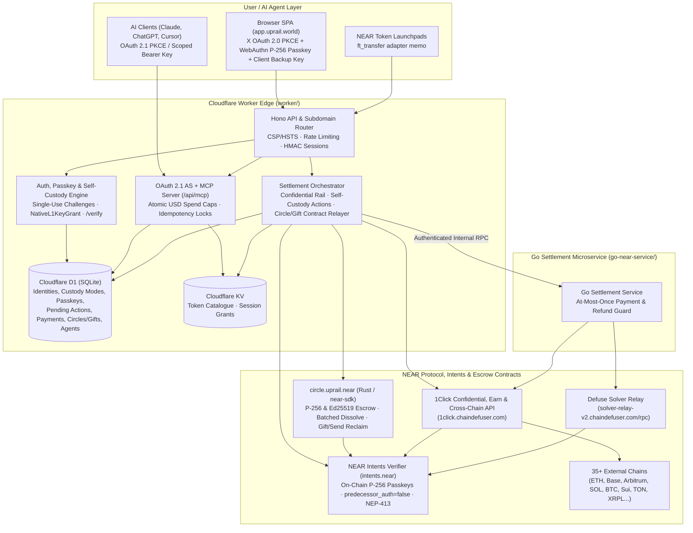

# UPRAIL (v1.1)

**Your X handle is now your non-custodial, private money hub.**  
UPRAIL is a **non-custodial social money ecosystem built around NEAR Intents** (`intents.near` + Confidential Intents + `circle.uprail.near`): every account uses **Passkey Self-Custody** so only your device WebAuthn key controls `intents.near`, earn together in smart-contract **Circles**, gift timelocked Earn vaults, pay anyone privately by `@handle`, accept no-login **Buy Me a Coffee** tips across 35+ chains, and route `$` directly to `near.com` or AI agents — all without seed phrases or gas.

- **Version:** v1.1.0
- **Hackathon Tracks:** Privacy & Private AI (`privacy`) · Social Money (`social`) · Unstoppable DeFi (`defi`) · Agent Economy (`agents`) · Autonomous Business (`business`) · Real-World Money (`realworld`) · Open Innovation (`open`)
- **Mainnet Traction (Real People, Real Money):** **80 and counting** real users · **141** payment & withdrawal txs (**95** settled on-chain · **8** active escrow) · **$158.55 USDC** settled (**$156.83** payments & withdrawals + **$1.72** Buy Me a Coffee; **$186.51+ USDC** initiated) on NEAR Mainnet
- **Live Application:** [https://app.uprail.world](https://app.uprail.world) *(Judge Invite Code: `INTENT` — controlled onboarding while testing and talking directly with early users)*
- **Non-Custodial On-Chain Verifier:** [https://app.uprail.world/verify?q=xy63ry0rx](https://app.uprail.world/verify?q=xy63ry0rx)
- **Escrow Smart Contract (NEAR Mainnet):** [`circle.uprail.near`](./contracts/circle-escrow/) ([tx `FWhnEgq...`](https://nearblocks.io/txns/FWhnEgqK6uRgVatqtFX5MvbHnDXKepperQC2LdYBjr3z))
- **Marketing & Interactive Preview:** [https://uprail.world](https://uprail.world)
- **Developer Documentation:** [https://docs.uprail.world](https://docs.uprail.world)
- **Remote MCP Server:** `https://api.uprail.world/api/mcp`
- **OpenAPI 3.1.0 Spec (AI Agents):** [https://api.uprail.world/api/agent/openapi.json](https://api.uprail.world/api/agent/openapi.json)
- **X (Twitter):** [@uprailworld](https://x.com/uprailworld)

---

## 📑 Index

- **[Live Mainnet Traction](#live-mainnet-traction-real-people-real-money)** — Live NEAR Mainnet user, transaction, and USDC volume metrics
- **[Judging in 60 Seconds](#-judging-in-60-seconds-do-x--see-y)** — `make check-mainnet`, 201 automated tests (187 Worker + 14 Rust contract), curl checks, and `Do X → See Y`
- **[Judging Map (Track-by-Track)](#-judging-map-track-by-track-verification)** — Every hackathon track mapped to verified source files and tests
- **[Why UPRAIL](#why-uprail-a-social-ecosystem-around-near-intents)** — Non-custodial social money thesis built around NEAR Intents and `@handle` identity
- **[How It Works (Technical)](#how-it-works-technical)** — Passkey Self-Custody, `UP1-...` Recovery Keys, `circle.uprail.near`, Vaults, Circles, Passkeys, Confidential Intents, `near.com`, and MCP
- **[Key NEAR Primitives Used](#key-near-primitives-used)** — `intents.near`, `circle.uprail.near`, 1Click, Defuse Solver Relay, `escrow.uprail.near`, and NEAR RPC
- **[Quick Demo (For Human & AI Judges)](#quick-demo-for-human--ai-judges)** — Step-by-step walkthroughs starting with Passkey Self-Custody, Circles & Timelocked Gifts
- **[Architecture](#architecture)** — System diagram across SPA, Cloudflare Worker/D1/KV, `circle.uprail.near`, Go service, and NEAR Intents
- **[Project Structure](#project-structure)** — Repository layout (`contracts/circle-escrow/`, `frontend/`, `worker/`, `go-near-service/`, `scripts/`)
- **[Tech Stack & Security Model](#tech-stack)** — Frameworks, non-custodial key guarantees, defense-in-depth security, production status, and env config
- **[Links](#links)** — Live app, `/verify`, docs, OpenAPI, MCP server, and X (`@uprailworld`)

---

## Live Mainnet Traction (Real People, Real Money)

UPRAIL is not a testnet prototype — it is live in production on **NEAR Mainnet** with real users onboarding via X + WebAuthn passkeys and moving real money across social handles, AI agents, and external wallets:

| Metric | Live Mainnet Count / Volume | Breakdown & Details |
| :--- | :--- | :--- |
| **Users (`x_identities`)** | **80 X Identities (and counting)** | Authenticated real X (Twitter) accounts onboarded via OAuth 2.0 PKCE, each mapped to a deterministic `u_<hex>.escrow.uprail.near` sub-account |
| **Payment & Withdrawal Txs** | **141 Total** (**95** settled · **8** in escrow) | **82** `@handle` payments (**59** claimed, **8** escrowed, **14** cancelled, **1** refunded) + **59** cross-chain & `near.com` withdrawals (**36** completed, **23** failed) |
| **Settled USDC Volume** | **$158.55 USDC Settled** | **$84.51 USDC** in **49** claimed `@handle` payments + **$72.31 USDC** in **29** completed withdrawals (**$156.83 USDC**; **$186.51+ USDC** initiated) + **$1.72 USDC** Buy Me a Coffee settlement *(excl. NEAR & launchpad token txs)* |
| **Social & Agent Surfaces** | **13** requests · **8** agent keys · **3** Circles | **13** social requests (**1** completed, **4** pending, **6** declined, **2** expired) · **8** MCP AI agent keys · **8** coffee checkouts (**1** settled, **7** expired) · **3** active Circles |

---

## ⚡ Judging in 60 Seconds (Do X → See Y)

Judges and automated evaluators (Claude Code, Codex) can verify the live project, on-chain contracts, every core feature, and the full test suite in seconds:

### 1. One-Command Live Mainnet & Feature Verification (11 Checks)
Verify the live gas sponsor (`escrow.uprail.near`), user sub-accounts, `intents.near` key registration, cross-chain token registry, AI agent OpenAPI/MCP discovery, launchpad routing, Circles & Earn Vault Gifting, and fail-closed security:
```bash
make check-mainnet
# Or directly: python3 scripts/verify-mainnet.py
```
**Expected Output (11/11 checks passing):**
```text
=================================================================
⚡ UPRAIL: Live Mainnet & Full-Feature Verification (11 Checks)
=================================================================

[1/11] NEAR Mainnet Sponsor (escrow.uprail.near)... ✔ OK! Block #224158284 (0.3546 NEAR)
[2/11] User Sub-Account (u_0a7f020b1386a20e.escrow.uprail.near)... ✔ OK! Key ed25519:5j9f5u3G5H...
[3/11] NEAR Intents Key Registration (intents.near)... ✔ OK! has_public_key == true
[4/11] Production Worker Health (api.uprail.world/health)... ✔ OK! uprail-worker v1.0.0
[5/11] Public Identity Resolver (@xy63ry0rx)... ✔ OK! -> u_0a7f020b1386a20e.escrow.uprail.near
[6/11] Cross-Chain Tokens & Live Price Oracle... ✔ OK! 494 Intents tokens · NEAR=$3.55
[7/11] AI Agent OpenAPI 3.1.0 Spec (/api/agent/openapi.json)... ✔ OK! 9 agent paths
[8/11] OAuth 2.1 & MCP Discovery (RFC 8414 / RFC 9728)... ✔ OK! MCP=https://api.uprail.world/api/mcp
[9/11] Launchpad Creator-Fee Routing (/api/launchpads/config)... ✔ OK! Kinds: token_config, factory, jh_v2_dev
[10/11] Fail-Closed Anti-BAC Guard (/api/payments)... ✔ OK! Unauthenticated access blocked (HTTP 401)
[11/11] Circles & Earn Vault Gifting (/api/circles/vaults)... ✔ OK! 6 Earn vaults (TLO, gtUSDCp, kV-gtSOLb, stNEAR, cNEAR, wstETH) · Auth 401 guarded
=================================================================
🎉 ALL ON-CHAIN SPONSOR, MAINNET & FEATURE CHECKS PASSED!
```

### 2. Run Full Automated Test Suite (201 Tests, 0 Failures)
Run the complete Worker unit, Miniflare integration, Self-Custody cryptography/flows, confidential rail, stabilization, coffee, Circles & Earn Vault Gifting, launchpad, and NEAR smart-contract test suites *(requires Node 22+ and Rust/Cargo; `make test` automatically switches via `nvm` when present)*:
```bash
make test
# Worker suite: cd worker && npm test
# Smart contract suite: cargo test --manifest-path contracts/circle-escrow/Cargo.toml
```
**Expected Output:**
```text
Worker tests   : 120 + 67 = 187 passed, 0 failed (40 suites)
Contract tests : 14 passed, 0 failed (uprail-circle-escrow)
```

### 3. Quick Zero-Install Curl Checks (All Public Surfaces)
Inspect every live public endpoint directly from your terminal:
```bash
# 1. Live Worker health & version
curl -sS https://api.uprail.world/health | jq .

# 2. Resolve an X @handle to its deterministic on-chain NEAR vault
curl -sS "https://api.uprail.world/api/resolve?handle=xy63ry0rx" | jq .

# 3. Verify live non-custodial account state & circle.uprail.near smart-contract binding
curl -sS "https://api.uprail.world/api/verify/xy63ry0rx" | jq '{accountId, circleContractId, selfCustodyVerifiedOnchain, onchain}'
curl -sS "https://app.uprail.world/verify?q=xy63ry0rx" >/dev/null && echo "/verify OK"

# 4. Inspect live cross-chain Intents tokens (35+ chains) & live USD oracle pricing
curl -sS https://api.uprail.world/api/onchain/tokens | jq '{count: (.tokens | length)}'
curl -sS "https://api.uprail.world/api/onchain/price?asset=wrap.near" | jq .

# 5. Verify OAuth 2.1 RFC 8414 Server & RFC 9728 MCP Protected Resource metadata
curl -sS https://app.uprail.world/.well-known/oauth-authorization-server | jq .
curl -sS https://api.uprail.world/.well-known/oauth-protected-resource/api/mcp | jq .

# 6. Inspect OpenAPI 3.1.0 Agent Payment specification (9 agent endpoints)
curl -sS https://api.uprail.world/api/agent/openapi.json | jq '{openapi, paths: (.paths | keys)}'

# 7. Inspect self-serve Launchpad Creator-Fee Routing proof config
curl -sS https://api.uprail.world/api/launchpads/config | jq '{network, escrowAccount, verificationKinds}'

# 8. Inspect Public Payment Link / Buy Me a Coffee routes & live creator JSON (@xy63ry0rx)
curl -sS https://api.uprail.world/api/coffee/options | jq '.tokens | map({symbol, chains: (.chains | length)})'
curl -sS "https://uprail.world/xy63ry0rx?format=json" | jq .

# 9. Inspect Circles & Timelocked Earn Vault Gifting catalog (6 curated 1Click Earn vaults) & fail-closed guards
curl -sS https://api.uprail.world/api/circles/vaults | jq '.vaults | map({symbol, estimatedApyPct, minDepositUsd, priceUsd})'
curl -sS https://api.uprail.world/api/gifts/vaults | jq '.vaults | length'
```

### 4. All-Feature Quick Verification (`Do X → See Y`)

| Feature | Do This (Action) | See This (Verified Result) |
| :--- | :--- | :--- |
| **0. Non-Custodial Passkey Self-Custody & `/verify`** | Sign in with X + invite code `INTENT`, register your device Passkey, save your `UP1-...` Recovery Key (`HKDF-SHA256`), and inspect `/verify?q=xy63ry0rx` | Registers WebAuthn `p256:...` and client-derived backup Ed25519 key on `intents.near`, locks out server/predecessor execution (`set_auth_by_predecessor_id(false)`), rotates the native NEAR L1 key, and verifies live on-chain state publicly at `app.uprail.world/verify?q=xy63ry0rx` |
| **1. Circles & Timelocked Earn Vault Gifting (`circle.uprail.near`)** | Click **Circles** (`/app/circles`) to create a smart-contract Circle (`circle.uprail.near`), collect signed terms, or send a timelocked Earn Gift (`uprail.world/gift/:id`) | Routes into 6 curated 1Click Earn vaults (`TLO`, `gtUSDCp`, `kV-gtSOLb`, `stNEAR`, `cNEAR`, `wstETH`); binds every member by `(account_id, pubkey)`; enforces WebAuthn P-256 low-S + origin checks, batched 0%-fee dissolve (`8` members/tx, `<300 TGas`) or 99%/1% creator settle, and 30-day Gift reclaim |
| **2. Private `@handle` Send & Unlinked Claim** | Send USDC/NEAR on `/app/send` to any `@handle` (registered or new) + confirm with Passkey | Confidential Intents / `circle.uprail.near` settlement or shareable `/claim/<id>` link with edge OG card; claimed via X + Passkey |
| **3. Public Payment Link (`uprail.world/<handle>`)** | Toggle ON via dashboard coin-pouch icon; visit `uprail.world/xy63ry0rx` without logging in | Pick `USDC`/`USDT`/`NEAR`/`SOL`/`ETH`/`BTC`, exact token amount (`amountToken`) & chain → one-time `FLEX_INPUT` `CONFIDENTIAL_INTENTS` address + 99% net payout settled directly in stables (`USDC`/`USDT`) |
| **4. 1-Tap `near.com` Internal Withdrawal** | Dashboard → **Withdraw** (`near.com`) → bind `nearcom:0x...` address with Passkey → withdraw | 0% bridge fee internal settlement straight into `near.com` balance (`nearcomWithdraw.ts` + single-tap Self-Custody signing) |
| **5. 35+ Chain "Send to Wallet"** | Send/Withdraw to any external EVM, Solana, Bitcoin, TON, Tron, Sui, XRP, or NEAR address | 1Click cross-chain swap & delivery across 35+ networks (`oneclickWithdraw.ts` + Passkey Self-Custody WebAuthn intents) |
| **6. Stabilize (Crypto → USDC/USDT)** | Click **Stabilize** on Dashboard or any held token ≥ 0.05 NEAR / $1 | Gas-sponsored 1Click Confidential or Rhea Finance swap into USDC/USDT (1% fee) |
| **7. Social Invoicing & "People You Pay"** | Create request on `/app/request`; share `/request/:id`; pin/nickname frequent contacts | Recipient views/pays/declines `/request/:id` in 1 tap; persistent contact memory with anti-spam blocks |
| **8. AI Agent Rail (OAuth 2.1 + 13-Tool MCP)** | Connect `https://api.uprail.world/api/mcp` in Claude/ChatGPT/Cursor & approve caps with Passkey | Agent calls 13 MCP tools (`pay_handle`, `request_payment`, etc.) bounded by atomic per-tx/daily USD caps |
| **9. Launchpad Creator-Fee Routing** | Register token via `POST /api/launchpads/register` or send `Fees to @handle via UPRAIL` | Escrow verifies on-chain receipts/memos via NEAR RPC and credits the creator's vault automatically |
| **10. Hardware Passkeys & Recovery Keys** | Register WebAuthn P-256 passkey + save `UP1-...` device recovery key / encrypted recovery codes | Every fund-moving endpoint rejects unverified sessions; lost passkeys recover via client-derived Ed25519 NEP-413 key |
| **11. 100% Sponsored Gas & Native L1 Passkey Auth** | Onboard with invite code `INTENT` & 0 NEAR; move native L1 assets or run `Export Private Key` | `escrow.uprail.near` sponsors account creation & gas while server L1 access stays blocked unless granted by [`NativeL1KeyGrant`](worker/src/services/nativeL1Grant.ts) after a fresh passkey signature |

---

## 🗺️ Judging Map (Track-by-Track Verification)

Where each hackathon track criterion is implemented and tested in the codebase:

| Track | Focus & Hints | UPRAIL Implementation | Verified Source Code & Tests |
| :--- | :--- | :--- | :--- |
| **`social`**<br/>(Social Money) | Social identity value transfer, shared budgets, collective rewards (for walletless users without DAO UIs) | Maps any `@handle` to deterministic NEAR vaults (`u_<hex>.escrow.uprail.near`); non-custodial smart-contract **Circles** (`circle.uprail.near`) on `/app/circles` with signer-bound `(account_id, pubkey)` commitments and batched 0% dissolve; **1-to-1 Timelocked Earn Vault Gifting** (`uprail.world/gift/:id`) with 30-day reclaim; **Buy Me a Coffee** (`uprail.world/<handle>`); `/request/:id` invoicing | • [`contracts/circle-escrow/src/lib.rs`](contracts/circle-escrow/src/lib.rs)<br/>• [`worker/src/services/selfCustodyVaultOps.ts`](worker/src/services/selfCustodyVaultOps.ts)<br/>• [`worker/src/services/circles.ts`](worker/src/services/circles.ts)<br/>• [`worker/src/services/gifts.ts`](worker/src/services/gifts.ts)<br/>• [`worker/test/circles-and-gifts.test.ts`](worker/test/circles-and-gifts.test.ts)<br/>• [`worker/test/self-custody-flows.test.ts`](worker/test/self-custody-flows.test.ts) |
| **`privacy`**<br/>(Privacy & Private AI) | Private finance, breaking on-chain transaction graphs | NEAR Confidential Intents (`intents.near` + 1Click `CONFIDENTIAL_INTENTS`) with fail-closed anti-downgrade validation; unlinked pooled escrow & dedicated `ATTESTOR_PRIVATE_KEY` handle claims (`circle.uprail.near`); D1 leg-identifier scrubbing (`scrubSettledPaymentLinks`) & anti-IDOR gates | • [`worker/src/services/confidentialRail.ts`](worker/src/services/confidentialRail.ts)<br/>• [`worker/test/confidential-rail.test.ts`](worker/test/confidential-rail.test.ts)<br/>• [`worker/src/services/refunds.ts`](worker/src/services/refunds.ts) |
| **`defi`**<br/>(Unstoppable DeFi) | Non-custodial key ownership & multi-chain settlement via NEAR Intents | True non-custodial WebAuthn P-256 keys directly on `intents.near` (`set_auth_by_predecessor_id(false)`), device-only `UP1-...` HKDF-Ed25519 NEP-413 backup keys, smart-contract custody (`circle.uprail.near`), 6 1Click Earn Vaults, 0% `near.com` withdrawals, **Stabilize** swaps | • [`worker/src/services/selfCustodyCrypto.ts`](worker/src/services/selfCustodyCrypto.ts)<br/>• [`worker/src/services/selfCustodyActions.ts`](worker/src/services/selfCustodyActions.ts)<br/>• [`worker/src/services/nativeL1Grant.ts`](worker/src/services/nativeL1Grant.ts)<br/>• [`worker/test/self-custody-crypto.test.ts`](worker/test/self-custody-crypto.test.ts)<br/>• [`worker/test/stabilize.test.ts`](worker/test/stabilize.test.ts) |
| **`agents`** / **`business`**<br/>(Agent Economy & Autonomous Business) | Policy-bounded agent commerce, treasury/invoicing without raw keys | Production OAuth 2.1 AS + 13-tool Streamable HTTP MCP Server (`api.uprail.world/api/mcp`) + OpenAPI 3.1.0 with atomic per-tx/daily USD spend caps, idempotency locks, live oracle pricing, and mobile/desktop `/approve` WebAuthn escalation | • [`worker/src/routes/mcp.ts`](worker/src/routes/mcp.ts)<br/>• [`worker/src/routes/agent.ts`](worker/src/routes/agent.ts)<br/>• [`worker/src/routes/approval.ts`](worker/src/routes/approval.ts)<br/>• [`worker/test/miniflare.test.mjs`](worker/test/miniflare.test.mjs) |
| **`realworld`**<br/>(Real-World Money) | Stablecoins, invoicing, remittances, meta-tx for real users | Zero seed phrases, zero payer login, and 100% sponsored gas (`escrow.uprail.near`); non-custodial Touch ID / Face ID WebAuthn P-256 passkeys + `UP1-...` recovery keys; `/verify` transparency UI; `uprail.world/<handle>` USDC/USDT checkouts & live mainnet volume (**$158.55 USDC** settled) | • [`frontend/src/views/VerifyPage.tsx`](frontend/src/views/VerifyPage.tsx)<br/>• [`frontend/src/views/CirclesView.tsx`](frontend/src/views/CirclesView.tsx)<br/>• [`frontend/src/views/PublicGiftView.tsx`](frontend/src/views/PublicGiftView.tsx)<br/>• [`frontend/src/views/PublicCoffeeView.tsx`](frontend/src/views/PublicCoffeeView.tsx) |
| **`open`**<br/>(Open Innovation) | Chain abstraction + composable non-custodial identity rails | Unifies public social handles (`@handle`), non-custodial `intents.near` passkey keys, smart-contract escrows (`circle.uprail.near`), universal `near.com` ingress, and autonomous MCP commerce under one verifiable layer | • [`contracts/circle-escrow/src/crypto.rs`](contracts/circle-escrow/src/crypto.rs)<br/>• [`scripts/deploy-circle-contract.mjs`](scripts/deploy-circle-contract.mjs)<br/>• [`scripts/verify-mainnet.py`](scripts/verify-mainnet.py)<br/>• [`worker/src/index.ts`](worker/src/index.ts) |

---

## Why UPRAIL: A Social Ecosystem Around NEAR Intents

> *"Public blockchains leak your wealth and rekt. NEAR Intents made confidential transfers possible. UPRAIL streams that private value to X handles."*

Instead of building a single-purpose bridge or spend-cap script, UPRAIL wraps **NEAR Intents**, **Confidential Intents**, and **1Click Earn Vaults** around social identity so crypto behaves like everyday internet money — private, gasless, and social by default:

1. **Social Transfers, Invoicing & Public Pay Links (No Wallet Required):** Public explorers expose every financial relationship, and asking someone for a chain-specific address breaks peer payments. UPRAIL maps any `@handle` to a deterministic NEAR vault (`u_<hex>.escrow.uprail.near`) with 100% sponsored gas, `CONFIDENTIAL_INTENTS` routing, pooled escrow for unregistered recipients, *People You Pay* contact memory, `/request/:id` invoicing, and public `uprail.world/<handle>` pages.
2. **Social Earning & Timelocked Gifting (`Circles` + `Gifts`):** Real social money isn't just 1-to-1 transfers — people save together and gift across milestones. **Circles** let groups pool into 6 curated 1Click Earn vaults with percentage splits and unanimous WebAuthn passkey dissolve, while **Timelocked Gifts** (`uprail.world/gift/:id`) compound yield until an unlock timestamp behind anti-IDOR and biometric claim gates.
3. **Universal Ingress for `near.com` & 35+ Chains:** `near.com` and 1Click deposit addresses rotate per live user session, so peers, clients, or agents can't fund you asynchronously. UPRAIL turns `@handle` and `uprail.world/<handle>` into permanent cross-chain ingress across 35+ chains, paired with **Stabilize** swaps into USDC/USDT and a **0%-bridge-fee `near.com` internal withdrawal rail (`nearcom:0x...`)**.
4. **Autonomous Agents & Creator Fee Routing (Post-Frontend Era):** Software is shifting from web dashboards to AI assistants, and launchpads shouldn't force creators to expose static wallets. UPRAIL embeds an **OAuth 2.1 + 13-tool MCP server** (`api.uprail.world/api/mcp`) with atomic biometric spend caps and `/approve` escalation, alongside on-chain receipt verification for launchpad creator fees (`Fees to @handle via UPRAIL`).

---

## How It Works (Technical)

### 1. Passkey Self-Custody & 100% Gas-Sponsored Execution
Every X account maps to a deterministic NEAR sub-account (`u_<hex>.escrow.uprail.near`) controlled by the user's hardware WebAuthn passkey on `intents.near` (`custody_mode = 'self'`), without requiring a browser wallet extension or any native gas balance:

1. **Cryptographic Self-Custody on `intents.near` (`custodyService.ts`):**
   - Registers the user's hardware WebAuthn passkey (`p256:<base58>`, low-S normalized uncompressed `x||y`) and client-only Backup Recovery Key (`ed25519:<base58>`, `UP1-...` derived in the browser via [`frontend/src/lib/selfCustody.ts`](frontend/src/lib/selfCustody.ts)) onto `intents.near` via `add_public_key`.
   - Removes UPRAIL's server-derived Ed25519 key via `remove_public_key` and disables implicit predecessor auth via `set_auth_by_predecessor_id(false)` so the server **cannot move Intents funds** even if `ESCROW_PRIVATE_KEY` were ever compromised.
   - Publicly verifiable at [`app.uprail.world/verify`](https://app.uprail.world/verify) via `GET /api/verify/:accountOrHandle`.
2. **Per-Action Hardware WebAuthn Signing & Scoped NEAR L1 Grants:**
   - All Intents actions (`transfer`, `ft_withdraw`, `mt_withdraw`, `native_withdraw`, 1Click swaps, and `circle.uprail.near` transfers) use [`selfCustodyActions.ts`](worker/src/services/selfCustodyActions.ts) and [`selfCustodyCrypto.ts`](worker/src/services/selfCustodyCrypto.ts) (`prepare` → browser WebAuthn P-256 prompt → `submit`) backed by single-use `pending_custody_actions` challenges.
   - NEAR L1 operations on `u_*.escrow.uprail.near` (`wrap.near`, L1 `ft_transfer`) require a fresh WebAuthn prompt that mints an in-memory, `WeakMap`-backed [`NativeL1KeyGrant`](worker/src/services/nativeL1Grant.ts) bound to the exact user, operation, asset, and target (TTL `<= 120s`).
3. **100% Sponsored Gas (Zero Gas Required from Users):**
   - **Sub-Account Creation & Storage:** `escrow.uprail.near` sponsors `CreateAccount` + `AddKey`, `0.01 NEAR` storage reserves, and `intents.near::add_public_key` (`5 TGas`) automatically via [`nearRpc.ts`](worker/src/services/nearRpc.ts).
   - **Token Storage & Gasless Relaying:** `escrow.uprail.near` sponsors NEP-145 `storage_deposit` and relays signed `execute_intents` payloads to `intents.near` without users holding `NEAR` for gas.
4. **Device Loss Recovery & Key Export:**
   - Users recover lost passkeys using their offline client-only Backup Recovery Key (`ed25519` NEP-413 `add_public_key` signed in browser — zero server knowledge of the backup seed). Users may also export their vault key / backup credentials with passkey authentication.

### 2. Non-Custodial Earn Circles (`circle.uprail.near`), Vault Gifting & Unclaimed Sends
UPRAIL pairs **1Click Earn vaults** (`TLO` Ethereum USDC, `gtUSDCp` Base USDC, `kV-gtSOLb` Solana SOL, `stNEAR`, `cNEAR`, `wstETH`) with the Rust NEAR smart contract [`circle.uprail.near`](contracts/circle-escrow/src/lib.rs):

1. **Zero-Stranding Circle Funding (`selfCustodyVaultOps.ts` & `circle.uprail.near`):**
   - Creator proposes goal, payout `@handle`, and splits summing to `10,000` bps (`100.00%`), bound per member by `(account_id, pubkey)` and `circle_id`.
   - Invited members review and sign [`agree_circle` / `signCircleTermsOnchain`](worker/src/services/circleContract.ts) with their hardware Passkey (`AuthProof::WebAuthn`) before contributions begin (`PENDING_SIGNATURES` → `ACTIVE`).
   - Non-vault deposits (e.g., USDC → `stNEAR`) swap via `1Click` with `refundTo` set to the **user's own `intents.near` account**, then deposit exact vault shares into `circle.uprail.near` (`mt_transfer_call` / `ft_transfer_call` with `contribute_circle` `msg`).
2. **Permissionless/Signed Payout Settlement (`SETTLED`) & Fee Split:**
   - Creator or verified payout recipient executes contract settlement (with scoped `@handle` attestation signed by `ATTESTOR_PRIVATE_KEY`): **99%** goes directly to the payout recipient and **1%** (`FEE_BPS = 100`) to `escrow.uprail.near`.
3. **Unanimous Dissolve, Batched Refunds & Safeguard Reclaim (`DISSOLVED`):**
   - Contributors approve dissolution on-chain with their Passkey; refunds process deterministically in batches (`MAX_DISSOLVE_REFUNDS_PER_TX = 8`) with callback rollback safety (`refund_pending`) and a time-locked `dissolve_safeguard_ms` escape hatch so funds are never permanently trapped.
4. **Timelocked Vault Gifting (`uprail.world/gift/:id`) & Unclaimed Sends:**
   - On-chain [`circle.uprail.near`](contracts/circle-escrow/src/lib.rs) escrow verifies recipient claims with handle attestation + passkey proof after `timelock_until`, supports sender `reclaim_gift` / `reclaim_unclaimed_send` expiry recovery, and includes `show_amount = 0` masking and custom `/og/gift/:id.png` cards.

### 3. Dual-Factor Identity: X OAuth 2.0 PKCE + WebAuthn P-256 Passkeys
- **X OAuth 2.0:** Uses S256 PKCE challenges to verify ownership of the X `@handle` and issues an authenticated session.
- **Per-Transaction WebAuthn Gate:** Restricts authorization to hardware P-256 / ES256 passkeys with resident keys, counter verification, and strict origin/RP ID checks (`webauthnConfig.ts`).
- **One-Time Recovery Codes & Backup Keys:** Account-level recovery codes remain domain-separated and AEAD-encrypted, complementing the client-only `ed25519` on-chain Backup Recovery Key on `intents.near`.

### 4. Three-Rail Intent Execution & Confidential Settlement
When a sender initiates a transfer, the system generates a cryptographically signed quote binding recipient, asset, amount, and expiry, then settles across three rails:

1. **NEAR Confidential Intents Rail:**
   - Authenticates intent sessions and requests confidential execution with anti-downgrade validation.
   - Signs NEP-413 intent payloads and submits them to `intents.near` via the confidential execution layer.
2. **Public NEAR Intents Rail:**
   - Pre-registers NEP-145 token storage, deposits assets into `intents.near`, and broadcasts NEP-413 transfer intents via gas-sponsored relayer or the Defuse Solver Relay.
3. **Native NEP-141 Fallback Rail:**
   - For launchpad or custom NEP-141 tokens not yet listed on `intents.near`, handles direct sponsored transfers.

### 5. Escrowed Social Claims, Atomic Locks & Refunds
- **Direct vs. Escrowed Routing:** Registered handles settle directly into their NEAR Intents vault. Unregistered handles receive funds into a 30-day pooled escrow.
- **Handle Binding on Registration:** When a new user connects their X identity and registers a passkey, all pending escrowed transfers matching their handle are permanently bound to their verified identity, preventing handle rename attacks.
- **Atomic Claim Reservation:** Claims execute using atomic conditional state updates to guarantee at-most-once payouts and eliminate race conditions.
- **At-Most-Once Refunds:** Senders can cancel unclaimed transfers, and expired escrowed funds (>30 days) automatically refund the full gross amount to the original sender.

### 6. Universal Ingress to near.com & Internal Withdrawal Rail
- **Universal Ingress for near.com (Solving the Rotating Address Barrier):** On `near.com` (and Defuse / 1Click), cross-chain deposit addresses are ephemeral, session-bound, and rotating. Only the authenticated owner at their terminal can generate a quote to fund their account. UPRAIL solves this by giving every user a persistent public identity (`@handle`) mapped to a NEAR Intents vault: anyone in the world can deposit from 35+ chains directly to `@handle` without requiring a live session quote from the recipient.
- **Passkey-Gated `near.com` Internal Withdrawal Rail:** Once funds settle into the user's UPRAIL vault, users can withdraw directly into their personal `near.com` wallet in one tap:
  - **Zero Bridge Fees & 1:1 Routing:** Bypasses external chain bridges and routing fees by transferring internally inside the Confidential Intents layer (`submitPrivateTransfer`) to the recipient's NEP-518 internal address (`nearcom:0x...`).
  - **Two-Step Passkey Security:**
    1. **Address Setup & Verification:** Users paste their internal address from `near.com` (Account Menu → *My address* → copy internal address like `nearcom:0xb137a2f1054b5de422a8df801613d6722701163c`). The address is validated, stripped of the URI scheme, and cryptographically bound to the user's identity via a WebAuthn passkey challenge.
    2. **Withdrawal Execution:** Selecting an Intents-supported asset and amount opens a detailed confirmation modal. The user signs with their hardware passkey (`Touch ID` / `Face ID`), the worker reserves the withdrawal in D1, shields any plain balance shortfall via `ensureConfidentialFunds`, and submits the private transfer to `intents.near` with instant settlement.
  - **Edit Protection:** Updating or replacing the saved `near.com` withdrawal destination is strictly gated by a fresh passkey challenge to protect against unauthorized modification.
- **Cross-Chain Withdrawals ("Send to Wallet"):** In addition to internal `near.com` routing, users can withdraw any asset from their vault to an external address across **35+ blockchains** (NEAR, Ethereum, Base, Arbitrum, Optimism, Polygon, BNB Chain, Avalanche, Solana, Bitcoin, Sui, Aptos, TON, Tron, XRP Ledger, Stellar, Dogecoin, Litecoin, Zcash, Starknet, Hyperliquid, Monad, Berachain, etc.) with chain-specific address validation and atomic state reservation.

### 7. AI Agent Payment Rail & OAuth 2.1 Remote MCP Server (The Post-Frontend Thesis)

> **The Post-Frontend Thesis:** In the coming era, users will rarely interact with traditional web frontends. The future of software is conversational and autonomous — where AI agents negotiate, orchestrate workflows, tip creators, purchase compute, split bounties, and settle transactions on our behalf. But an agent that cannot move value is just an observer, while giving an LLM unconstrained access to a raw crypto wallet is a fatal security flaw. From day one, UPRAIL was built with this post-frontend reality in mind: we integrated the agentic value railway directly into the protocol's foundation, letting autonomous models transact with cryptographic safety, biometric spend limits, and zero seed phrases.

UPRAIL includes a full **OAuth 2.1 Authorization Server** and **Streamable HTTP MCP Server** (`2025-06-18`) at `https://api.uprail.world/api/mcp`:
- **The Railway for Autonomous Agents:** Rather than forcing humans to sit at terminals and click through transaction forms, users connect Claude, ChatGPT, Grok, Meta Muse, or Cursor directly to UPRAIL via open standards (OAuth 2.1 PKCE + Model Context Protocol).
- **Zero Raw Key Exposure:** Agents never touch or store private keys. Instead, they receive revocable, policy-bounded OAuth bearer grants authorized by the user's hardware passkey (Touch ID / Face ID / WebAuthn).
- **Biometric Policy Boundaries & Spend Caps:** Users define strict, immutable guardrails during connection: a maximum USD limit per individual payment and an aggregate daily USD spend cap. Every tool call pre-checks and reserves quota atomically against live oracle pricing.
- **13 MCP Tools for Autonomous Commerce:**
  1. `pay_handle`: Send crypto confidentially to any X handle (single or batch) with automated claim links and prefilled X post intent URLs.
  2. `check_approval`: Query the resolution status of batch or policy-overflow authorization tickets.
  3. `withdraw_to_wallet`: Withdraw funds to any external address across 35+ blockchains or internally to near.com.
  4. `receive_payment`: Inspect deposit addresses, pending incoming transfers, or shareable payment links.
  5. `get_balance`: Check public, confidential, and total balances across all supported assets.
  6. `list_payments`: Audit recent sent and received payments with full transaction telemetry.
  7. `resolve_handle`: Resolve whether an X identity has an active UPRAIL vault or routes through escrow.
  8. `list_contacts`: Retrieve the user's saved and frequent transfer recipients with recency and preferred assets.
  9. `save_contact`: Save, update, or pin trusted contacts in the user's persistent address book.
  10. `request_payment`: Create a social payment request asking an X handle for funds, generating shareable claim URLs and prefilled X posts.
  11. `list_requests`: Query inbound and outbound payment requests by direction and settlement status.
  12. `accept_request`: Pay an incoming payment request autonomously on behalf of the owner, bounded by spend caps.
  13. `decline_request`: Decline an incoming payment request with an optional reason.
- **Human-in-the-Loop Instant Passkey Escalation (`/approve`):** When an agent needs to execute an anomalous high-value batch transfer or exceed its daily limit, it yields an authorization ticket link (`/approve?id=...`). The user reviews the breakdown on their device, confirms with Face ID or fingerprint via WebAuthn, and the agent's intent executes atomically on NEAR.
- **Fail-Closed Spend Policy & Anti-Replay:** Live oracle token pricing, atomic database reservations before signing intents, and idempotency locks prevent retried prompts from causing double-spends or prompt-injection drains.

### 8. Launchpad Creator-Fee Routing
Launchpads and DEX pools (Nearly, JustHoot v2, and Intear Launchpad on `launch.intear.near` / `dex.intear.near`) keep their own fee receiver. When a payout should reach an X handle, their adapter or keeper sends the transfer to escrow with the target handle memo (`Fees to @handle via UPRAIL`), and UPRAIL automatically verifies the onchain receipt and credits the creator's vault.

### 9. Social Invoicing, Contact Memory & Anti-Spam Request Rails
Peer-to-peer finance is fundamentally relational and two-sided. UPRAIL introduces zero-friction social payment memory:
- **"People you pay" (Contact Engine):** A user-governed registry mapping contacts to X identities, tracking custom nicknames, preferred transfer assets and amounts, and pin priorities, automatically merged with transfer ledger history.
- **Social Requests Lifecycle & Anti-Harassment:** Payment requests follow a strict state machine (`PENDING` → `COMPLETED` / `DECLINED` / `CANCELLED` / `EXPIRED`). Requests include rate-limiting (max 10 requests/hour/user) and request-blocking primitives to prevent spam, while allowing unregistered recipients to inspect invoices without signing up upfront.
- **Full Autonomous Agent Parity:** AI agents can audit, generate, accept, and decline payment requests within their owner's biometric spend guardrails.

---

## Key NEAR Primitives Used

| NEAR Primitive | Contract / Endpoint | How UPRAIL Uses It | Primary Code Path |
| :--- | :--- | :--- | :--- |
| **NEAR Intents (NEP-413)** | `intents.near` | Off-chain Ed25519 signed `nep413` payloads (`transfer`, `ft_withdraw`, `mt_withdraw`, `native_withdraw`, `swap_transfer`) with versioned salt and deadline nonces. | [`nearRpc.ts`](worker/src/services/nearRpc.ts), [`intentsNonce.ts`](worker/src/services/intentsNonce.ts) |
| **WebAuthn P-256 Intents Auth** | `intents.near` (`add_public_key`, `set_auth_by_predecessor_id`) | Registers user hardware `p256:<base58>` passkeys + client-only Backup Recovery Key (`ed25519`) and locks out server predecessor auth for Passkey Self-Custody. | [`selfCustodyCrypto.ts`](worker/src/services/selfCustodyCrypto.ts), [`custodyService.ts`](worker/src/services/custodyService.ts) |
| **Circle & Gift Escrow Contract** | `circle.uprail.near` | Non-custodial Rust NEAR contract verifying `AuthProof::WebAuthn` / `Ed25519`, scoped `@handle` attestations, 1% payout split, batched dissolves (`<= 8`/tx), and timelocked Gift/Send claims & reclaims. | [`lib.rs`](contracts/circle-escrow/src/lib.rs), [`circleContract.ts`](worker/src/services/circleContract.ts) |
| **Confidential Intents & 1Click** | `https://1click.chaindefuser.com` | Confidential balances, NEP-413 / WebAuthn session authentication, confidential quotes, 1Click swaps (`refundTo` user on self-custody), and Earn vaults. | [`confidentialRail.ts`](worker/src/services/confidentialRail.ts), [`selfCustodyVaultOps.ts`](worker/src/services/selfCustodyVaultOps.ts) |
| **Defuse Solver Relay** | `https://solver-relay-v2.chaindefuser.com/rpc` | JSON-RPC 2.0 `publish_intent` relay for signed NEP-413 escrow settlements and refunds. | [`relay.go`](go-near-service/internal/intents/relay.go), [`nearRpc.ts`](worker/src/services/nearRpc.ts) |
| **Deterministic Sub-Accounts & Smart Escrow** | `u_<hex>.escrow.uprail.near` & `circle.uprail.near` | Per-user sub-accounts with `NativeL1KeyGrant` gating for passkey-authorized L1 sweeps and `circle.uprail.near` smart-contract escrow. | [`nearRpc.ts`](worker/src/services/nearRpc.ts), [`nativeL1Grant.ts`](worker/src/services/nativeL1Grant.ts) |
| **Gasless Relayer & Storage Sponsor** | `escrow.uprail.near` | Sponsors NEP-145 `storage_deposit` and relays signed `intents.near::execute_intents` & `circle.uprail.near` transactions so users hold zero `NEAR` for gas. | [`nearRpc.ts`](worker/src/services/nearRpc.ts), [`selfCustodyActions.ts`](worker/src/services/selfCustodyActions.ts) |
| **Onchain Receipt Verification & `/verify`** | NEAR JSON-RPC + `GET /api/verify/:accountOrHandle` | Verifies creator-fee receipts and exposes live on-chain `intents.near` public key & predecessor-auth proofs publicly. | [`nearRpc.ts`](worker/src/services/nearRpc.ts), [`custody.ts`](worker/src/routes/custody.ts) |

---

## Quick Demo (For Human & AI Judges)

### Flow 1: Circles (`circle.uprail.near`) & Timelocked Earn Vault Gifting
1. **Create a Circle Pool & Collect Unanimous Member Signatures:** On `/app/circles` (click **Circles** above **Stabilize** on the dashboard), pick one of 6 live Earn vaults (`TLO`, `gtUSDCp`, `kV-gtSOLb`, `stNEAR`, `cNEAR`, `wstETH`), set a USD goal and payout `@handle`, assign member handles with percentage splits summing to `100%`, and sign with your Passkey.
   - **Expected result:** The Circle starts in `PENDING_SIGNATURES` on `circle.uprail.near` (binding each member's `(account_id, pubkey)`). Once **every invited member** signs with their hardware Passkey (`agree_circle`), the Circle flips to `ACTIVE`.
2. **Contribute, Earn Yield & Settle (or Unanimously Dissolve):** Signed members contribute in one or multiple installments; contributions swap into compounding Earn vault shares (`refundTo` the member's own `intents.near` account first) and deposit into `circle.uprail.near` until settled (`99%` to payout `@handle`, `1%` fee to `escrow.uprail.near`) or dissolved via Passkey (`<= 8` refunds/tx) or the 7-day safeguard.
3. **Send a Timelocked Earn Gift (with 30-Day Reclaim):** Open **Send Gift** on `/app/circles`, enter any recipient `@handle`, pick an occasion preset & unlock timestamp, optionally hide exact USD principal, and fund from any Intents asset with your Passkey.
   - **Expected result:** UPRAIL swaps into the chosen Earn vault, escrows on `circle.uprail.near`, renders a shareable `uprail.world/gift/<id>` page with `/og/gift/<id>.png` preview card, blocks claims until `timelock_until` + recipient X & Passkey verification, and allows sender reclaim if unclaimed after expiry.

### Flow 2: Onboard with Passkey Self-Custody, Verify at `/verify`, Send & Claim Privately by `@handle`
1. **Sign In, Enter Invite Code `INTENT` & Provision Non-Custodial Vault:** Go to [https://app.uprail.world](https://app.uprail.world), sign in with X, enter invite code **`INTENT`** *(gated during active testing so onboarding stays controlled and the team can talk directly with early users)*, register a device Passkey (Touch ID / Face ID), and save your `UP1-...` Backup Recovery Key.
   - **Expected result:** UPRAIL provisions your `u_<hex>.escrow.uprail.near` vault, registers your `p256:<base58>` passkey and `ed25519` backup key on `intents.near` with `set_auth_by_predecessor_id(false)`, rotates the native NEAR L1 key to your backup key, and lets anyone verify your non-custodial key state at [https://app.uprail.world/verify?q=xy63ry0rx](https://app.uprail.world/verify?q=xy63ry0rx).
2. **Deposit or Check Balance:** Open **Receive** (`/app/receive`) to copy your `@handle` payment link or generate a cross-chain deposit address (e.g., USDC from Base, Arbitrum, Solana, or NEAR).
3. **Send to Any `@handle`:** Open **Send** (`/app/send`), enter any X handle (even one that has never used UPRAIL), choose an asset and amount, and confirm with your Passkey.
   - **Expected result:** A signed quote is generated, your passkey authorizes the intent, and UPRAIL returns a shareable claim link (`https://app.uprail.world/claim/<paymentId>`) with a dynamically rendered OpenGraph preview card.
4. **Claim with X + Passkey:** Open the claim link as the recipient `@handle`, sign in with X, and confirm with your Passkey (or click **Send to Wallet** on `/app/claim` to withdraw directly to an external wallet across 35+ chains).
   - **Expected result:** The payment is atomically claimed and settled into the recipient's vault (or bridged cross-chain via 1Click).

### Flow 3: 1-Tap Internal Withdrawal to near.com (0% Bridge Fee)
1. **Open Withdraw:** On the Dashboard ([https://app.uprail.world/app](https://app.uprail.world/app)), click the **Withdraw** button (`near.com`).
2. **First-Time Setup (Passkey Gated):**
   - In `near.com`, tap your account menu → click **My address** → copy your internal address (e.g. `nearcom:0xb137a2f1054b5de422a8df801613d6722701163c`).
   - Paste it into the setup modal and click **Save & Verify with Passkey** (Touch ID / Face ID).
   - UPRAIL validates the NEP-518 account, strips the scheme, and binds it securely to your verified identity in D1.
3. **Withdraw Assets:**
   - Tap any Intents asset (USDC, NEAR, USDT, ETH, BTC, SOL) and enter or select the amount (`25%`, `50%`, `75%`, `MAX`).
   - Click **Review Withdrawal** to verify the confirmation modal breakdown (`Fee: 0.00 Sponsored`, `Route: Confidential Intents → near.com Internal`).
   - Confirm with your Passkey: the transfer settles directly into your `near.com` internal balance with zero bridge fees.
   - You can edit your saved destination at any time by clicking **Edit** (also passkey-gated).

### Flow 4: Connect an AI Agent (Claude, ChatGPT, Cursor) via OAuth 2.1 + MCP
1. Go to [https://app.uprail.world/app/agents](https://app.uprail.world/app/agents) and copy the MCP server URL `https://api.uprail.world/api/mcp`.
2. Add it as a remote connector in Claude, ChatGPT, or Cursor—this launches UPRAIL's **OAuth 2.1 PKCE + Passkey** consent screen where you set per-transaction and daily USD spend caps.
3. Once connected, manage or revoke active agent session cards directly on `/app/agents`. Your agent gets access to all **13 MCP tools** (`pay_handle`, `check_approval`, `withdraw_to_wallet`, `receive_payment`, `get_balance`, `list_payments`, `resolve_handle`, `list_contacts`, `save_contact`, `request_payment`, `list_requests`, `accept_request`, `decline_request`) bounded by your passkey-approved caps.

### Flow 5: Public Payment Link (`uprail.world/<handle>` — Live Example: `@xy63ry0rx`)
1. **Enable Your Payment Link (Passkey-Gated):** On your dashboard ([https://app.uprail.world/app](https://app.uprail.world/app)), click the coin-pouch button under **Stabilize** and flip the toggle (verified by Face ID / Touch ID). Your link `https://uprail.world/<handle>` goes live immediately with a `PAY ME HERE` OpenGraph preview card showing your X profile picture.
2. **Get Paid Without Payer Sign-Up (Human Flow):** Visit the live public page [https://uprail.world/xy63ry0rx](https://uprail.world/xy63ry0rx) without logging in, choose `USDC` / `USDT` / `NEAR` / `SOL` / `ETH` / `BTC`, enter an exact token amount (`amountToken`), pick an origin chain, and send to a one-time `FLEX_INPUT` confidential deposit address + QR code. Regardless of the token sent, `checkAndSettleCoffeeDonation` settles 99% net **directly in stables (`USDC`/`USDT`)** privately via `payEscrowPrivate` and displays a minimal receipt.
3. **Get Paid by Any Visiting AI Agent:**
   ```bash
   # Discover supported routes & machine-readable instructions on live creator @xy63ry0rx
   curl -s "https://uprail.world/xy63ry0rx?format=json" | jq .

   # Create a one-time confidential FLEX_INPUT deposit quote directly
   curl -s -X POST https://uprail.world/xy63ry0rx \
     -H "Content-Type: application/json" \
     -d '{"amountToken":"1","originSymbol":"NEAR","originChain":"near"}' | jq .
   ```

---

## Architecture



---

## Project Structure

```text
/
├── contracts/circle-escrow/               # Rust NEAR smart contract (near-sdk 5.30 -> circle.uprail.near)
│   └── src/                               # lib.rs, crypto.rs (P-256/Ed25519 verify), types.rs, ext.rs, tests.rs (14 Rust tests)
│
├── scripts/                               # Deployment & mainnet audit scripts
│   ├── deploy-circle-contract.mjs         # Interactive masked-key NEAR deploy/migrate + Wrangler secret helper (--self-test)
│   └── verify-mainnet.py                  # Live mainnet & D1 integrity audit script
│
├── frontend/                              # Next.js 16 + React 19 + Tailwind CSS (static export served by Worker)
│   ├── src/app/                           # App Router pages: /, /tip, /gift, /verify, /app/send, /app/claim, /app/receive, /app/circles, /app/agents, /docs/*
│   ├── src/components/                    # AppShell, CapabilitiesCarousel, PasskeyModal, CoffeeModal, StabilizeModal, DomainGate
│   ├── src/views/                         # LandingPage, AppHome, CirclesView, PublicGiftView, PublicCoffeeView, SendPage, ClaimPage, ReceivePage, AgentsPage
│   ├── src/hooks/                         # useXAuth, usePasskey, usePayments, useOnchainData
│   └── src/lib/                           # Typed API client (api.ts), client-only Backup Key & Ed25519 (selfCustody.ts), client router, status formatters
│
├── worker/                                # Cloudflare Worker (Hono v4 + D1 SQLite + KV + Cron Triggers)
│   ├── wrangler.jsonc                     # Routes, D1/KV bindings, cron schedule ("0 * * * *"), public vars (CIRCLE_CONTRACT_ID)
│   ├── src/index.ts                       # Entry point, security headers, subdomain routing, OG bot handler, cron sweeps
│   ├── src/db/                            # Canonical D1 schema.sql + sequential SQL migrations (through 0018_self_custody.sql)
│   ├── src/middleware/                    # HMAC sessions, WebAuthn passkeyAuth, agentAuth, rateLimit, securityHeaders
│   ├── src/oauth/                         # OAuth 2.1 Authorization Server (PKCE, DCR, /authorize UI) & Resource Server
│   ├── src/routes/                        # auth, custody, payments, claim, coffee, circles, gifts, onchain, agent, mcp, fees, launchpads, invites, og
│   ├── src/services/                      # nearRpc, custodyService, selfCustodyCrypto, selfCustodyActions, selfCustodyVaultOps, nativeL1Auth, nativeL1Grant,
│   │                                      # circleContract, confidentialRail, coffee, circles, gifts, earnVaults, stabilize, oneclickClient, oneclickAuth,
│   │                                      # oneclickWithdraw, intentsNonce, launchpadFees, launchpadIntegrations, refunds
│   └── test/                              # 20 automated test files (187 tests across 40 suites: Miniflare integration + unit tests)
│
├── go-near-service/                       # Go 1.25 Settlement Microservice
│   ├── cmd/server/main.go                 # Chi HTTP server, graceful shutdown, route wiring
│   └── internal/                          # middleware, escrow signer, solver relay RPC client, oneclick
└── README.md
```

---

## Tech Stack

- **Smart Contract (`circle.uprail.near`):** Rust, `near-sdk 5.30`, `p256` + `ed25519` WebAuthn/NEP-413 signature verification (`contracts/circle-escrow/`)
- **Frontend:** Next.js 16.4 (Static Export), React 19.3, TypeScript 5, Tailwind CSS 3.4, `@simplewebauthn/browser`, pure-BigInt client Ed25519 Backup Key (`frontend/src/lib/selfCustody.ts`)
- **Edge Backend:** Cloudflare Workers, Hono v4, Cloudflare D1 (SQLite), Cloudflare KV, `@simplewebauthn/server`, `@noble/curves`, `workers-og`
- **Settlement Microservice:** Go 1.25 (`chi/v5`), Ed25519 NEP-413 signer, JSON-RPC 2.0 Solver Relay client
- **Authentication & Agent Auth:** X OAuth 2.0 (PKCE `S256`), WebAuthn Passkeys (`ES256` / P-256), OAuth 2.1 Authorization Server, Streamable HTTP MCP (`2025-06-18`)
- **Blockchain & Confidentiality:** NEAR Protocol (`intents.near` WebAuthn P-256 + NEP-413, `circle.uprail.near`), NEAR Confidential Intents & 1Click API (`1click.chaindefuser.com`), Defuse Solver Relay (`solver-relay-v2.chaindefuser.com`)

---

## Security Model & Defense-in-Depth

- **Non-Custodial `intents.near` & NEAR L1 Lockout (`custody_mode = 'self'`):** Passkey Self-Custody atomically registers the user's `p256:<base58>` passkey and browser-derived `UP1-...` Backup Recovery Key (`ed25519`) on `intents.near`, removes UPRAIL's server Ed25519 key, executes `set_auth_by_predecessor_id(false)`, and rotates the native NEAR L1 `FullAccess` key on `u_<hex>.escrow.uprail.near` to the user's backup key (`custodyService.ts`, `nearRpc.ts`). The server retains zero capability to spend or redirect Intents or L1 balances, publicly auditable at [`/verify?q=xy63ry0rx`](https://app.uprail.world/verify?q=xy63ry0rx).
- **Scoped Runtime Grants & Key Separation:** NEAR L1 sub-account sweeps/transfers require an unforgeable in-memory `WeakMap` grant ([`NativeL1KeyGrant`](worker/src/services/nativeL1Grant.ts), TTL `<= 120s`) minted strictly after WebAuthn verification. `circle.uprail.near` handle attestations use a dedicated `ATTESTOR_PRIVATE_KEY`, isolated from `ESCROW_PRIVATE_KEY` (`circleContract.ts`).
- **On-Chain Circle, Gift & Unclaimed Send Safeguards (`circle.uprail.near`):** Enforces low-S P-256 WebAuthn & Ed25519 proof checks, origin allowlisting, zero-stranding 1Click `refundTo` routing back to the user's account (`selfCustodyVaultOps.ts`), deterministic batched dissolves (`MAX_DISSOLVE_REFUNDS_PER_TX = 8`) with `refund_pending` callback recovery, and time-locked `dissolve_safeguard_ms` / reclaim paths.
- **Fail-Closed Secret Validation:** All critical services fail closed immediately if cryptographic secrets or configurations are absent, preventing insecure fallbacks.
- **Hardware Passkey Assertion Per Transaction:** Every fund-moving action requires a fresh biometric WebAuthn P-256 assertion bound to a single-use challenge.
- **Anti-Downgrade Confidentiality Guard:** The client cryptographically verifies that the privacy level returned matches the requested confidential tier before any intent is signed.
- **Atomic Database Reservations:** Claims, refunds, withdrawals, and AI agent spend reservations execute atomically to eliminate race conditions and double-spends.
- **Strict Subdomain Isolation & Security Headers:** Enforces strict origin separation, CSP, HSTS, frame denial, and CORS policies across web app and API boundaries.

---

## Current Status & Known Limitations

### Current Status
- **Live in Production:** Running at [https://app.uprail.world](https://app.uprail.world), [https://app.uprail.world/verify?q=xy63ry0rx](https://app.uprail.world/verify?q=xy63ry0rx), [https://api.uprail.world](https://api.uprail.world), [https://docs.uprail.world](https://docs.uprail.world), and [https://uprail.world](https://uprail.world), with [`circle.uprail.near`](https://nearblocks.io/address/circle.uprail.near) live on NEAR Mainnet.
- **Mainnet Onchain Activity (Real People, Real Money):** **80 and counting** authenticated X users across **141** payment & withdrawal records (**95** settled on-chain: **59** `@handle` claims + **36** withdrawals; **8** active in escrow), settling **$158.55 USDC** (**$84.51** `@handle` claims + **$72.31** withdrawals + **$1.72** Buy Me a Coffee; **$186.51+ USDC** initiated) alongside NEAR & launchpad token transfers, **13** payment requests, **8** MCP AI agent keys, and **3** active Circles.

### Known Limitations (Tracked)
1. **Fail-Closed Confidential Policy:** Prioritizes privacy over convenience. If confidential execution is unavailable or reports a privacy downgrade, transactions fail closed rather than falling back to a public broadcast.
2. **Self-Custodial Export & Backup Recovery:** Users control their `intents.near` balance via WebAuthn P-256 passkey + offline `UP1-...` Backup Recovery Key and can export their vault keys at any time.
3. **Static Export CSP:** Web application is distributed as a high-performance static export at the edge, utilizing scoped Content-Security-Policy directives for client scripts.
4. **Client State Caching:** Transient balance and activity snapshots are cached locally in browser storage for instant UI responsiveness and cleared on sign-out.

---

## Configuration Reference

Local configuration templates are available in `worker/.dev.vars.example` and `go-near-service/.env.example`. Production configurations are managed via Cloudflare Wrangler and container environment variables.

| Variable | Component | Purpose |
| :--- | :--- | :--- |
| `SESSION_SECRET` | Worker | Session encryption and state verification |
| `X_CLIENT_SECRET` | Worker | X OAuth 2.0 authentication |
| `RECOVERY_PEPPER` | Worker | Passkey recovery code protection |
| `INTERNAL_SERVICE_KEY` | Worker & Go | Internal service-to-service authentication |
| `SETTLEMENT_SERVICE_URL` | Worker | Base URL of the settlement microservice |
| `ESCROW_PRIVATE_KEY` | Worker & Go | Gas sponsor relayer and onchain execution key |
| `CIRCLE_CONTRACT_ID` | Worker | Deployed non-custodial escrow contract ID (`circle.uprail.near`) |
| `ATTESTOR_PRIVATE_KEY` | Worker | Scoped Ed25519 key signing `@handle` attestations for `circle.uprail.near` |
| `NEAR_RPC_URL` | Worker | NEAR JSON-RPC provider endpoint |
| `ONE_CLICK_API_KEY` | Worker & Go | 1Click cross-chain routing API key |
| `CONFIDENTIAL_RAIL_ENABLED` | Worker | Feature flag for confidential execution path |
| `CREATOR_FEES_ENABLED` | Worker | Feature flag for launchpad creator fee processing |

---

## Links

- **Live Web App:** [https://app.uprail.world](https://app.uprail.world) *(Judge Invite Code: `INTENT` — controlled onboarding during active testing & user feedback)*
- **Public On-Chain Self-Custody Verifier:** [https://app.uprail.world/verify?q=xy63ry0rx](https://app.uprail.world/verify?q=xy63ry0rx)
- **On-Chain Escrow Smart Contract:** [`circle.uprail.near`](https://nearblocks.io/address/circle.uprail.near)
- **Marketing & Interactive Demo:** [https://uprail.world](https://uprail.world)
- **Developer Docs:** [https://docs.uprail.world](https://docs.uprail.world) ([AI Agents](https://docs.uprail.world/agents) · [MCP Server](https://docs.uprail.world/mcp) · [Creator Fees](https://docs.uprail.world/fees) · [Buy Me a Coffee](https://docs.uprail.world/coffee))
- **Remote MCP Endpoint:** `https://api.uprail.world/api/mcp`
- **Agent OpenAPI 3.1.0 Spec:** [https://api.uprail.world/api/agent/openapi.json](https://api.uprail.world/api/agent/openapi.json)
- **X (Twitter):** [@uprailworld](https://x.com/uprailworld)

---

## Hackathon Disclosure (Multi-Project Rule Q-015)

In accordance with NEAR HACKATHON rule **Q-015**, the author is also submitting a separate, independent hackathon project: **[fe2vi.space](https://fe2vi.space)** (a distinct product with its own repository and submission; maximum 2 projects per participant).

---

## License

Released under the [MIT License](./LICENSE).

