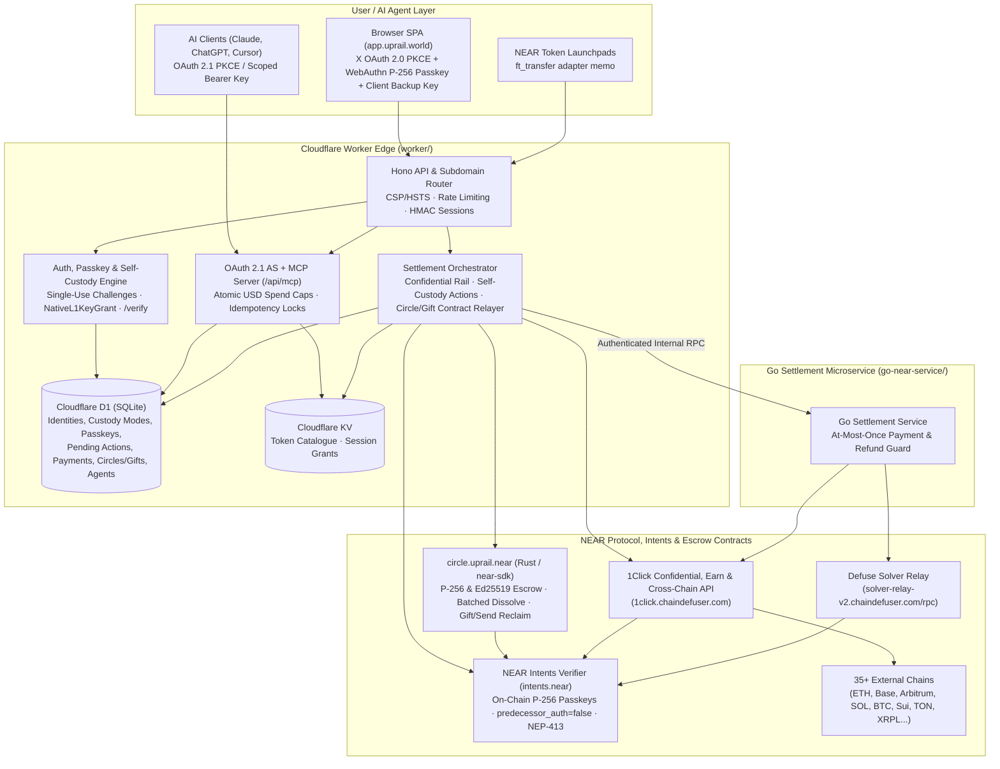

# UPRAIL (v1.1)

**Your X handle is now your non-custodial, private money hub.**  
UPRAIL is a **non-custodial social money ecosystem built around NEAR Intents** (`intents.near` + Confidential Intents + `circle.uprail.near`): new accounts start in **Passkey Self-Custody** (with 1-click upgrade for earlier accounts) so only your device WebAuthn key and offline `UP1-...` recovery key control `intents.near`, earn together in smart-contract **Circles**, gift timelocked Earn vaults, pay anyone privately by `@handle`, accept no-login **Buy Me a Coffee** tips across 35+ chains, and route `$` directly to `near.com` or AI agents — all without seed phrases or gas.

- **Version:** v1.1.0
- **Hackathon Tracks:** Privacy & Private AI (`privacy`) · Social Money (`social`) · Unstoppable DeFi (`defi`) · Agent Economy (`agents`) · Autonomous Business (`business`) · Real-World Money (`realworld`) · Open Innovation (`open`)
- **Mainnet Traction (Real People, Real Money):** **80 and counting** real users · **141** payment & withdrawal txs (**95** settled on-chain · **8** active escrow) · **$158.55 USDC** settled (**$156.83** payments & withdrawals + **$1.72** Buy Me a Coffee; **$186.51+ USDC** initiated) on NEAR Mainnet
- **Live Application:** [https://app.uprail.world](https://app.uprail.world) *(Judge Invite Code: `INTENT` — controlled onboarding while testing and talking directly with early users)*
- **Non-Custodial On-Chain Verifier:** [https://app.uprail.world/verify?q=xy63ry0rx](https://app.uprail.world/verify?q=xy63ry0rx)
- **Escrow Smart Contract (NEAR Mainnet):** [`circle.uprail.near`](./contracts/circle-escrow/) ([tx `FWhnEgq...`](https://nearblocks.io/txns/FWhnEgqK6uRgVatqtFX5MvbHnDXKepperQC2LdYBjr3z))
- **Marketing & Interactive Preview:** [https://uprail.world](https://uprail.world)
- **Developer Documentation:** [https://docs.uprail.world](https://docs.uprail.world)
- **Remote MCP Server:** `https://api.uprail.world/api/mcp`
- **OpenAPI 3.1.0 Spec (AI Agents):** [https://api.uprail.world/api/agent/openapi.json](https://api.uprail.world/api/agent/openapi.json)
- **X (Twitter):** [@uprailworld](https://x.com/uprailworld)

---

## 📑 Index

- **[Live Stats & Traction](#live-mainnet-traction-real-people-real-money)** — Live NEAR Mainnet user, transaction, and USDC volume metrics
- **[Quick Start & Verification](#-quick-start--live-verification)** — `make check-mainnet`, 205 automated tests (190 Worker + 15 Rust contract), curl checks, and feature verification
- **[Track-by-Track Map](#-judging-map-track-by-track-verification)** — Every track mapped to verified source files and tests
- **[Why UPRAIL](#why-uprail)** — Non-custodial social money around NEAR Intents and `@handle` identity
- **[How UPRAIL Works](#how-uprail-works)** — Passkey Self-Custody, `UP1-...` Recovery Keys, Agent Allowance Pocket, Circles & Vault Gifts, Confidential Intents, `near.com`, and MCP
- **[Built on NEAR](#built-on-near)** — `intents.near`, `circle.uprail.near`, 1Click, Defuse Solver Relay, `escrow.uprail.near`, and NEAR RPC
- **[Guided Walkthroughs](#guided-walkthroughs)** — Step-by-step walkthroughs starting with Passkey Self-Custody, Circles & Timelocked Gifts
- **[Architecture](#architecture)** — System diagram across SPA, Cloudflare Worker/D1/KV, `circle.uprail.near`, Go service, and NEAR Intents
- **[Project Structure](#project-structure)** — Repository layout (`contracts/circle-escrow/`, `frontend/`, `worker/`, `go-near-service/`, `scripts/`)
- **[Tech Stack](#tech-stack) & [Security](#security--self-custody-guarantees)** — Frameworks, non-custodial key guarantees, Agent Pocket isolation, production status, and env config
- **[Links](#links)** — Live app, `/verify`, docs, OpenAPI, MCP server, and X (`@uprailworld`)

---

## Live Mainnet Traction (Real People, Real Money)

UPRAIL is live in production on **NEAR Mainnet** with real users onboarding via X + WebAuthn passkeys and moving real money across social handles, AI agents, and external wallets:

| Metric | Live Mainnet Count / Volume | Breakdown & Details |
| :--- | :--- | :--- |
| **Users (`x_identities`)** | **80 X Identities (and counting)** | Authenticated real X (Twitter) accounts onboarded via OAuth 2.0 PKCE, each mapped to a deterministic `u_<hex>.escrow.uprail.near` sub-account |
| **Payment & Withdrawal Txs** | **141 Total** (**95** settled · **8** in escrow) | **82** `@handle` payments (**59** claimed, **8** escrowed, **14** cancelled, **1** refunded) + **59** cross-chain & `near.com` withdrawals (**36** completed, **23** failed) |
| **Settled USDC Volume** | **$158.55 USDC Settled** | **$84.51 USDC** in **49** claimed `@handle` payments + **$72.31 USDC** in **29** completed withdrawals (**$156.83 USDC**; **$186.51+ USDC** initiated) + **$1.72 USDC** Buy Me a Coffee settlement *(excl. NEAR & launchpad token txs)* |
| **Social & Agent Surfaces** | **13** requests · **8** agent keys · **3** Circles | **13** social requests (**1** completed, **4** pending, **6** declined, **2** expired) · **8** MCP AI agent keys · **8** coffee checkouts (**1** settled, **7** expired) · **3** active Circles |

---

## ⚡ Quick Start & Live Verification

Evaluators, users, and coding agents can verify live on-chain state, every core feature, and the complete automated test suite in seconds:

### 1. Live Mainnet & Feature Checks (11 Checks)
Verify the live gas sponsor (`escrow.uprail.near`), user sub-accounts, `intents.near` key registration, cross-chain token registry, AI agent OpenAPI/MCP discovery, launchpad routing, Circles & Earn Vault Gifting, and fail-closed security:
```bash
make check-mainnet
# Or directly: python3 scripts/verify-mainnet.py
```
**Expected Output (11/11 checks passing):**
```text
=================================================================
⚡ UPRAIL: Live Mainnet & Full-Feature Verification (11 Checks)
=================================================================

[1/11] NEAR Mainnet Sponsor (escrow.uprail.near)... ✔ OK! Block #224158284 (0.3546 NEAR)
[2/11] User Sub-Account (u_0a7f020b1386a20e.escrow.uprail.near)... ✔ OK! Key ed25519:3P7ijos7Gt...
[3/11] NEAR Intents Key Registration (intents.near)... ✔ OK! has_public_key == true
[4/11] Production Worker Health (api.uprail.world/health)... ✔ OK! uprail-worker v1.0.0
[5/11] Public Identity Resolver (@xy63ry0rx)... ✔ OK! -> u_0a7f020b1386a20e.escrow.uprail.near
[6/11] Cross-Chain Tokens & Live Price Oracle... ✔ OK! 494 Intents tokens · NEAR=$3.55
[7/11] AI Agent OpenAPI 3.1.0 Spec (/api/agent/openapi.json)... ✔ OK! 10 agent paths
[8/11] OAuth 2.1 & MCP Discovery (RFC 8414 / RFC 9728)... ✔ OK! MCP=https://api.uprail.world/api/mcp
[9/11] Launchpad Creator-Fee Routing (/api/launchpads/config)... ✔ OK! Kinds: token_config, factory, jh_v2_dev
[10/11] Fail-Closed Anti-BAC Guard (/api/payments)... ✔ OK! Unauthenticated access blocked (HTTP 401)
[11/11] Circles & Earn Vault Gifting (/api/circles/vaults)... ✔ OK! 6 Earn vaults (TLO, gtUSDCp, kV-gtSOLb, stNEAR, cNEAR, wstETH) · Auth 401 guarded
=================================================================
🎉 ALL ON-CHAIN SPONSOR, MAINNET & FEATURE CHECKS PASSED!
```

### 2. Full Automated Test Suite (205 Tests, 0 Failures)
Run the Worker unit, Miniflare integration, Self-Custody & Agent Pocket flows, confidential rail, stabilization, coffee, Circles & Earn Vault Gifting, launchpad, and NEAR smart-contract test suites *(requires Node 22+ and Rust/Cargo; `make test` automatically switches via `nvm` when present)*:
```bash
make test
# Worker suite: cd worker && npm test
# Smart contract suite: cargo test --manifest-path contracts/circle-escrow/Cargo.toml
```
**Expected Output:**
```text
Worker tests   : 120 + 70 = 190 passed, 0 failed (40 suites)
Contract tests : 15 passed, 0 failed (uprail-circle-escrow)
```

### 3. Public Endpoint Checks (Curl)
Inspect live public endpoints directly from your terminal:
```bash
# 1. Live Worker health & version
curl -sS https://api.uprail.world/health | jq .

# 2. Resolve an X @handle to its deterministic on-chain NEAR vault
curl -sS "https://api.uprail.world/api/resolve?handle=xy63ry0rx" | jq .

# 3. Verify live non-custodial account state & circle.uprail.near smart-contract binding
curl -sS "https://api.uprail.world/api/verify/xy63ry0rx" | jq '{accountId, circleContractId, selfCustodyVerifiedOnchain, onchain}'
curl -sS "https://app.uprail.world/verify?q=xy63ry0rx" >/dev/null && echo "/verify OK"

# 4. Inspect live cross-chain Intents tokens (35+ chains) & live USD oracle pricing
curl -sS https://api.uprail.world/api/onchain/tokens | jq '{count: (.tokens | length)}'
curl -sS "https://api.uprail.world/api/onchain/price?asset=wrap.near" | jq .

# 5. Verify OAuth 2.1 RFC 8414 Server & RFC 9728 MCP Protected Resource metadata
curl -sS https://app.uprail.world/.well-known/oauth-authorization-server | jq .
curl -sS https://api.uprail.world/.well-known/oauth-protected-resource/api/mcp | jq .

# 6. Inspect OpenAPI 3.1.0 Agent Payment specification (10 agent paths)
curl -sS https://api.uprail.world/api/agent/openapi.json | jq '{openapi, paths: (.paths | keys)}'

# 7. Inspect self-serve Launchpad Creator-Fee Routing proof config
curl -sS https://api.uprail.world/api/launchpads/config | jq '{network, escrowAccount, verificationKinds}'

# 8. Inspect Public Payment Link / Buy Me a Coffee routes & live creator JSON (@xy63ry0rx)
curl -sS https://api.uprail.world/api/coffee/options | jq '.tokens | map({symbol, chains: (.chains | length)})'
curl -sS "https://uprail.world/xy63ry0rx?format=json" | jq .

# 9. Inspect Circles & Timelocked Earn Vault Gifting catalog (6 curated 1Click Earn vaults)
curl -sS https://api.uprail.world/api/circles/vaults | jq '.vaults | map({symbol, estimatedApyPct, minDepositUsd, priceUsd})'
curl -sS https://api.uprail.world/api/gifts/vaults | jq '.vaults | length'
```

### 4. Feature Verification Matrix

| Feature | Do This (Action) | See This (Verified Result) |
| :--- | :--- | :--- |
| **0. Default Passkey Self-Custody & `/verify`** | Sign up with X + invite code `INTENT`, register your Passkey, save your `UP1-...` Recovery Key, and open `/verify?q=xy63ry0rx` | New accounts start in **Passkey Self-Custody** (`custody_mode = 'self'`): registers your `p256:...` passkey and offline `ed25519` backup key on `intents.near`, removes server execution, locks `auth_by_predecessor_id`, and rotates the NEAR L1 `FullAccess` key — all verifiable publicly at `app.uprail.world/verify?q=xy63ry0rx` |
| **1. Circles & Vault Gifts (USDC → 6 Earn Pools)** | Click **Circles** (`/app/circles`) to create a Circle (`circle.uprail.near`) or send a timelocked Earn Gift (`uprail.world/gift/:id`) funded with **USDC** | Users fund strictly with **USDC**, which swaps automatically into any of 6 curated 1Click Earn pools (`TLO`, `gtUSDCp`, `kV-gtSOLb`, `stNEAR`, `cNEAR`, `wstETH`); binds every member by `(account_id, pubkey)`, supports batched 0%-fee dissolve or 99%/1% creator settle, and 30-day Gift reclaim |
| **2. Private `@handle` Send & Claim Links** | Send USDC/NEAR on `/app/send` to any `@handle` (registered or new) + confirm with Passkey | Confidential Intents / `circle.uprail.near` settlement or shareable `/claim/<id>` link with edge OG card; claimed via X + Passkey |
| **3. Public Payment Link (`uprail.world/<handle>`)** | Toggle ON via dashboard coin-pouch icon; visit `uprail.world/xy63ry0rx` without logging in | Pick `USDC`/`USDT`/`NEAR`/`SOL`/`ETH`/`BTC`, exact token amount & chain → one-time `FLEX_INPUT` confidential address + 99% net payout settled directly in stables (`USDC`/`USDT`) |
| **4. Direct `near.com` Withdrawal (0% Bridge Fee)** | Dashboard → **Withdraw** (`near.com`) → bind `nearcom:0x...` address with Passkey → withdraw | 0% bridge fee internal settlement straight into `near.com` balance (`nearcomWithdraw.ts` + single-tap Self-Custody signing) |
| **5. 35+ Chain Cross-Chain Withdrawals** | Send/Withdraw to any external EVM, Solana, Bitcoin, TON, Tron, Sui, XRP, or NEAR address | 1Click cross-chain swap & delivery across 35+ networks (`oneclickWithdraw.ts` + Passkey Self-Custody WebAuthn intents) |
| **6. Stabilize (Crypto → USDC/USDT)** | Click **Stabilize** on Dashboard or any held token ≥ 0.05 NEAR / $1 | Gas-sponsored 1Click Confidential or Rhea Finance swap into USDC/USDT (1% fee) |
| **7. Payment Requests & Contacts** | Create request on `/app/request`; share `/request/:id`; pin/nickname frequent contacts | Recipient views/pays/declines `/request/:id` in 1 tap; persistent contact memory with anti-spam blocks |
| **8. AI Chat Payments, MCP & Agent Allowance Pocket** | Connect `https://api.uprail.world/api/mcp` in Claude/ChatGPT/Cursor; optionally load USDC/USDT/NEAR into your **Agent Allowance Pocket** on `/app/agents` | Agents read **all** held balances (`get_balance` / `GET /api/agent/balances`), pay privately via **Confidential Intents** & withdraw inside caps with **zero passkey popup** when funded in the Agent Pocket (escalating to `/approve` otherwise); pocket funds stay counted in your UPRAIL balance and auto-pull back when you spend in the app |
| **9. Launchpad Creator-Fee Routing** | Register token via `POST /api/launchpads/register` or send `Fees to @handle via UPRAIL` | Escrow verifies on-chain receipts/memos via NEAR RPC and credits the creator's vault automatically |
| **10. Passkey Loss Recovery (`UP1-...`)** | On `/login` (`Second factor required`), tap **Use your Offline Recovery Key** and enter `UP1-...` | Derives your Ed25519 backup key in-browser, signs a NEP-413 `add_public_key` + old-passkey revocation payload on `intents.near`, and activates your replacement passkey |
| **11. Zero-Gas Execution & L1 Auth** | Onboard with invite code `INTENT` & 0 NEAR; move native L1 assets or export key | `escrow.uprail.near` sponsors account creation & gas while server L1 access stays gated by [`NativeL1KeyGrant`](worker/src/services/nativeL1Grant.ts) after a fresh passkey assertion |

---

## 🗺️ Judging Map (Track-by-Track Verification)

Where each hackathon track criterion is implemented and tested in the codebase:

| Track | Focus & Hints | UPRAIL Implementation | Verified Source Code & Tests |
| :--- | :--- | :--- | :--- |
| **`social`**<br/>(Social Money) | Social identity value transfer, shared budgets, collective rewards (for walletless users without DAO UIs) | Maps any `@handle` to deterministic NEAR vaults (`u_<hex>.escrow.uprail.near`); non-custodial smart-contract **Circles** (`circle.uprail.near`) on `/app/circles` with signer-bound `(account_id, pubkey)` commitments and batched 0% dissolve; **1-to-1 Timelocked Earn Vault Gifting** (`uprail.world/gift/:id`) with 30-day reclaim; **Buy Me a Coffee** (`uprail.world/<handle>`); `/request/:id` invoicing | • [`contracts/circle-escrow/src/lib.rs`](contracts/circle-escrow/src/lib.rs)<br/>• [`worker/src/services/selfCustodyVaultOps.ts`](worker/src/services/selfCustodyVaultOps.ts)<br/>• [`worker/src/services/circles.ts`](worker/src/services/circles.ts)<br/>• [`worker/src/services/gifts.ts`](worker/src/services/gifts.ts)<br/>• [`worker/test/circles-and-gifts.test.ts`](worker/test/circles-and-gifts.test.ts)<br/>• [`worker/test/self-custody-flows.test.ts`](worker/test/self-custody-flows.test.ts) |
| **`privacy`**<br/>(Privacy & Private AI) | Private finance, breaking on-chain transaction graphs | NEAR Confidential Intents (`intents.near` + 1Click `CONFIDENTIAL_INTENTS`) with fail-closed anti-downgrade validation; unlinked pooled escrow & dedicated `ATTESTOR_PRIVATE_KEY` handle claims (`circle.uprail.near`); D1 leg-identifier scrubbing (`scrubSettledPaymentLinks`) & anti-IDOR gates | • [`worker/src/services/confidentialRail.ts`](worker/src/services/confidentialRail.ts)<br/>• [`worker/test/confidential-rail.test.ts`](worker/test/confidential-rail.test.ts)<br/>• [`worker/src/services/refunds.ts`](worker/src/services/refunds.ts) |
| **`defi`**<br/>(Unstoppable DeFi) | Non-custodial key ownership & multi-chain settlement via NEAR Intents | True non-custodial WebAuthn P-256 keys directly on `intents.near` (`set_auth_by_predecessor_id(false)`), device-only `UP1-...` HKDF-Ed25519 NEP-413 backup keys, smart-contract custody (`circle.uprail.near`), 6 1Click Earn Vaults, 0% `near.com` withdrawals, **Stabilize** swaps | • [`worker/src/services/selfCustodyCrypto.ts`](worker/src/services/selfCustodyCrypto.ts)<br/>• [`worker/src/services/selfCustodyActions.ts`](worker/src/services/selfCustodyActions.ts)<br/>• [`worker/src/services/nativeL1Grant.ts`](worker/src/services/nativeL1Grant.ts)<br/>• [`worker/test/self-custody-crypto.test.ts`](worker/test/self-custody-crypto.test.ts)<br/>• [`worker/test/stabilize.test.ts`](worker/test/stabilize.test.ts) |
| **`agents`** / **`business`**<br/>(Agent Economy & Autonomous Business) | Policy-bounded agent commerce, treasury/invoicing without raw keys | Production OAuth 2.1 AS + 13-tool Streamable HTTP MCP Server (`api.uprail.world/api/mcp`) + OpenAPI 3.1.0 with atomic per-tx/daily USD spend caps, idempotency locks, live oracle pricing, and mobile/desktop `/approve` WebAuthn escalation | • [`worker/src/routes/mcp.ts`](worker/src/routes/mcp.ts)<br/>• [`worker/src/routes/agent.ts`](worker/src/routes/agent.ts)<br/>• [`worker/src/routes/approval.ts`](worker/src/routes/approval.ts)<br/>• [`worker/test/miniflare.test.mjs`](worker/test/miniflare.test.mjs) |
| **`realworld`**<br/>(Real-World Money) | Stablecoins, invoicing, remittances, meta-tx for real users | Zero seed phrases, zero payer login, and 100% sponsored gas (`escrow.uprail.near`); non-custodial Touch ID / Face ID WebAuthn P-256 passkeys + `UP1-...` recovery keys; `/verify` transparency UI; `uprail.world/<handle>` USDC/USDT checkouts & live mainnet volume (**$158.55 USDC** settled) | • [`frontend/src/views/VerifyPage.tsx`](frontend/src/views/VerifyPage.tsx)<br/>• [`frontend/src/views/CirclesView.tsx`](frontend/src/views/CirclesView.tsx)<br/>• [`frontend/src/views/PublicGiftView.tsx`](frontend/src/views/PublicGiftView.tsx)<br/>• [`frontend/src/views/PublicCoffeeView.tsx`](frontend/src/views/PublicCoffeeView.tsx) |
| **`open`**<br/>(Open Innovation) | Chain abstraction + composable non-custodial identity rails | Unifies public social handles (`@handle`), non-custodial `intents.near` passkey keys, smart-contract escrows (`circle.uprail.near`), universal `near.com` ingress, and autonomous MCP commerce under one verifiable layer | • [`contracts/circle-escrow/src/crypto.rs`](contracts/circle-escrow/src/crypto.rs)<br/>• [`scripts/deploy-circle-contract.mjs`](scripts/deploy-circle-contract.mjs)<br/>• [`scripts/verify-mainnet.py`](scripts/verify-mainnet.py)<br/>• [`worker/src/index.ts`](worker/src/index.ts) |

---

## Why UPRAIL

> *"Public blockchains leak your wealth and rekt. NEAR Intents made confidential transfers possible. UPRAIL streams that private value to X handles."*

Instead of building a single-purpose bridge or spend-cap script, UPRAIL wraps **NEAR Intents**, **Confidential Intents**, and **1Click Earn Vaults** around social identity so crypto behaves like everyday internet money — private, gasless, and social by default:

1. **Social Transfers, Invoicing & Public Pay Links (No Wallet Required):** Public explorers expose every financial relationship, and asking someone for a chain-specific address breaks peer payments. UPRAIL maps any `@handle` to a deterministic NEAR vault (`u_<hex>.escrow.uprail.near`) with 100% sponsored gas, `CONFIDENTIAL_INTENTS` routing, pooled escrow for unregistered recipients, *People You Pay* contact memory, `/request/:id` invoicing, and public `uprail.world/<handle>` pages.
2. **Social Earning & Timelocked Gifting (`Circles` + `Gifts`):** Real social money isn't just 1-to-1 transfers — people save together and gift across milestones. **Circles** let groups fund with **USDC** into any of 6 curated 1Click Earn vaults with percentage splits and unanimous WebAuthn passkey dissolve, while **Timelocked Gifts** (`uprail.world/gift/:id`) compound yield until an unlock timestamp behind anti-IDOR and biometric claim gates.
3. **Universal Ingress for `near.com` & 35+ Chains:** `near.com` and 1Click deposit addresses rotate per live user session, so peers, clients, or agents can't fund you asynchronously. UPRAIL turns `@handle` and `uprail.world/<handle>` into permanent cross-chain ingress across 35+ chains, paired with **Stabilize** swaps into USDC/USDT and a **0%-bridge-fee `near.com` internal withdrawal rail (`nearcom:0x...`)**.
4. **Autonomous AI Chat Payments & Agent Allowance Pocket:** Software is shifting from web dashboards to AI assistants, and launchpads shouldn't force creators to expose static wallets. UPRAIL embeds an **OAuth 2.1 + 13-tool MCP server** (`api.uprail.world/api/mcp`) where self-custody users can fund an isolated **Agent Allowance Pocket** for zero-prompt AI spends inside strict biometric caps, plus on-chain receipt verification for launchpad creator fees (`Fees to @handle via UPRAIL`).

---

## How UPRAIL Works

### 1. Passkey Self-Custody & Zero-Gas Payments
Every new X account gets a deterministic NEAR sub-account (`u_<hex>.escrow.uprail.near`) locked to **Passkey Self-Custody** (`custody_mode = 'self'`) by default, without requiring any browser wallet extension or NEAR balance for gas:

1. **On-Chain Self-Custody on `intents.near` (`custodyService.ts`):**
   - Registers your device's hardware WebAuthn passkey (`p256:<base58>`) and offline client-derived Backup Recovery Key (`ed25519:<base58>`, `UP1-...` derived in the browser via [`frontend/src/lib/selfCustody.ts`](frontend/src/lib/selfCustody.ts)) onto `intents.near` (`add_public_key`).
   - Removes UPRAIL's server key (`remove_public_key`), locks predecessor execution (`set_auth_by_predecessor_id(false)`), verifies fail-closed on-chain, and rotates the NEAR L1 `FullAccess` key on `u_<hex>.escrow.uprail.near` to the user's backup key (`rotateSubAccountL1KeyToBackup`).
   - Publicly inspectable anytime at [`app.uprail.world/verify`](https://app.uprail.world/verify) via `GET /api/verify/:accountOrHandle`.
2. **Per-Action Passkey Signing & Scoped L1 Grants:**
   - Transfers, swaps, withdrawals, and `circle.uprail.near` actions use [`selfCustodyActions.ts`](worker/src/services/selfCustodyActions.ts) and [`selfCustodyCrypto.ts`](worker/src/services/selfCustodyCrypto.ts) (`prepare` → Face ID / Touch ID prompt → `submit`) with single-use `pending_custody_actions` challenges.
   - Any remaining NEAR L1 token sweeps on `u_*.escrow.uprail.near` require a fresh passkey assertion creating a short-lived `WeakMap`-backed [`NativeL1KeyGrant`](worker/src/services/nativeL1Grant.ts) (`<= 120s`).
3. **100% Sponsored Gas (Zero Gas Needed):**
   - `escrow.uprail.near` sponsors account creation, NEP-145 token storage deposits, and relaying signed payloads on `intents.near` and `circle.uprail.near` so users never need `NEAR` for gas.
4. **Offline Passkey Recovery (`UP1-...`):**
   - If you lose your device or passkey, sign in with X on `/login` (`Second factor required`), tap **Use your Offline Recovery Key**, and paste your `UP1-...` key. Your browser derives your backup Ed25519 key (`signNep413RecoveryPayload`), adds your replacement passkey on `intents.near`, and removes lost passkeys — zero server seed knowledge.

### 2. Group Circles, Vault Gifts & Unclaimed Sends (`circle.uprail.near`)
UPRAIL pairs **6 curated 1Click Earn vaults** (`TLO` Ethereum USDC, `gtUSDCp` Base USDC, `kV-gtSOLb` Solana SOL, `stNEAR`, `cNEAR`, `wstETH`) with the Rust NEAR smart contract [`circle.uprail.near`](contracts/circle-escrow/src/lib.rs):

1. **USDC Funding & Zero-Stranding Circle Deposits (`selfCustodyVaultOps.ts` & `circle.uprail.near`):**
   - All Circle and Gift deposits use **USDC** (`isUsdcOriginAsset`), which swaps cleanly into any chosen Earn pool (`refundTo` set to the user's own `intents.near` account before depositing exact vault shares into `circle.uprail.near`).
   - Invited members sign agreed splits summing to `10,000` bps (`100.00%`) with their hardware Passkey before contributions begin.
2. **Payout Settlement (`SETTLED`) & 1% Fee Split:**
   - Verified payout settlement sends **99%** directly to the payout `@handle` and **1%** (`FEE_BPS = 100`) to `escrow.uprail.near`.
3. **Unanimous Dissolve, Batched Refunds & 7-Day Safeguard (`DISSOLVED`):**
   - Contributors approve dissolution with their Passkey; refunds process in batches (`MAX_DISSOLVE_REFUNDS_PER_TX = 8`) with callback rollback protection (`refund_pending`) and a time-locked `dissolve_safeguard_ms` escape hatch.
4. **Timelocked Vault Gifting (`uprail.world/gift/:id`) & Unclaimed Sends:**
   - [`circle.uprail.near`](contracts/circle-escrow/src/lib.rs) locks Earn gifts behind `timelock_until` + handle attestation + recipient Passkey verification, supports sender `reclaim_gift` / `reclaim_unclaimed_send`, and renders shareable `/og/gift/:id.png` previews.

### 3. X Login + Device Passkeys + Offline Recovery
- **X OAuth 2.0:** Uses S256 PKCE challenges to verify ownership of the X `@handle` and issue an authenticated session.
- **Device WebAuthn Passkeys:** Hardware P-256 / ES256 passkeys with strict origin and RP ID checks (`webauthnConfig.ts`).
- **Offline Recovery & Recovery Codes:** Client-only `UP1-...` Ed25519 Backup Recovery Keys recover self-custody accounts on `intents.near`, alongside encrypted fallback recovery codes (`recoveryCodes.ts`).

### 4. Private & Cross-Chain Settlement
When a sender initiates a transfer, UPRAIL verifies a cryptographic quote binding recipient, asset, amount, and expiry across three rails:

1. **NEAR Confidential Intents:** Authenticates intent sessions and executes confidential transfers with anti-downgrade validation.
2. **Public NEAR Intents:** Pre-registers NEP-145 token storage, deposits assets into `intents.near`, and relays signed NEP-413 intents.
3. **Native NEP-141 Transfers:** Handles sponsored direct transfers for launchpad or custom tokens not listed on `intents.near`.

### 5. Claim Links & Escrow Protection
- **Direct vs. Escrowed Routing:** Registered handles settle straight into their vault. Unregistered handles settle into 30-day escrow until claimed.
- **Identity Binding:** Registering with X + Passkey binds pending unclaimed transfers to your immutable X ID to prevent handle-rename theft.
- **At-Most-Once Refunds:** Senders can cancel unclaimed sends anytime; expired escrow transfers (>30 days) return automatically.

### 6. Direct near.com & 35+ Chain Withdrawals
- **Permanent `@handle` Deposits for `near.com` Users:** Receive from anyone across 35+ chains to `@handle` without keeping a rotating `near.com` deposit session open.
- **0%-Fee `near.com` Internal Withdrawals:** Passkey-bind your `nearcom:0x...` address and route 1:1 through Confidential Intents with zero bridge fee (`nearcomWithdraw.ts`).
- **35+ External Networks:** Withdraw directly to NEAR, Ethereum, Base, Arbitrum, Optimism, Polygon, BNB Chain, Avalanche, Solana, Bitcoin, Sui, Aptos, TON, Tron, XRP, Stellar, and more (`oneclickWithdraw.ts`).

### 7. AI Chat Payments, MCP & Agent Allowance Pocket
UPRAIL runs a full **OAuth 2.1 Authorization Server** and **Streamable HTTP MCP Server** (`2025-06-18`) at `https://api.uprail.world/api/mcp` for Claude, ChatGPT, Grok, Meta Muse, and Cursor:
- **Zero-Prompt Agent Allowance Pocket (for Self-Custody):** Because UPRAIL never holds a signing key on your main self-custody vault, you can optionally pre-load **USDC, USDT, or NEAR** into your isolated **Agent Allowance Pocket** on `/app/agents` with one passkey tap (`agentPocketService.ts`). While funded within your per-tx/daily USD limits, `pay_handle`, `withdraw_to_wallet`, and `accept_request` settle immediately with no passkey popup — with handle payments routed privately through **Confidential Intents** (`privacy_rail = 'confidential'`).
- **Unified Balance Across UPRAIL:** Funds inside your Agent Allowance Pocket still appear seamlessly inside your main UPRAIL balance and pull back automatically on-demand whenever you spend anywhere in the app — and auto-reclaim to your main vault when revoking your last active agent key.
- **Instant `/approve` Escalation:** Over-cap or un-funded pocket requests never fail silently — agents return a `/approve?id=...` link so you can confirm once with Face ID / Touch ID.
- **Full All-Balance Reads (`get_balance` / `GET /api/agent/balances`):** Agents read **every** held balance across Main Intents, NEAR L1, Confidential Intents, Virtual Escrow, and Agent Allowance Pocket (returning `USDC`, `NEAR`, `USDT`, plus any held asset like `ETH`, `SOL`, or vault tokens) while preserving backwards-compatible single-asset `/api/agent/balance?asset=...` reads.
- **13 MCP Tools:** `pay_handle`, `check_approval`, `withdraw_to_wallet`, `receive_payment`, `get_balance`, `list_payments`, `resolve_handle`, `list_contacts`, `save_contact`, `request_payment`, `list_requests`, `accept_request`, and `decline_request`.

### 8. Creator Fee Routing for Token Launchpads
Launchpads and DEX pools (`launch.intear.near`, Nearly, JustHoot v2) send creator payouts with memo `Fees to @handle via UPRAIL`; UPRAIL verifies on-chain receipts via NEAR RPC and credits the creator's vault automatically.

### 9. Payment Requests & Saved Contacts
- **"People You Pay" Address Book:** Track nicknames, preferred tokens/amounts, and pinned contacts alongside transaction history.
- **Social Invoices (`/request/:id`):** Rate-limited (10/hr/user) payment requests with 1-tap Accept / Decline / Cancel — fully supported in both the web app and MCP agent tools.

---

## Built on NEAR

| NEAR Primitive | Contract / Endpoint | How UPRAIL Uses It | Primary Code Path |
| :--- | :--- | :--- | :--- |
| **NEAR Intents (NEP-413)** | `intents.near` | Off-chain signed `nep413` payloads (`transfer`, `ft_withdraw`, `mt_withdraw`, `native_withdraw`) with versioned salt and deadline nonces. | [`nearRpc.ts`](worker/src/services/nearRpc.ts), [`intentsNonce.ts`](worker/src/services/intentsNonce.ts) |
| **WebAuthn P-256 Intents Auth** | `intents.near` (`add_public_key`, `set_auth_by_predecessor_id`) | Registers hardware `p256:<base58>` passkeys + client Backup Recovery Key (`ed25519`) and disables predecessor auth for Passkey Self-Custody. | [`selfCustodyCrypto.ts`](worker/src/services/selfCustodyCrypto.ts), [`custodyService.ts`](worker/src/services/custodyService.ts) |
| **Circle & Gift Escrow Contract** | `circle.uprail.near` | Non-custodial Rust NEAR contract verifying `AuthProof::WebAuthn` / `Ed25519`, scoped `@handle` attestations, 1% payout split, batched dissolves (`<= 8`/tx), and timelocked Gift/Send claims & reclaims. | [`lib.rs`](contracts/circle-escrow/src/lib.rs), [`circleContract.ts`](worker/src/services/circleContract.ts) |
| **Confidential Intents & 1Click** | `https://1click.chaindefuser.com` | Confidential balances, WebAuthn session auth, confidential quotes, 1Click swaps (`refundTo` user on self-custody), and Earn vaults. | [`confidentialRail.ts`](worker/src/services/confidentialRail.ts), [`selfCustodyVaultOps.ts`](worker/src/services/selfCustodyVaultOps.ts) |
| **Defuse Solver Relay** | `https://solver-relay-v2.chaindefuser.com/rpc` | JSON-RPC 2.0 `publish_intent` relay for signed NEP-413 settlements and refunds. | [`relay.go`](go-near-service/internal/intents/relay.go), [`nearRpc.ts`](worker/src/services/nearRpc.ts) |
| **Deterministic Sub-Accounts & Pocket** | `u_<hex>.escrow.uprail.near` | Per-user self-custody vaults with rotated L1 backup keys + isolated optional Agent Allowance Pockets (`deriveUserAgentPocket`). | [`nearRpc.ts`](worker/src/services/nearRpc.ts), [`agentPocketService.ts`](worker/src/services/agentPocketService.ts) |
| **Gasless Relayer & Storage Sponsor** | `escrow.uprail.near` | Sponsors NEP-145 `storage_deposit` and relays signed `intents.near::execute_intents` & `circle.uprail.near` transactions so users hold zero `NEAR` for gas. | [`nearRpc.ts`](worker/src/services/nearRpc.ts), [`selfCustodyActions.ts`](worker/src/services/selfCustodyActions.ts) |
| **Public Ownership Check (`/verify`)** | NEAR JSON-RPC + `GET /api/verify/:accountOrHandle` | Verifies creator-fee receipts and exposes live on-chain `intents.near` keys, L1 key rotation, and lock proofs publicly. | [`nearRpc.ts`](worker/src/services/nearRpc.ts), [`custody.ts`](worker/src/routes/custody.ts) |

---

## Guided Walkthroughs

### Flow 1: Circles (`circle.uprail.near`) & Timelocked Earn Vault Gifting
1. **Create a Circle Pool & Collect Unanimous Member Signatures:** On `/app/circles`, pick any of 6 live Earn vaults (`TLO`, `gtUSDCp`, `kV-gtSOLb`, `stNEAR`, `cNEAR`, `wstETH`), set a USD goal and payout `@handle`, assign member handles with splits summing to `100%`, and sign with your Passkey.
   - **Expected result:** Circle starts in `PENDING_SIGNATURES` on `circle.uprail.near`. Once every member signs with their Passkey (`agree_circle`), it turns `ACTIVE`.
2. **Fund with USDC, Earn Yield & Settle (or Dissolve):** Signed members contribute **USDC** (`isUsdcOriginAsset`); contributions swap into compounding Earn shares (`refundTo` the member's own `intents.near` account first) and deposit into `circle.uprail.near` until settled (`99%` to payout `@handle`, `1%` fee to `escrow.uprail.near`) or unanimously dissolved (`<= 8` refunds/tx).
3. **Send a Timelocked Earn Gift (30-Day Reclaim):** Open **Send Gift** on `/app/circles`, enter any recipient `@handle`, pick an occasion & unlock timestamp, choose any Earn vault (`TLO`, `gtUSDCp`, `kV-gtSOLb`, `stNEAR`, `cNEAR`, `wstETH`), and fund with **USDC**.
   - **Live Example:** [https://uprail.world/gift/gft_e0adc567066d8bacb471f6899f1edf89](https://uprail.world/gift/gft_e0adc567066d8bacb471f6899f1edf89)
   - **Expected result:** Swaps USDC into the chosen Earn vault, locks on `circle.uprail.near`, renders a shareable `uprail.world/gift/<id>` link with `/og/gift/<id>.png` preview card, enforces `timelock_until` + X + Passkey verification on claim (auto-converting claimed shares to Confidential `USDC`), and supports sender reclaim on expiry.

### Flow 2: Onboard with Passkey Self-Custody, Verify at `/verify`, Send & Claim Privately by `@handle`
1. **Sign Up with Invite Code `INTENT`:** Visit [https://app.uprail.world](https://app.uprail.world), sign in with X, enter invite code **`INTENT`**, register a device Passkey, and save your `UP1-...` Recovery Key.
   - **Expected result:** New accounts provision automatically in **Passkey Self-Custody** (`intents.near` passkey + backup key registered, server key removed, `auth_by_predecessor_id` locked, NEAR L1 key rotated to backup key), publicly verifiable at [https://app.uprail.world/verify?q=xy63ry0rx](https://app.uprail.world/verify?q=xy63ry0rx).
2. **Send, Claim & Recover:** Send to any `@handle` on `/app/send`, share `/claim/<id>`, withdraw across 35+ chains or to `near.com`, and if a device is ever lost, recover via `/login` → **Use your Offline Recovery Key**.

### Flow 3: 1-Tap Internal Withdrawal to near.com (0% Bridge Fee)
1. **Open Withdraw:** On the Dashboard ([https://app.uprail.world/app](https://app.uprail.world/app)), click **Withdraw** (`near.com`).
2. **First-Time Setup (Passkey Gated):** Copy your `nearcom:0x...` address from `near.com` → **Save & Verify with Passkey**.
3. **Withdraw Assets:** Pick an asset & amount (`25%`, `50%`, `75%`, `MAX`) → confirm with Passkey for 0%-bridge-fee settlement into `near.com`.

### Flow 4: Connect an AI Agent & Load Agent Allowance Pocket
1. Go to [https://app.uprail.world/app/agents](https://app.uprail.world/app/agents) and connect `https://api.uprail.world/api/mcp` in Claude, ChatGPT, or Cursor via **OAuth 2.1 PKCE + Passkey**, setting per-tx and daily USD caps.
2. *(Optional)* Load **USDC, USDT, or NEAR** into your **Agent Allowance Pocket** on `/app/agents` with one passkey tap for instant zero-prompt AI sends/withdrawals (the loaded balance stays visible in your UPRAIL balance and auto-pulls back when needed in the app). Any over-cap or un-funded request returns a one-tap `/approve?id=...` Passkey link.

### Flow 5: Public Payment Link (`uprail.world/<handle>` — Live Example: `@xy63ry0rx`)
1. **Enable Your Payment Link (Passkey-Gated):** On your dashboard ([https://app.uprail.world/app](https://app.uprail.world/app)), click the coin-pouch button under **Stabilize** and flip the toggle (verified by Face ID / Touch ID). Your link `https://uprail.world/<handle>` goes live immediately with a `PAY ME HERE` OpenGraph preview card showing your X profile picture.
2. **Get Paid Without Payer Sign-Up (Human Flow):** Visit the live public page [https://uprail.world/xy63ry0rx](https://uprail.world/xy63ry0rx) without logging in, choose `USDC` / `USDT` / `NEAR` / `SOL` / `ETH` / `BTC`, enter an exact token amount (`amountToken`), pick an origin chain, and send to a one-time `FLEX_INPUT` confidential deposit address + QR code. Regardless of the token sent, `checkAndSettleCoffeeDonation` settles 99% net **directly in stables (`USDC`/`USDT`)** privately via `payEscrowPrivate` and displays a minimal receipt.
3. **Get Paid by Any Visiting AI Agent:**
   ```bash
   # Discover supported routes & machine-readable instructions on live creator @xy63ry0rx
   curl -s "https://uprail.world/xy63ry0rx?format=json" | jq .

   # Create a one-time confidential FLEX_INPUT deposit quote directly
   curl -s -X POST https://uprail.world/xy63ry0rx \
     -H "Content-Type: application/json" \
     -d '{"amountToken":"1","originSymbol":"NEAR","originChain":"near"}' | jq .
   ```

---

## Architecture



---

## Project Structure

```text
/
├── contracts/circle-escrow/               # Rust NEAR smart contract (near-sdk 5.30 -> circle.uprail.near)
│   └── src/                               # lib.rs, crypto.rs (P-256/Ed25519 verify), types.rs, ext.rs, tests.rs (15 Rust tests)
│
├── scripts/                               # Deployment & mainnet audit scripts
│   ├── deploy-circle-contract.mjs         # Interactive masked-key NEAR deploy/migrate + Wrangler secret helper (--self-test)
│   └── verify-mainnet.py                  # Live mainnet & D1 integrity audit script
│
├── frontend/                              # Next.js 16 + React 19 + Tailwind CSS (static export served by Worker)
│   ├── src/app/                           # App Router pages: /, /tip, /gift, /verify, /app/send, /app/claim, /app/receive, /app/circles, /app/agents, /docs/*
│   ├── src/components/                    # AppShell, CapabilitiesCarousel, PasskeyModal, CoffeeModal, StabilizeModal, DomainGate
│   ├── src/views/                         # LandingPage, AppHome, CirclesView, PublicGiftView, PublicCoffeeView, SendPage, ClaimPage, ReceivePage, AgentsPage
│   ├── src/hooks/                         # useXAuth, usePasskey, usePayments, useOnchainData
│   └── src/lib/                           # Typed API client (api.ts), client-only Backup Key & Ed25519 (selfCustody.ts), client router, status formatters
│
├── worker/                                # Cloudflare Worker (Hono v4 + D1 SQLite + KV + Cron Triggers)
│   ├── wrangler.jsonc                     # Routes, D1/KV bindings, cron schedule ("0 * * * *"), public vars (CIRCLE_CONTRACT_ID)
│   ├── src/index.ts                       # Entry point, security headers, subdomain routing, OG bot handler, cron sweeps
│   ├── src/db/                            # Canonical D1 schema.sql + sequential SQL migrations (through 0018_self_custody.sql)
│   ├── src/middleware/                    # HMAC sessions, WebAuthn passkeyAuth, agentAuth, rateLimit, securityHeaders
│   ├── src/oauth/                         # OAuth 2.1 Authorization Server (PKCE, DCR, /authorize UI) & Resource Server
│   ├── src/routes/                        # auth, custody, payments, claim, coffee, circles, gifts, onchain, agent, mcp, fees, launchpads, invites, og
│   ├── src/services/                      # nearRpc, custodyService, selfCustodyCrypto, selfCustodyActions, selfCustodyVaultOps, agentPocketService,
│   │                                      # nativeL1Auth, nativeL1Grant, circleContract, confidentialRail, coffee, circles, gifts, earnVaults,
│   │                                      # stabilize, oneclickClient, oneclickAuth, oneclickWithdraw, intentsNonce, launchpadFees, launchpadIntegrations, refunds
│   └── test/                              # 20 automated test files (190 tests across 40 suites: Miniflare integration + unit tests)
│
├── go-near-service/                       # Go 1.25 Settlement Microservice
│   ├── cmd/server/main.go                 # Chi HTTP server, graceful shutdown, route wiring
│   └── internal/                          # middleware, escrow signer, solver relay RPC client, oneclick
└── README.md
```

---

## Tech Stack

- **Smart Contract (`circle.uprail.near`):** Rust, `near-sdk 5.30`, `p256` + `ed25519` WebAuthn/NEP-413 signature verification (`contracts/circle-escrow/`)
- **Frontend:** Next.js 16.4 (Static Export), React 19.3, TypeScript 5, Tailwind CSS 3.4, `@simplewebauthn/browser`, pure-BigInt client Ed25519 Backup Key (`frontend/src/lib/selfCustody.ts`)
- **Edge Backend:** Cloudflare Workers, Hono v4, Cloudflare D1 (SQLite), Cloudflare KV, `@simplewebauthn/server`, `@noble/curves`, `workers-og`
- **Settlement Microservice:** Go 1.25 (`chi/v5`), Ed25519 NEP-413 signer, JSON-RPC 2.0 Solver Relay client
- **Authentication & Agent Auth:** X OAuth 2.0 (PKCE `S256`), WebAuthn Passkeys (`ES256` / P-256), OAuth 2.1 Authorization Server, Streamable HTTP MCP (`2025-06-18`)
- **Blockchain & Confidentiality:** NEAR Protocol (`intents.near` WebAuthn P-256 + NEP-413, `circle.uprail.near`), NEAR Confidential Intents & 1Click API (`1click.chaindefuser.com`), Defuse Solver Relay (`solver-relay-v2.chaindefuser.com`)

---

## Security & Self-Custody Guarantees

- **Non-Custodial `intents.near` & NEAR L1 Lockout (`custody_mode = 'self'`):** Passkey Self-Custody atomically registers the user's `p256:<base58>` passkey and browser-derived `UP1-...` Backup Recovery Key (`ed25519`) on `intents.near`, removes UPRAIL's server Ed25519 key, executes `set_auth_by_predecessor_id(false)`, and rotates the native NEAR L1 `FullAccess` key on `u_<hex>.escrow.uprail.near` to the user's backup key (`custodyService.ts`, `nearRpc.ts`). The server retains zero capability to spend main Intents or L1 balances, publicly auditable at [`/verify?q=xy63ry0rx`](https://app.uprail.world/verify?q=xy63ry0rx). If a device is lost, sign in with X on `/login` → **Use your Offline Recovery Key** to authorize a new passkey and prune lost keys.
- **Isolated Agent Allowance Pocket (`agentPocketService.ts`):** Self-custody users can optionally load **USDC, USDT, or NEAR** into a dedicated per-user `intents.near` pocket for zero-prompt AI agent spends within per-tx and daily USD caps. The server can only spend funds explicitly placed inside that pocket, the balance stays counted in your unified UPRAIL balance, any main-app shortfall auto-pulls back on demand, and revoking your last active agent key automatically returns pocket funds to your main vault.
- **Scoped Runtime Grants & Key Separation:** NEAR L1 sub-account sweeps/transfers require an unforgeable in-memory `WeakMap` grant ([`NativeL1KeyGrant`](worker/src/services/nativeL1Grant.ts), TTL `<= 120s`) minted strictly after WebAuthn verification. `circle.uprail.near` handle attestations use a dedicated `ATTESTOR_PRIVATE_KEY`, isolated from `ESCROW_PRIVATE_KEY` (`circleContract.ts`).
- **On-Chain Circle, Gift & Unclaimed Send Safeguards (`circle.uprail.near`):** Enforces low-S P-256 WebAuthn & Ed25519 proof checks, origin allowlisting, USDC-only funding routed safely with `refundTo` pointing back to the user's own account (`selfCustodyVaultOps.ts`), deterministic batched dissolves (`MAX_DISSOLVE_REFUNDS_PER_TX = 8`) with `refund_pending` callback recovery, and time-locked `dissolve_safeguard_ms` / reclaim paths.
- **Fail-Closed Secret Validation:** Critical services fail closed immediately if cryptographic secrets or configurations are absent, preventing insecure fallbacks.
- **Passkey Approval for Main Vault Actions:** Every main-vault transfer, swap, withdrawal, circle/gift action, pocket load/reclaim, and agent `/approve` link requires a fresh biometric WebAuthn P-256 assertion bound to a single-use challenge (with autonomous AI spends restricted strictly to user-funded Agent Allowance Pockets within configured caps).
- **Anti-Downgrade Confidentiality Guard:** The client cryptographically verifies that the privacy level returned matches the requested confidential tier before any intent is signed.
- **Atomic Database Reservations:** Claims, refunds, withdrawals, and AI agent spend reservations execute atomically to eliminate race conditions and double-spends.
- **Strict Subdomain Isolation & Security Headers:** Enforces strict origin separation, CSP, HSTS, frame denial, and CORS policies across web app and API boundaries.

---

## Current Status & Known Limitations

### Current Status
- **Live in Production:** Running at [https://app.uprail.world](https://app.uprail.world), [https://app.uprail.world/verify?q=xy63ry0rx](https://app.uprail.world/verify?q=xy63ry0rx), [https://api.uprail.world](https://api.uprail.world), [https://docs.uprail.world](https://docs.uprail.world), and [https://uprail.world](https://uprail.world), with [`circle.uprail.near`](https://nearblocks.io/address/circle.uprail.near) live on NEAR Mainnet.
- **Mainnet Onchain Activity (Real People, Real Money):** **80 and counting** authenticated X users across **141** payment & withdrawal records (**95** settled on-chain: **59** `@handle` claims + **36** withdrawals; **8** active in escrow), settling **$158.55 USDC** (**$84.51** `@handle` claims + **$72.31** withdrawals + **$1.72** Public Payment Link / Buy Me a Coffee; **$186.51+ USDC** initiated) alongside NEAR & launchpad token transfers, **13** payment requests, **8** MCP AI agent keys, and **3** active Circles.

### Known Limitations (Tracked)
1. **Fail-Closed Confidential Policy:** Prioritizes privacy over convenience. If confidential execution is unavailable or reports a privacy downgrade, confidential transactions fail closed rather than silently falling back to a public broadcast.
2. **Offline Recovery Responsibility (`UP1-...`):** Because UPRAIL never stores your private seed or Backup Recovery Key, losing *both* all registered passkeys *and* your offline `UP1-...` Recovery Key makes a self-custody vault unrecoverable; store your `UP1-...` key safely offline.
3. **Static Export CSP:** Web application is distributed as a high-performance static export at the edge, utilizing scoped Content-Security-Policy directives for client scripts.
4. **Client State Caching:** Transient balance and activity snapshots are cached locally in browser storage for instant UI responsiveness and cleared on sign-out.

---

## Configuration Reference

Local configuration templates are available in `worker/.dev.vars.example` and `go-near-service/.env.example`. Production configurations are managed via Cloudflare Wrangler and container environment variables.

| Variable | Component | Purpose |
| :--- | :--- | :--- |
| `SESSION_SECRET` | Worker | Session encryption and state verification |
| `X_CLIENT_SECRET` | Worker | X OAuth 2.0 authentication |
| `RECOVERY_PEPPER` | Worker | Passkey recovery code protection |
| `INTERNAL_SERVICE_KEY` | Worker & Go | Internal service-to-service authentication |
| `SETTLEMENT_SERVICE_URL` | Worker | Base URL of the settlement microservice |
| `ESCROW_PRIVATE_KEY` | Worker & Go | Gas sponsor relayer and onchain execution key |
| `CIRCLE_CONTRACT_ID` | Worker | Deployed non-custodial escrow contract ID (`circle.uprail.near`) |
| `ATTESTOR_PRIVATE_KEY` | Worker | Scoped Ed25519 key signing `@handle` attestations for `circle.uprail.near` |
| `NEAR_RPC_URL` | Worker | NEAR JSON-RPC provider endpoint |
| `ONE_CLICK_API_KEY` | Worker & Go | 1Click cross-chain routing API key |
| `CONFIDENTIAL_RAIL_ENABLED` | Worker | Feature flag for confidential execution path |
| `CREATOR_FEES_ENABLED` | Worker | Feature flag for launchpad creator fee processing |

---

## Links

- **Live Web App:** [https://app.uprail.world](https://app.uprail.world) *(Judge Invite Code: `INTENT` — controlled onboarding during active testing & user feedback)*
- **Public On-Chain Self-Custody Verifier:** [https://app.uprail.world/verify?q=xy63ry0rx](https://app.uprail.world/verify?q=xy63ry0rx)
- **On-Chain Escrow Smart Contract:** [`circle.uprail.near`](https://nearblocks.io/address/circle.uprail.near)
- **Marketing & Interactive Demo:** [https://uprail.world](https://uprail.world)
- **Developer Docs:** [https://docs.uprail.world](https://docs.uprail.world) ([AI Agents](https://docs.uprail.world/agents) · [MCP Server](https://docs.uprail.world/mcp) · [Creator Fees](https://docs.uprail.world/fees) · [Buy Me a Coffee](https://docs.uprail.world/coffee))
- **Remote MCP Endpoint:** `https://api.uprail.world/api/mcp`
- **Agent OpenAPI 3.1.0 Spec:** [https://api.uprail.world/api/agent/openapi.json](https://api.uprail.world/api/agent/openapi.json)
- **X (Twitter):** [@uprailworld](https://x.com/uprailworld)

---

## Hackathon Disclosure (Multi-Project Rule Q-015)

In accordance with NEAR HACKATHON rule **Q-015**, the author is also submitting a separate, independent hackathon project: **[fe2vi.space](https://fe2vi.space)** (a distinct product with its own repository and submission; maximum 2 projects per participant).

---

## License

Released under the [MIT License](./LICENSE).

