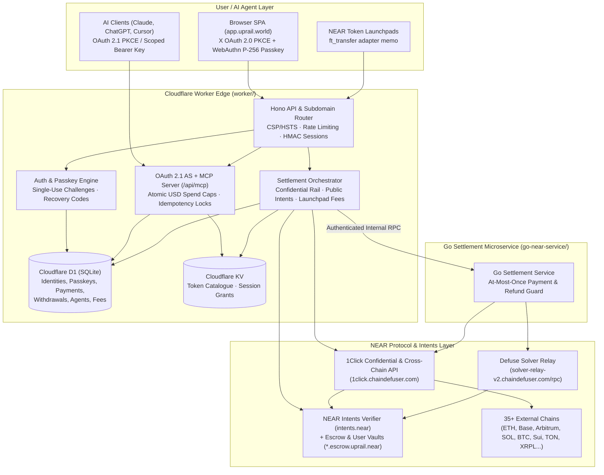

# UPRAIL (v1.1)

**The public identity & universal deposit ingress layer for near.com: Private value transfers to any X (Twitter) handle, policy-bounded AI agent payment rails, and 35+ chain wallet routing built on NEAR Intents + confidential execution.**

- **Version:** v1.1.0
- **Hackathon Tracks:** Privacy & Private AI · Social Money · Agent Economy · Real World Money · Open Innovation
- **Mainnet Traction (Real People, Real Money):** **72 and counting** real users · **120+ and counting** mainnet payment & withdrawal transactions · **$152.65+ USDC and counting** settled volume ($167.51+ initiated) on NEAR Mainnet
- **Live Application:** [https://app.uprail.world](https://app.uprail.world)
- **Marketing & Interactive Preview:** [https://uprail.world](https://uprail.world)
- **Developer Documentation:** [https://docs.uprail.world](https://docs.uprail.world)
- **Remote MCP Server:** `https://api.uprail.world/api/mcp`
- **OpenAPI 3.1.0 Spec (AI Agents):** [https://api.uprail.world/api/agent/openapi.json](https://api.uprail.world/api/agent/openapi.json)

---

## Live Mainnet Traction (Real People, Real Money)

UPRAIL is not a testnet prototype — it is live in production on **NEAR Mainnet** with real users onboarding via X + WebAuthn passkeys and moving real money across social handles, AI agents, and external wallets:

| Metric | Live Mainnet Count / Volume | Details |
| :--- | :--- | :--- |
| **Registered Users** | **72 X Identities (and counting)** | Authenticated real X (Twitter) accounts onboarded via OAuth 2.0 PKCE |
| **Total Onchain Operations** | **120+ Transactions (and counting)** | **71** social `@handle` payments + **49** cross-chain & `near.com` internal withdrawals (**9** social requests, **7** AI agent keys) |
| **Real USD Stablecoin Volume** | **$152.65+ USDC Settled (and counting)** | **$83.75 USDC** across settled/active `@handle` payments + **$68.91 USDC** in completed wallet withdrawals ($167.51+ USDC initiated) |

---

## ⚡ Judging in 60 Seconds (Do X → See Y)

Judges and automated evaluators (Claude Code, Codex) can verify the live project, on-chain contracts, and test suite in seconds:

### 1. One-Command Live Mainnet On-Chain Verification
Verify the live gas sponsor (`escrow.uprail.near`), user sub-accounts, `intents.near`, and API resolver:
```bash
make check-mainnet
# Or directly: python3 scripts/verify-mainnet.py
```
**Expected Output (6/6 checks passing):**
```text
===========================================================
⚡ UPRAIL: Live Mainnet & On-Chain Sponsor Verification
===========================================================
[1/6] Checking NEAR Mainnet Sponsor (escrow.uprail.near)... ✔ OK! Active at block #223778597 (Balance: 0.0202 NEAR)
[2/6] Checking User Sub-Account (u_fc982587d85af44f.escrow.uprail.near)... ✔ OK! Sub-account verified with key ed25519:FBgiyisw...
[3/6] Checking NEAR Intents Contract (intents.near)... ✔ OK! Verified contract code hash BtA1BEFNS619...
[4/6] Checking Live API Health (api.uprail.world/health)... ✔ OK! Service: uprail-worker v1.0.0
[5/6] Resolving Handle (@uprailworld) -> Deterministic Vault... ✔ OK! Resolved to u_fc982587d85af44f.escrow.uprail.near
[6/6] Verifying OAuth 2.1 & MCP Protected Resource (RFC 9728)... ✔ OK! Resource: https://api.uprail.world/api/mcp (mcp)
===========================================================
🎉 ALL ON-CHAIN SPONSOR & MAINNET CHECKS PASSED SUCCESSFULLY!
```

### 2. Run Full Automated Test Suite (164 Tests, 0 Failures)
Run the complete unit, Miniflare integration, and security test harness:
```bash
make test
# Or: cd worker && npm test
```
**Expected Output:**
```text
ℹ tests 164
ℹ suites 39
ℹ pass 164
ℹ fail 0
```

### 3. Quick Zero-Install Curl Checks
Inspect the live production services directly from your terminal:
```bash
# 1. Check live worker health
curl -sS https://api.uprail.world/health | jq .

# 2. Resolve an X handle to its deterministic on-chain NEAR vault
curl -sS "https://api.uprail.world/api/resolve?handle=uprailworld" | jq .

# 3. Verify OAuth 2.1 RFC 8414 Server & RFC 9728 MCP Protected Resource metadata
curl -sS https://app.uprail.world/.well-known/oauth-authorization-server | jq .
curl -sS https://api.uprail.world/.well-known/oauth-protected-resource/api/mcp | jq .

# 4. Inspect OpenAPI 3.1.0 Agent Payment specification
curl -sS https://api.uprail.world/api/agent/openapi.json | jq .info

# 5. Inspect live Buy Me a Coffee supported tokens & cross-chain routes
curl -sS https://api.uprail.world/api/coffee/options | jq '.tokens | map({symbol, chains: (.chains | length)})'
```

---

## 🗺️ Judging Map (Track-by-Track Verification)

Where each hackathon criterion is implemented and tested in the codebase:

| Track | Requirement | UPRAIL Implementation | Verified Source Code & Tests |
| :--- | :--- | :--- | :--- |
| **`social`**<br/>(Social Money) | Send value via social identity, shared budgets, reputation rails | Maps any `@handle` to deterministic NEAR vaults (`u_<hex>.escrow.uprail.near`); **Buy Me a Coffee** (`uprail.world/<handle>`) walletless cross-chain tip pages; `/request/:id` social payment cards; "People You Pay" contact memory | • [`worker/src/routes/coffee.ts`](file:///home/x-5194/UP/worker/src/routes/coffee.ts)<br/>• [`worker/src/services/coffee.ts`](file:///home/x-5194/UP/worker/src/services/coffee.ts)<br/>• [`worker/test/coffee.test.ts`](file:///home/x-5194/UP/worker/test/coffee.test.ts)<br/>• [`worker/src/routes/requests.ts`](file:///home/x-5194/UP/worker/src/routes/requests.ts) |
| **`privacy`**<br/>(Privacy & Private AI) | Confidential computation, breaking on-chain transaction graph | NEAR Confidential Intents (`intents.near` + 1Click); unlinked escrow claims break on-chain sender-recipient linkability; confidential balance reconciliation | • [`worker/src/services/confidentialRail.ts`](file:///home/x-5194/UP/worker/src/services/confidentialRail.ts)<br/>• [`worker/test/confidential-rail.test.ts`](file:///home/x-5194/UP/worker/test/confidential-rail.test.ts)<br/>• [`worker/src/services/refunds.ts`](file:///home/x-5194/UP/worker/src/services/refunds.ts) |
| **`defi`**<br/>(Unstoppable DeFi) | Multi-chain cross-chain settlement via NEAR Intents | Cross-chain ingress & egress across 35+ chains (Base, Arbitrum, Solana, Bitcoin) via 1Click and `intents.near`; 1-click ephemeral deposit address generation | • [`worker/src/services/oneclickWithdraw.ts`](file:///home/x-5194/UP/worker/src/services/oneclickWithdraw.ts)<br/>• [`worker/test/oneclick-client.test.ts`](file:///home/x-5194/UP/worker/test/oneclick-client.test.ts)<br/>• [`worker/test/intents-support.test.mjs`](file:///home/x-5194/UP/worker/test/intents-support.test.mjs) |
| **`agents`** / **`business`**<br/>(Agent Economy) | Policy-bounded agent spending, autonomous payments | Remote MCP Server (`api.uprail.world/api/mcp`) + OpenAPI 3.1.0 with per-transaction & daily USD spend caps enforced atomically | • [`worker/src/routes/mcp.ts`](file:///home/x-5194/UP/worker/src/routes/mcp.ts)<br/>• [`worker/src/routes/agent.ts`](file:///home/x-5194/UP/worker/src/routes/agent.ts)<br/>• [`worker/test/miniflare.test.mjs`](file:///home/x-5194/UP/worker/test/miniflare.test.mjs) |
| **`realworld`**<br/>(Real-World Money) | Stablecoin rails for real people and businesses | Zero seed phrases & zero contributor login: hardware WebAuthn P-256 passkeys (Touch ID / Face ID), 100% sponsored gas, and public `uprail.world/<handle>` USDC/USDT tip pages | • [`frontend/src/views/PublicCoffeeView.tsx`](file:///home/x-5194/UP/frontend/src/views/PublicCoffeeView.tsx)<br/>• [`worker/src/services/nearRpc.ts`](file:///home/x-5194/UP/worker/src/services/nearRpc.ts)<br/>• [`worker/test/recovery-codes.test.ts`](file:///home/x-5194/UP/worker/test/recovery-codes.test.ts) |

---

## Problem

1. **Public blockchains expose every financial relationship.** Standard transfers leak the sender address, recipient address, token, and exact amount on public explorers, turning a single peer transfer or creator payout into permanent wallet-graph surveillance.
2. **Sending crypto requires the recipient to already have a wallet.** Senders must ask for a chain-specific address (`0x...`, `.near`, Solana base58) and worry about bridging and gas before a transfer can happen.
3. **The post-frontend reality lacks safe, autonomous payment rails.** In the near future, users will not interact with traditional web frontends: AI agents (Claude, ChatGPT, Grok, Cursor, autonomous bots) will orchestrate commerce, negotiate deals, and move value on our behalf. Yet today, giving an AI assistant raw private keys risks catastrophic wallet drain, while token launchpads require creators to hardcode public wallets upfront instead of routing fees directly to an X identity.
4. **near.com and cross-chain intent protocols require interactive, rotating deposit sessions.** On `near.com` (and Defuse / 1Click), cross-chain deposit addresses are ephemeral, session-bound, and rotating. Only the authenticated account owner sitting at the terminal can generate a quote and fund their own account. You cannot publish a permanent address on your social profile, invoice, or AI agent configuration for third parties, friends, or clients to deposit funds to you asynchronously.

---

## Solution

UPRAIL bridges this gap by mapping any X handle (`@handle`) to a deterministic, passkey-gated NEAR vault and routing transfers through **NEAR Intents** and **NEAR Confidential Intents** (`intents.near` + 1Click confidential execution):

- **Universal Ingress to near.com via Public Identity:** Solves the near.com rotating address barrier. Anyone in the world can deposit or send funds to your persistent public identity (`@handle`) from 35+ chains without requiring a live session quote from you. Funds settle into your passkey-secured vault on NEAR Intents (`intents.near`), ready to be routed into any personal wallet or spent across the NEAR ecosystem.
- **Buy Me a Coffee (`uprail.world/<handle>`):** Creators toggle their public link on/off behind a hardware WebAuthn passkey gate on the dashboard. Supporters and autonomous agents need **no UPRAIL account and no wallet connection**—they pick an amount (`$2`, `$5`, `$10`, `$25`, or custom), pick `USDC`/`USDT` (or `NEAR`, `SOL`, `ETH`, `BTC`, etc.), pick any origin chain, and receive a one-time deposit address generated with `CONFIDENTIAL_INTENTS` (`confidentiality: "advanced"`) that settles 99% net via `payEscrowPrivate` straight into the creator's confidential vault, complete with minimal privacy-preserving receipts, JSON-LD `PayAction` / `POST` agent support, and dynamic X-avatar OpenGraph preview cards.
- **Send to any `@handle` without a recipient wallet:** Senders pay `@handle` in `USDC`, `USDT`, `NEAR`, `ETH`, `SOL`, `BTC`, or NEP-141 tokens. Registered recipients receive funds directly into their confidential/intents vault; unregistered handles receive funds into a pooled escrow and claim whenever they sign in.
- **"People You Pay" (Persistent Identity Contacts & Quick-Actions):** P2P transfers are social and recurring. UPRAIL maintains a user-controlled, persistent contact memory merging pinned favorites, custom nicknames, and historical transfer recency—enabling single-tap sends and requests without re-typing handles or token parameters.
- **UPRAIL Requests (Social Invoicing & Network-Effect Ingress):** Allow users to request money from any X handle with custom amounts, reasons, and expiry. Recipients receive a minimal, playful social card (`/request/:id`) and can accept or decline voluntarily in one tap. Unregistered recipients can view requests without an account upfront, and upon passkey onboarding, settle directly from their vault.
- **Passkey + X OAuth 2.0 onboarding (zero seed phrases):** Recipients sign in with X OAuth 2.0 PKCE and confirm with a hardware WebAuthn P-256 passkey (Touch ID / Face ID / YubiKey). UPRAIL sponsors 100% of NEAR account creation, storage deposits, and execution gas.
- **Confidential execution & unlinked escrow claims:** When routed through NEAR Confidential Intents, balances and swap legs settle inside the confidential layer. Escrowed claims settle from pooled escrow's confidential balance to the recipient's vault, breaking onchain linkability between sender and recipient.
- **Cross-chain "Send to Wallet" across 35+ blockchains:** Users can withdraw their balance to any external wallet on NEAR, Ethereum, Base, Arbitrum, Solana, Bitcoin, Sui, Aptos, TON, Tron, XRP Ledger, Starknet, and 25+ other chains via 1Click.
- **Built for the Post-Frontend Era (OAuth 2.1 + MCP):** Because users won't interact with frontends in the future, UPRAIL integrated the agent value rail from day one. Users connect Claude, ChatGPT, Grok, Meta Muse, or Cursor via OAuth 2.1 + PKCE or scoped Bearer keys with passkey-bounded per-transaction and daily USD spend caps enforced atomically—enabling AI agents to transact autonomously without seed phrases or raw key custody.
- **Launchpad Creator-Fee Routing:** Token launchpads route creator fees directly to an X identity by sending transfers to escrow with the target handle memo, crediting the creator onchain automatically.

---

## How It Works (Technical)

### 1. Deterministic Per-User NEAR Vaults & 100% Gas-Sponsored Execution
Every X account is mapped to a dedicated NEAR sub-account (`u_<hex>.escrow.uprail.near`) without requiring a browser wallet extension or any native gas balance:

1. **100% Sponsored Gas (Zero Gas Required from Users):**
   - **Sub-Account Creation & Storage:** `escrow.uprail.near` sponsors onchain sub-account creation (`CreateAccount` + `AddKey`) and funds the `0.01 NEAR` storage/execution reserve automatically.
   - **NEAR Intents Key Registration (`5 TGas`):** Every user vault's Ed25519 public key is registered on `intents.near::add_public_key` (`5 TGas`), with [`ensureRegistrationGas`](worker/src/services/nearRpc.ts) automatically topping up any gas shortfall from `escrow.uprail.near`.
   - **Token Storage Sponsorship (NEP-145):** `escrow.uprail.near` sponsors `storage_deposit` on NEP-141 token contracts for `intents.near`, user vaults, and destination wallets before transfers or withdrawals execute.
   - **Gasless Intent Relaying & FT Top-Ups:** Signed NEP-413 intents are relayed and gas-sponsored by `escrow.uprail.near` (`execute_intents`), and direct NEP-141 transfers from user sub-accounts automatically receive sponsored gas reserves beforehand.
2. **Self-Custody Key Export:**
   - With a fresh WebAuthn passkey assertion, any user can export their raw Ed25519 private key and sub-account ID at any time, maintaining complete non-custodial ownership and portability.

### 2. Dual-Factor Identity: X OAuth 2.0 PKCE + WebAuthn P-256 Passkeys
- **X OAuth 2.0:** Uses S256 PKCE challenges to verify ownership of the X handle and issues an authenticated session.
- **Per-Transaction WebAuthn Gate:** Restricts authorization to hardware P-256 / ES256 passkeys with resident keys. Every fund-moving or security-sensitive action requires a fresh biometric challenge and verifies signature counters to prevent replays.
- **Encrypted Recovery Codes:** First-time passkey registration issues one-time recovery codes protected with authenticated encryption and domain-separated hashing, enabling users to safely rotate passkeys if a device is lost.

### 3. Three-Rail Intent Execution & Confidential Settlement
When a sender initiates a transfer, the system generates a cryptographically signed quote binding recipient, asset, amount, and expiry, then settles across three rails:

1. **NEAR Confidential Intents Rail:**
   - Authenticates intent sessions and requests confidential execution with anti-downgrade validation.
   - Signs NEP-413 intent payloads and submits them to `intents.near` via the confidential execution layer.
2. **Public NEAR Intents Rail:**
   - Pre-registers NEP-145 token storage, deposits assets into `intents.near`, and broadcasts NEP-413 transfer intents via gas-sponsored relayer or the Defuse Solver Relay.
3. **Native NEP-141 Fallback Rail:**
   - For launchpad or custom NEP-141 tokens not yet listed on `intents.near`, handles direct sponsored transfers.

### 4. Escrowed Social Claims, Atomic Locks & Refunds
- **Direct vs. Escrowed Routing:** Registered handles settle directly into their NEAR Intents vault. Unregistered handles receive funds into a 30-day pooled escrow.
- **Handle Binding on Registration:** When a new user connects their X identity and registers a passkey, all pending escrowed transfers matching their handle are permanently bound to their verified identity, preventing handle rename attacks.
- **Atomic Claim Reservation:** Claims execute using atomic conditional state updates to guarantee at-most-once payouts and eliminate race conditions.
- **At-Most-Once Refunds:** Senders can cancel unclaimed transfers, and expired escrowed funds (>30 days) automatically refund the full gross amount to the original sender.

### 5. Universal Ingress to near.com & Internal Withdrawal Rail
- **Universal Ingress for near.com (Solving the Rotating Address Barrier):** On `near.com` (and Defuse / 1Click), cross-chain deposit addresses are ephemeral, session-bound, and rotating. Only the authenticated owner at their terminal can generate a quote to fund their account. UPRAIL solves this by giving every user a persistent public identity (`@handle`) mapped to a NEAR Intents vault: anyone in the world can deposit from 35+ chains directly to `@handle` without requiring a live session quote from the recipient.
- **Passkey-Gated `near.com` Internal Withdrawal Rail:** Once funds settle into the user's UPRAIL vault, users can withdraw directly into their personal `near.com` wallet in one tap:
  - **Zero Bridge Fees & 1:1 Routing:** Bypasses external chain bridges and routing fees by transferring internally inside the Confidential Intents layer (`submitPrivateTransfer`) to the recipient's NEP-518 internal address (`nearcom:0x...`).
  - **Two-Step Passkey Security:**
    1. **Address Setup & Verification:** Users paste their internal address from `near.com` (Account Menu → *My address* → copy internal address like `nearcom:0xb137a2f1054b5de422a8df801613d6722701163c`). The address is validated, stripped of the URI scheme, and cryptographically bound to the user's identity via a WebAuthn passkey challenge.
    2. **Withdrawal Execution:** Selecting an Intents-supported asset and amount opens a detailed confirmation modal. The user signs with their hardware passkey (`Touch ID` / `Face ID`), the worker reserves the withdrawal in D1, shields any plain balance shortfall via `ensureConfidentialFunds`, and submits the private transfer to `intents.near` with instant settlement.
  - **Edit Protection:** Updating or replacing the saved `near.com` withdrawal destination is strictly gated by a fresh passkey challenge to protect against unauthorized modification.
- **Cross-Chain Withdrawals ("Send to Wallet"):** In addition to internal `near.com` routing, users can withdraw any asset from their vault to an external address across **35+ blockchains** (NEAR, Ethereum, Base, Arbitrum, Optimism, Polygon, BNB Chain, Avalanche, Solana, Bitcoin, Sui, Aptos, TON, Tron, XRP Ledger, Stellar, Dogecoin, Litecoin, Zcash, Starknet, Hyperliquid, Monad, Berachain, etc.) with chain-specific address validation and atomic state reservation.

### 6. AI Agent Payment Rail & OAuth 2.1 Remote MCP Server (The Post-Frontend Thesis)

> **The Post-Frontend Thesis:** In the coming era, users will rarely interact with traditional web frontends. The future of software is conversational and autonomous — where AI agents negotiate, orchestrate workflows, tip creators, purchase compute, split bounties, and settle transactions on our behalf. But an agent that cannot move value is just an observer, while giving an LLM unconstrained access to a raw crypto wallet is a fatal security flaw. From day one, UPRAIL was built with this post-frontend reality in mind: we integrated the agentic value railway directly into the protocol's foundation, letting autonomous models transact with cryptographic safety, biometric spend limits, and zero seed phrases.

UPRAIL includes a full **OAuth 2.1 Authorization Server** and **Streamable HTTP MCP Server** (`2025-06-18`) at `https://api.uprail.world/api/mcp`:
- **The Railway for Autonomous Agents:** Rather than forcing humans to sit at terminals and click through transaction forms, users connect Claude, ChatGPT, Grok, Meta Muse, or Cursor directly to UPRAIL via open standards (OAuth 2.1 PKCE + Model Context Protocol).
- **Zero Raw Key Exposure:** Agents never touch or store private keys. Instead, they receive revocable, policy-bounded OAuth bearer grants authorized by the user's hardware passkey (Touch ID / Face ID / WebAuthn).
- **Biometric Policy Boundaries & Spend Caps:** Users define strict, immutable guardrails during connection: a maximum USD limit per individual payment and an aggregate daily USD spend cap. Every tool call pre-checks and reserves quota atomically against live oracle pricing.
- **13 MCP Tools for Autonomous Commerce:**
  1. `pay_handle`: Send crypto confidentially to any X handle (single or batch) with automated claim links and prefilled X post intent URLs.
  2. `check_approval`: Query the resolution status of batch or policy-overflow authorization tickets.
  3. `withdraw_to_wallet`: Withdraw funds to any external address across 35+ blockchains or internally to near.com.
  4. `receive_payment`: Inspect deposit addresses, pending incoming transfers, or shareable payment links.
  5. `get_balance`: Check public, confidential, and total balances across all supported assets.
  6. `list_payments`: Audit recent sent and received payments with full transaction telemetry.
  7. `resolve_handle`: Resolve whether an X identity has an active UPRAIL vault or routes through escrow.
  8. `list_contacts`: Retrieve the user's saved and frequent transfer recipients with recency and preferred assets.
  9. `save_contact`: Save, update, or pin trusted contacts in the user's persistent address book.
  10. `request_payment`: Create a social payment request asking an X handle for funds, generating shareable claim URLs and prefilled X posts.
  11. `list_requests`: Query inbound and outbound payment requests by direction and settlement status.
  12. `accept_request`: Pay an incoming payment request autonomously on behalf of the owner, bounded by spend caps.
  13. `decline_request`: Decline an incoming payment request with an optional reason.
- **Human-in-the-Loop Instant Passkey Escalation (`/approve`):** When an agent needs to execute an anomalous high-value batch transfer or exceed its daily limit, it yields an authorization ticket link (`/approve?id=...`). The user reviews the breakdown on their device, confirms with Face ID or fingerprint via WebAuthn, and the agent's intent executes atomically on NEAR.
- **Fail-Closed Spend Policy & Anti-Replay:** Live oracle token pricing, atomic database reservations before signing intents, and idempotency locks prevent retried prompts from causing double-spends or prompt-injection drains.

### 7. Launchpad Creator-Fee Routing
Launchpads and DEX pools (Nearly, JustHoot v2, and Intear Launchpad on `launch.intear.near` / `dex.intear.near`) keep their own fee receiver. When a payout should reach an X handle, their adapter or keeper sends the transfer to escrow with the target handle memo (`Fees to @handle via UPRAIL`), and UPRAIL automatically verifies the onchain receipt and credits the creator's vault.

### 8. Social Invoicing, Contact Memory & Anti-Spam Request Rails
Peer-to-peer finance is fundamentally relational and two-sided. UPRAIL introduces zero-friction social payment memory:
- **"People you pay" (Contact Engine):** A user-governed registry mapping contacts to X identities, tracking custom nicknames, preferred transfer assets and amounts, and pin priorities, automatically merged with transfer ledger history.
- **Social Requests Lifecycle & Anti-Harassment:** Payment requests follow a strict state machine (`PENDING` → `COMPLETED` / `DECLINED` / `CANCELLED` / `EXPIRED`). Requests include rate-limiting (max 10 requests/hour/user) and request-blocking primitives to prevent spam, while allowing unregistered recipients to inspect invoices without signing up upfront.
- **Full Autonomous Agent Parity:** AI agents can audit, generate, accept, and decline payment requests within their owner's biometric spend guardrails.

---

## Key NEAR Primitives Used

| NEAR Primitive | Contract / Endpoint | How UPRAIL Uses It | Primary Code Path |
| :--- | :--- | :--- | :--- |
| **NEAR Intents (NEP-413)** | `intents.near` | Off-chain Ed25519 signed `nep413` payloads (`transfer`, `ft_withdraw`, `swap_transfer`) with versioned salt and deadline nonces. | [`nearRpc.ts`](worker/src/services/nearRpc.ts), [`intentsNonce.ts`](worker/src/services/intentsNonce.ts) |
| **Confidential Intents & 1Click** | `https://1click.chaindefuser.com` | Confidential balances, NEP-413 session authentication, confidential quotes, intent generation, and submission. | [`confidentialRail.ts`](worker/src/services/confidentialRail.ts), [`oneclickClient.ts`](worker/src/services/oneclickClient.ts) |
| **Defuse Solver Relay** | `https://solver-relay-v2.chaindefuser.com/rpc` | JSON-RPC 2.0 `publish_intent` relay for signed NEP-413 escrow settlements and refunds. | [`relay.go`](go-near-service/internal/intents/relay.go), [`nearRpc.ts`](worker/src/services/nearRpc.ts) |
| **Deterministic Sub-Accounts** | `u_<hex>.escrow.uprail.near` | Per-user NEAR accounts created via atomic transactions and registered on `intents.near::add_public_key`. | [`nearRpc.ts`](worker/src/services/nearRpc.ts), [`service.go`](go-near-service/internal/account/service.go) |
| **Gasless Relayer & Storage Sponsor** | `escrow.uprail.near` | Sponsors NEP-145 `storage_deposit` and relays `intents.near::execute_intents` so end users never hold NEAR for gas. | [`nearRpc.ts`](worker/src/services/nearRpc.ts) |
| **Onchain Receipt Verification** | NEAR JSON-RPC | Verifies onchain receipt logs to credit creator fees directly to X identities. | [`nearRpc.ts`](worker/src/services/nearRpc.ts), [`launchpadFees.ts`](worker/src/services/launchpadFees.ts) |

---

## Quick Demo (For Human & AI Judges)

### Flow 1: Send & Claim Privately by `@handle`
1. **Sign In & Provision Vault:** Go to [https://app.uprail.world](https://app.uprail.world), sign in with X, and register a device Passkey (Touch ID / Face ID).
   - **Expected result:** UPRAIL deterministically provisions your vault, registers its key on `intents.near`, and displays your recovery codes.
2. **Deposit or Check Balance:** Open **Receive** (`/app/receive`) to copy your `@handle` payment link or generate a cross-chain deposit address (e.g., USDC from Base, Arbitrum, Solana, or NEAR).
3. **Send to Any `@handle`:** Open **Send** (`/app/send`), enter any X handle (even one that has never used UPRAIL), choose an asset and amount, and confirm with your Passkey.
   - **Expected result:** A signed quote is generated, your passkey authorizes the intent, and UPRAIL returns a shareable claim link (`https://app.uprail.world/claim/<paymentId>`) with a dynamically rendered OpenGraph preview card.
4. **Claim with X + Passkey:** Open the claim link as the recipient `@handle`, sign in with X, and confirm with your Passkey (or click **Send to Wallet** on `/app/claim` to withdraw directly to an external wallet across 35+ chains).
   - **Expected result:** The payment is atomically claimed and settled into the recipient's vault (or bridged cross-chain via 1Click).

#### Flow 2: 1-Tap Internal Withdrawal to near.com (0% Bridge Fee)
1. **Open Withdraw:** On the Dashboard ([https://app.uprail.world/app](https://app.uprail.world/app)), click the **Withdraw** button (`near.com`).
2. **First-Time Setup (Passkey Gated):**
   - In `near.com`, tap your account menu → click **My address** → copy your internal address (e.g. `nearcom:0xb137a2f1054b5de422a8df801613d6722701163c`).
   - Paste it into the setup modal and click **Save & Verify with Passkey** (Touch ID / Face ID).
   - UPRAIL validates the NEP-518 account, strips the scheme, and binds it securely to your verified identity in D1.
3. **Withdraw Assets:**
   - Tap any Intents asset (USDC, NEAR, USDT, ETH, BTC, SOL) and enter or select the amount (`25%`, `50%`, `75%`, `MAX`).
   - Click **Review Withdrawal** to verify the confirmation modal breakdown (`Fee: 0.00 Sponsored`, `Route: Confidential Intents → near.com Internal`).
   - Confirm with your Passkey: the transfer settles directly into your `near.com` internal balance with zero bridge fees.
   - You can edit your saved destination at any time by clicking **Edit** (also passkey-gated).

#### Flow 3: Verify Live API, OAuth 2.1 & MCP Endpoints via `curl`
Judges and automated agents can inspect the live production endpoints directly:

```bash
# 1. Check Worker + Settlement Service health
curl -s https://api.uprail.world/health | jq .

# 2. Resolve whether an X @handle has an active UPRAIL vault or routes via escrow
curl -s "https://api.uprail.world/api/resolve?handle=uprailworld" | jq .

# 3. Inspect OAuth 2.1 Authorization Server & Protected Resource MCP metadata (RFC 8414 / RFC 9728)
curl -s https://app.uprail.world/.well-known/oauth-authorization-server | jq .
curl -s https://api.uprail.world/.well-known/oauth-protected-resource/api/mcp | jq .

# 4. Inspect the OpenAPI 3.1.0 specification for AI Chat Payment actions
curl -s https://api.uprail.world/api/agent/openapi.json | jq '{openapi, info, paths: (.paths | keys)}'
```

#### Flow 4: Connect an AI Agent (Claude, ChatGPT, Cursor) via MCP
1. Go to [https://app.uprail.world/app/agents](https://app.uprail.world/app/agents) and either:
   - Add `https://api.uprail.world/api/mcp` as a remote MCP server in Claude / ChatGPT / Cursor (triggers the OAuth 2.1 + Passkey consent screen where you set per-tx and daily USD caps), **or**
   - Click **New Key**, approve with your Passkey, and copy the `up_agent_...` Bearer token.
2. Call the MCP server over Streamable HTTP:
   ```bash
   curl -s -X POST https://api.uprail.world/api/mcp \
     -H "Authorization: Bearer up_agent_YOUR_KEY" \
     -H "Content-Type: application/json" \
     -d '{"jsonrpc":"2.0","id":1,"method":"tools/list"}' | jq .
   ```
   - **Expected result:** Returns all 13 MCP tools (`pay_handle`, `check_approval`, `withdraw_to_wallet`, `receive_payment`, `get_balance`, `list_payments`, `resolve_handle`, `list_contacts`, `save_contact`, `request_payment`, `list_requests`, `accept_request`, `decline_request`) scoped to your key's USD spend caps.

#### Flow 5: Buy Me a Coffee (`uprail.world/<handle>`) — Humans & Visiting AI Agents
1. **Enable Link (Passkey-Gated):** On your dashboard ([https://app.uprail.world/app](https://app.uprail.world/app)), click the coin-pouch button under **Stabilize** and flip the toggle (verified by Face ID / Touch ID). Your public link `https://uprail.world/<handle>` is immediately live with a custom `PAY ME HERE` OpenGraph preview card showing your X profile picture.
2. **Pay Without an Account (Human Flow):** Anyone visits `https://uprail.world/<handle>`, picks `$2 / $5 / $10 / $25 / Custom`, chooses `USDC` / `USDT` / `NEAR` / `SOL` / `ETH` / `BTC`, picks an origin chain, and gets a one-time confidential deposit address + QR code. Once sent, `checkAndSettleCoffeeDonation` settles 99% net via `payEscrowPrivate` and displays a minimal receipt.
3. **Pay Programmatically (Any Visiting Agent):**
   ```bash
   # Discover supported routes & machine-readable instructions
   curl -s "https://uprail.world/uprailworld?format=json" | jq .

   # Create a one-time confidential deposit quote directly
   curl -s -X POST https://uprail.world/uprailworld \
     -H "Content-Type: application/json" \
     -d '{"amountUsd":5,"originSymbol":"NEAR","originChain":"near"}' | jq .
   ```

---

## Architecture



---

## Key Features

- **Universal Ingress for near.com:** Overcomes the rotating deposit address barrier on near.com. Anyone can deposit into a user's NEAR Intents vault from 35+ chains by simply sending to their `@handle`.
- **Wallet-less Social Transfers:** Send crypto to any `@handle` on X. Unregistered recipients claim via X login + device passkey within 30 days, or funds auto-refund to the sender.
- **Confidential Intents Execution:** Integrates 1Click confidential quotes and execution with fail-closed downgrade protection.
- **Hardware Passkey Biometrics + Recovery:** WebAuthn P-256 (`ES256`) per-transaction assertions on every fund-moving endpoint, backed by one-time recovery codes and self-custody private key export.
- **Zero-Gas User Experience:** Protocol relayer sponsors sub-account creation, NEP-145 token storage registration, and `intents.near::execute_intents` gas.
- **Buy Me a Coffee (`uprail.world/<handle>`):** Passkey-gated dashboard toggle activating walletless creator tip pages with preset/custom USD amounts, `USDC`/`USDT`/`NEAR`/major tokens across 35+ routes, one-time confidential 1Click deposit addresses, private `payEscrowPrivate` vault settlement, visiting-agent JSON/POST discovery, light/dark mode, and minimal receipts.
- **Cross-Chain Withdrawals (35+ Chains):** Withdraw from UPRAIL directly to external wallets on NEAR, Ethereum, Base, Arbitrum, Optimism, Polygon, Solana, Bitcoin, Sui, Aptos, TON, Tron, XRP Ledger, Starknet, and more.
- **AI Chat Payments (OAuth 2.1 + Remote MCP):** Streamable HTTP MCP server (`/api/mcp`) and OpenAPI 3.1.0 spec (`/api/agent/openapi.json`) with Passkey-approved per-tx and daily USD caps, live oracle valuation, and idempotency keys.
- **Launchpad Creator-Fee Routing:** Payout adapter (`POST /api/fees/adapter`) supporting Nearly, JustHoot v2, and Intear Launchpad (`launch.intear.near` / `dex.intear.near`). Launchpads keep their fee receiver and direct creator fees to an X handle onchain.
- **Dynamic Edge OpenGraph Cards:** Generates custom `1200x630` PNG social preview cards at the edge for Buy Me a Coffee links (`/og/coffee/<handle>.png` with X avatars), claim links, receipts, and creator fees.

---

## Project Structure

```text
/
├── frontend/                              # Next.js 16 + React 19 + Tailwind CSS (static export served by Worker)
│   ├── src/app/                           # App Router pages: /, /tip, /app/send, /app/claim, /app/receive, /app/agents, /docs/*
│   ├── src/components/                    # AppShell, PasskeyModal, CoffeeModal, StabilizeModal, DomainGate, FlowPulseWidget
│   ├── src/views/                         # LandingPage, AppHome, PublicCoffeeView, SendPage, ClaimPage, ReceivePage, AgentsPage
│   ├── src/hooks/                         # useXAuth, usePasskey, usePayments, useOnchainData
│   └── src/lib/                           # Typed API client (api.ts), client router, status formatters
│
├── worker/                                # Cloudflare Worker (Hono v4 + D1 SQLite + KV + Cron Triggers)
│   ├── wrangler.jsonc                     # Routes, D1/KV bindings, cron schedule ("0 * * * *"), public vars
│   ├── src/index.ts                       # Entry point, security headers, subdomain routing, OG bot handler, cron sweeps
│   ├── src/db/                            # Canonical D1 schema.sql + sequential SQL migrations
│   ├── src/middleware/                    # HMAC sessions, WebAuthn passkeyAuth, agentAuth, rateLimit, securityHeaders
│   ├── src/oauth/                         # OAuth 2.1 Authorization Server (PKCE, DCR, /authorize UI) & Resource Server
│   ├── src/routes/                        # auth, payments, claim, coffee, onchain, agent, mcp, fees, launchpads, invites, og
│   ├── src/services/                      # nearRpc, confidentialRail, coffee, stabilize, oneclickClient, oneclickAuth,
│   │                                      # oneclickWithdraw, intentsNonce, launchpadFees, launchpadIntegrations, refunds
│   └── test/                              # 15+ automated test suites (164 tests: Miniflare integration + unit tests)
│
├── go-near-service/                       # Go 1.25 Settlement Microservice
│   ├── cmd/server/main.go                 # Chi HTTP server, graceful shutdown, route wiring
│   └── internal/                          # middleware, escrow signer, solver relay RPC client, oneclick
└── README.md
```

---

## Tech Stack

- **Frontend:** Next.js 16.4 (Static Export), React 19.3, TypeScript 5, Tailwind CSS 3.4, `@simplewebauthn/browser`
- **Edge Backend:** Cloudflare Workers, Hono v4, Cloudflare D1 (SQLite), Cloudflare KV, `@simplewebauthn/server`, `@noble/curves`, `workers-og`
- **Settlement Microservice:** Go 1.25 (`chi/v5`), Ed25519 NEP-413 signer, JSON-RPC 2.0 Solver Relay client
- **Authentication & Agent Auth:** X OAuth 2.0 (PKCE `S256`), WebAuthn Passkeys (`ES256` / P-256), OAuth 2.1 Authorization Server, Streamable HTTP MCP (`2025-06-18`)
- **Blockchain & Confidentiality:** NEAR Protocol (`intents.near`), NEAR Confidential Intents & 1Click API (`1click.chaindefuser.com`), Defuse Solver Relay (`solver-relay-v2.chaindefuser.com`)

---

## Security Model & Defense-in-Depth

- **Fail-Closed Secret Validation:** All critical services fail closed immediately if cryptographic secrets or configurations are absent, preventing insecure fallbacks.
- **Hardware Passkey Assertion Per Transaction:** Every fund-moving action requires a fresh biometric WebAuthn P-256 assertion bound to a single-use challenge.
- **Anti-Downgrade Confidentiality Guard:** The client cryptographically verifies that the privacy level returned matches the requested confidential tier before any intent is signed.
- **Atomic Database Reservations:** Claims, refunds, withdrawals, and AI agent spend reservations execute atomically to eliminate race conditions and double-spends.
- **Strict Subdomain Isolation & Security Headers:** Enforces strict origin separation, CSP, HSTS, frame denial, and CORS policies across web app and API boundaries.

---

## Current Status & Known Limitations

### Current Status
- **Live in Production:** Running at [https://app.uprail.world](https://app.uprail.world), [https://api.uprail.world](https://api.uprail.world), [https://docs.uprail.world](https://docs.uprail.world), and [https://uprail.world](https://uprail.world).
- **Mainnet Onchain Activity (Real People, Real Money):** **72 and counting** authenticated X users have executed **120+ and counting** onchain payment and withdrawal transactions, settling **$152.65+ USDC and counting** ($167.51+ initiated) across `@handle` claims, `near.com` internal routes, 1Click cross-chain withdrawals, and MCP AI agents.

### Known Limitations (Tracked)
1. **Fail-Closed Confidential Policy:** Prioritizes privacy over convenience. If confidential execution is unavailable or reports a privacy downgrade, transactions fail closed rather than falling back to a public broadcast.
2. **Self-Custodial Export:** Users can export their keys at any time for direct onchain control via standard NEAR CLI or wallets.
3. **Static Export CSP:** Web application is distributed as a high-performance static export at the edge, utilizing scoped Content-Security-Policy directives for client scripts.
4. **Client State Caching:** Transient balance and activity snapshots are cached locally in browser storage for instant UI responsiveness and cleared on sign-out.

---

## Configuration Reference

Local configuration templates are available in `worker/.dev.vars.example` and `go-near-service/.env.example`. Production configurations are managed via Cloudflare Wrangler and container environment variables.

| Variable | Component | Purpose |
| :--- | :--- | :--- |
| `SESSION_SECRET` | Worker | Session encryption and state verification |
| `X_CLIENT_SECRET` | Worker | X OAuth 2.0 authentication |
| `RECOVERY_PEPPER` | Worker | Passkey recovery code protection |
| `INTERNAL_SERVICE_KEY` | Worker & Go | Internal service-to-service authentication |
| `SETTLEMENT_SERVICE_URL` | Worker | Base URL of the settlement microservice |
| `ESCROW_PRIVATE_KEY` | Worker & Go | Relayer and escrow onchain execution key |
| `NEAR_RPC_URL` | Worker | NEAR JSON-RPC provider endpoint |
| `ONE_CLICK_API_KEY` | Worker & Go | 1Click cross-chain routing API key |
| `CONFIDENTIAL_RAIL_ENABLED` | Worker | Feature flag for confidential execution path |
| `CREATOR_FEES_ENABLED` | Worker | Feature flag for launchpad creator fee processing |

---

## Links

- **Live Web App:** [https://app.uprail.world](https://app.uprail.world)
- **Marketing & Interactive Demo:** [https://uprail.world](https://uprail.world)
- **Developer Docs:** [https://docs.uprail.world](https://docs.uprail.world) ([AI Agents](https://docs.uprail.world/agents) · [MCP Server](https://docs.uprail.world/mcp) · [Creator Fees](https://docs.uprail.world/fees))
- **Remote MCP Endpoint:** `https://api.uprail.world/api/mcp`
- **Agent OpenAPI 3.1.0 Spec:** [https://api.uprail.world/api/agent/openapi.json](https://api.uprail.world/api/agent/openapi.json)
- **X (Twitter):** [@uprailworld](https://x.com/uprailworld)
